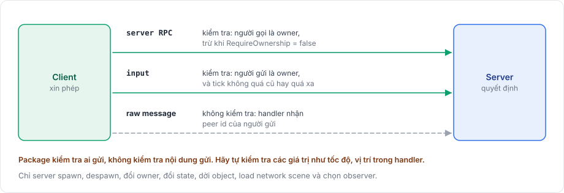

# Authority

Package theo mô hình server-authoritative. Server giữ game state thật và là phía duy nhất thay đổi được những gì người chơi khác nhìn thấy. Client chỉ có thể xin một thay đổi, còn server quyết định nó có xảy ra hay không. Một client gian lận vì thế có thể gửi yêu cầu sai, nhưng không thể trực tiếp thay đổi thế giới game.

<figure><figcaption>
Ba đường client có thể tới server, và package kiểm tra gì trên mỗi đường.
</figcaption></figure>

## Những việc chỉ server làm 

Chỉ server spawn, despawn network object và đổi owner của chúng. Gọi `ServerManager.Spawn` trên một tiến trình không chạy server sẽ ném `the server is not started`.

State model thay đổi trên server rồi đi xuống client, không bao giờ theo chiều ngược lại. Chuyển động cũng vậy: `NetworkTransform` gửi transform của server xuống client và không gửi thay đổi transform của client lên, và chỉ parameter `NetworkAnimator` của server tới được người chơi khác.

Server cũng load và unload network scene, và quyết định client nào observe object nào.

## Client gửi được gì 

| Đường | Package kiểm tra | Hướng dẫn |
|---|---|---|
| Server RPC | Người gọi phải là owner của object, trừ khi RPC đặt `RequireOwnership = false`. Lời gọi từ peer khác bị bỏ kèm một cảnh báo. | [RPC](../messaging/rpc.md) |
| Input cho object được dự đoán | Người gửi phải là owner của object. Input từ peer khác bị bỏ kèm một cảnh báo. Input cho tick đã qua, hoặc quá xa phía trước, bị bỏ và được đếm. | [Input](../prediction/input.md) |
| Raw message | Không kiểm tra. Handler nhận peer id của người gửi và phải tự kiểm tra nội dung. | [Raw message](../messaging/messages.md) |

Package kiểm tra ai được gửi, nhưng không kiểm tra nội dung có hợp lý hay không, như một tốc độ hay một vị trí. Hãy kiểm tra tham số trong handler RPC hoặc handler input trên server.

## Ownership không phải authority 

Owner là peer mà object thuộc về, như nhân vật thuộc về người chơi của nó. Ownership cho phép client đó gọi server RPC của object, và nếu object có input model, owner cũng dự đoán nó. Server vẫn là bên chạy object, và sửa prediction của owner khi nó khác kết quả của chính server. [Ownership](../objects/ownership.md) mô tả cách gán và đổi owner.

## Prediction vẫn do server quyết định 

Với prediction, owner áp input của mình ngay thay vì đợi server. Server áp cùng input đó khi nó tới và gửi kết quả về. Nếu hai kết quả khác nhau, client khôi phục kết quả của server và phát lại các input mới hơn lên trên. Dù client đã dự đoán gì, kết quả của server mới là kết quả được giữ lại. [Prediction](prediction.md) giải thích vòng lặp này chi tiết hơn.

Về cách quyết định của server tới được client, xem [server, client và message](networking-model.md) và [replication](replication.md).
