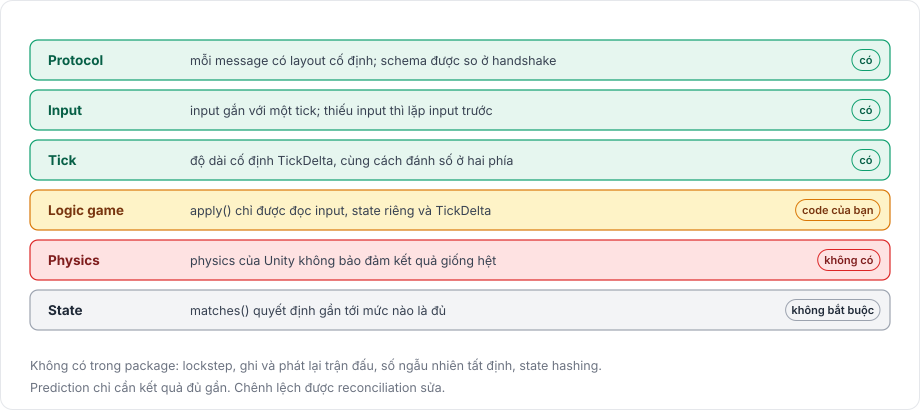

# Mô phỏng tất định

Một mô phỏng là tất định khi cùng state ban đầu và cùng input luôn cho ra cùng kết quả. Game networking dựa vào tính tất định ở các mức khác nhau tùy tính năng. Package cung cấp một số mức và không cung cấp các mức khác, trang này phân rõ mức nào thuộc loại nào.

<figure><figcaption>
Package cung cấp những mức tất định nào.
</figcaption></figure>

Một game lockstep cần mọi mức đúng tới từng bit trên mọi nền tảng. Client-side prediction, thứ package này hiện thực, chỉ cần chúng đủ gần để hiếm khi phải sửa.

## Package cung cấp gì 

| Thuộc tính | Tình trạng trong package |
|---|---|
| Protocol tất định | Mỗi message có layout cố định theo schema sinh ra, và client với server so schema trong lúc handshake. |
| Input tất định | Input gắn với một tick. Server apply input của tick N ở tick N của nó. Khi thiếu input cho một tick, server lặp lại input trước và đánh dấu bằng `InputContext.Repeated`. |
| Tick tất định | Tick có độ dài cố định, `TimeManager.TickDelta`, và client với server đánh số tick theo cùng một thang. Replay dùng cùng độ dài tick. |
| Logic game tất định | Trách nhiệm của bạn. Package gọi `apply` với cùng input ở hai phía, nhưng không kiểm soát được `apply` đọc những gì. |
| Physics tất định | Không có. Package cho các engine physics của Unity chạy, và chúng không bảo đảm kết quả giống hệt giữa các máy. |
| State tất định | Không bắt buộc. Hàm `matches` của reconcile quyết định state của client phải gần state của server tới mức nào. |

## Prediction không cần kết quả giống từng bit 

Client so predicted state với state của server ở cùng tick. Khi chúng khác nhau, client khôi phục state của server và replay các input mới hơn, nên một chênh lệch nhỏ chỉ tốn một lần sửa và game vẫn đồng bộ. Mặc định phép so sánh là so chính xác trên byte đã encode; với giá trị số thực, hãy truyền một hàm `matches` có dung sai, như trình bày trong [reconciliation](../prediction/reconciliation.md).

Để ít phải sửa, `apply` chỉ nên đọc input nó nhận, state riêng của behaviour (thứ reconcile model chụp và khôi phục) và `TimeManager.TickDelta`. Đọc object khác, `Time.deltaTime`, số ngẫu nhiên không có seed, hoặc dữ liệu chỉ một phía có sẽ làm hai phía khác nhau, và reconciliation phải sửa chênh lệch đó mỗi lần nó xảy ra. `NetworkBehaviour.ReconcileCount` đếm số lần sửa của một behaviour, giúp bạn lần ra một phụ thuộc như vậy.

## Physics chỉ gần đúng 

Khi bật mô phỏng physics, client lưu state của từng physics world mỗi tick và load lại để rollback. Một state đã lưu chứa vị trí, góc xoay, vận tốc, vận tốc góc và trạng thái ngủ của từng dynamic body, nhưng không chứa dữ liệu contact của engine physics, nên một lần replay bắt đầu từ state đã load có thể khác lần chạy đầu. [Rollback với physics](../prediction/rollback.md) đi vào chi tiết. Backend tùy chọn [Rapier physics](../rapier/overview.md) lưu toàn bộ world, kể cả contact, nên replay của nó cho ra đúng các tick như lần chạy đầu.

## Chưa có 

Một số tính năng cần mức tất định mà package không cung cấp, và package không có chúng. Không có mô phỏng lockstep, không có bộ sinh số ngẫu nhiên tất định, và không có state hashing để phát hiện lệch nhau. Cũng không thể ghi lại một trận đấu để phát lại sau. Ở bất cứ đâu tài liệu này nói replay, đó là việc apply lại input trong lúc reconciliation.

Để hiểu thêm các phần mà trang này dựa vào, xem [prediction](prediction.md), [tick và thời gian](tick.md) và [tổng quan physics](../physics/overview.md).
