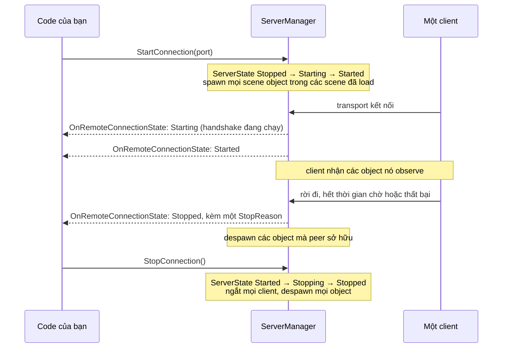
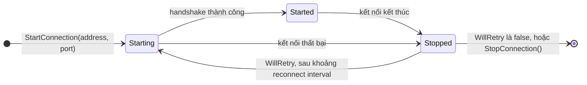
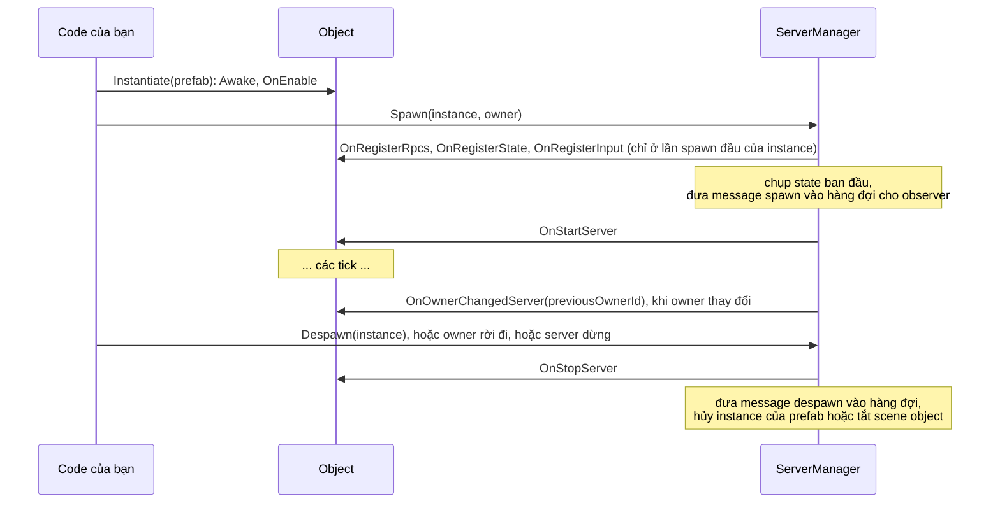
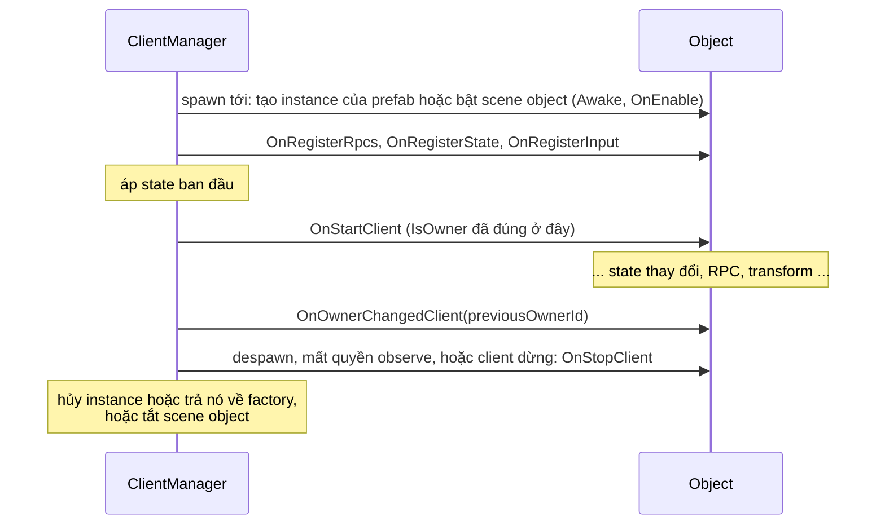

# Vòng đời

Trang này đưa ra thứ tự event của `NetworkManager`, của kết nối và của network object. Hãy dùng nó để quyết định một đoạn code nên nằm ở đâu: trong `Awake`, trong `OnStartServer`, trong một event kết nối hay trong `OnStopClient`.

## NetworkManager 

| Message của Unity | Manager làm gì |
|---|---|
| `Awake` | Đọc schema và codec đã đăng ký, đăng ký prefab của Collected Prefabs và Prefabs, đăng ký scene của Collected Scenes, tạo transport factory cùng `ServerManager`, `ClientManager`, `TimeManager` và `TransportManager`. Ném exception nếu phần đăng ký sinh ra chưa chạy. |
| `OnEnable` | Thêm các mục của nó vào player loop. |
| `OnDisable` | Gỡ các mục đó. Không tick nào chạy, không gì được nhận hay gửi. |
| `OnDestroy` | Dừng client và server, và giải phóng physics simulation. |

Manager cũng dừng cả hai kết nối khi ứng dụng thoát.

Vì các manager được tạo trong `Awake`, các component khác có thể dùng chúng từ `Start` trở đi. Trong `Awake` của chính các component đó, manager có thể chưa tồn tại.

## Server 

## Client 

`OnClientConnectionState` báo từng thay đổi. Khi client tới `Started`, các scene object trong các scene nó đã load bị tắt cho tới khi server spawn chúng. Sau đó các object được spawn, thay đổi và despawn. Khi kết nối dừng, mọi object trên client bị despawn, và `ConnectionStateArgs.WillRetry` cho biết client có khởi động lại sau khoảng reconnect interval hay không.

## Network object 

### Trên server 

Message spawn chứa state được chụp trước `OnStartServer`, nên hãy đặt state ban đầu trước khi gọi `Spawn`. Một thay đổi làm trong `OnStartServer` chỉ tới client cùng cập nhật state của tick sau.

Hủy một `GameObject` đã spawn trên server sẽ despawn nó.

### Trên client 

`NetworkBehaviour.NetworkObject` được gán khi object spawn, nên trong `Awake` của một prefab vừa tạo instance nó vẫn là null.

Nếu một client hủy một `GameObject` đã spawn mà không có despawn từ server, object bị gỡ khỏi danh sách object của client và một cảnh báo được log.

### Trong host mode 

Trong host mode, server và client của host dùng chung một instance. Instance đó nhận `OnStartServer` khi server spawn nó và `OnStartClient` khi client của host nhận nó. Khi despawn, `OnStopClient` chạy trước `OnStopServer`. [Host mode](../connections/host-mode.md) nói về hệ quả với code của bạn.

Các callback được mô tả trong [NetworkBehaviour](../objects/network-behaviour.md) và liệt kê trong [event và callback](../reference/callbacks.md). [Server, client và message](networking-model.md) giải thích kỹ hơn các trạng thái kết nối.
