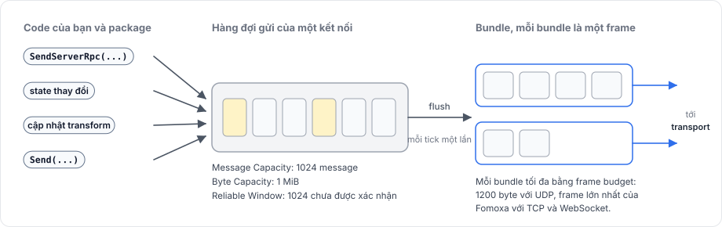
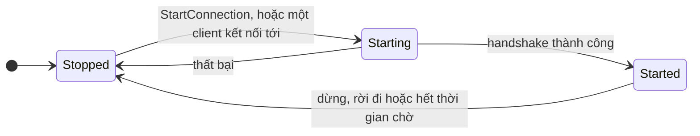
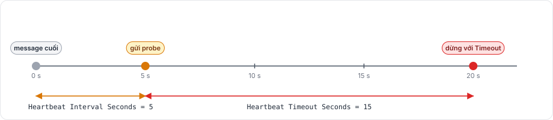

# Server, client và message

Trang này mô tả ai nói chuyện với ai, một message là gì, và message được xếp hàng, đóng gói và giữ cho kết nối sống như thế nào.

## Server và peer 

Một game có một server và số client bất kỳ. Server nắm game state và quyết định chuyện gì xảy ra. Client gửi yêu cầu và input, rồi hiển thị những gì server gửi về. Host là một server và một client chạy chung một tiến trình.

Server cấp cho mỗi client đang kết nối một peer id, kiểu `ulong` và không bao giờ bằng 0, vì peer id 0 nghĩa là "không có peer". Một object có owner 0 vì thế thuộc về server. Một client chỉ có một phía từ xa là server, nên các event mang peer id đều báo 0 trên client.

## Message là model 

Mọi thứ package gửi đi đều là model: một class C# đánh dấu bằng `[Network]` và `[Codec]`, có codec do `fomoxac` sinh ra. Điều này đúng với message của chính package, như message spawn, despawn, state và transform, và với tham số RPC, state và input của bạn.

Mỗi cặp model và codec có một message id, và `NetSchema` sinh ra liệt kê mọi message id cùng một fingerprint của layout. Trong lúc handshake, Fomoxa.Net so schema của client với schema của server. Nếu chúng khác nhau, Fomoxa.Net từ chối kết nối với `HandshakeFailure.SchemaConflict`, nên client và server phải được build từ cùng một bộ model. [Model và codec](../messaging/models.md) hướng dẫn cách khai báo chúng.

## Ba loại message 

| Loại | Gửi tới | Ví dụ | Hướng dẫn |
|---|---|---|---|
| System message | Package ở phía bên kia | Spawn, despawn, đổi owner, ping đồng hồ, xác nhận | Không dùng trực tiếp |
| Object message | Một `NetworkBehaviour` của một `NetworkObject` | RPC, state, cập nhật transform, input | [RPC](../messaging/rpc.md), [State](../synchronization/state.md) |
| Plain message | Handler đăng ký cho message id của nó | Message của game gửi bằng `ClientManager.Send` | [Raw message](../messaging/messages.md) |

Một object message mang một header 5 byte phía trước model: object id 4 byte và behaviour index 1 byte của component đích.

## Channel 

Mỗi message id có một channel.

- `Unreliable`, giá trị mặc định, cho phép message bị mất hoặc tới sai thứ tự so với các message khác.
- `ReliableOrdered` giao message đúng một lần, theo đúng thứ tự gửi so với mọi message tin cậy khác của cùng kết nối. Mỗi message tin cậy mang một số thứ tự 2 byte, bên nhận xác nhận nó, và bên gửi gửi lại cho tới khi nhận được xác nhận.

Một model khai báo channel bằng `[NetworkChannel]`, như mô tả trong [channel và độ tin cậy](../messaging/channels.md).

## Hàng đợi gửi và bundle 

Một lệnh gửi không ghi ra mạng ngay. Nó thêm message vào hàng đợi gửi của kết nối và trả về một `SendResult`. `NetworkManager` flush các hàng đợi sau đó: mỗi tick một lần ở timing mode Tick, hoặc một lần ở cuối mỗi frame ở timing mode Variable.

<figure><figcaption>
Message chờ trong hàng đợi của từng kết nối và rời đi theo bundle.
</figcaption></figure>

Một lần flush đóng các message đang chờ thành bundle. Mỗi bundle là một frame của transport và chứa nhiều message nhất có thể trong frame budget của transport: 1200 byte với UDP, và frame lớn nhất của Fomoxa với TCP và WebSocket. Nhờ vậy nhiều message nhỏ đi chung trong một datagram.

Hàng đợi của mỗi kết nối có giới hạn, bạn đặt trên `NetworkManager`:

| Field | Mặc định | Ý nghĩa |
|---|---|---|
| Message Capacity | 1024 | Số message chờ trong một hàng đợi |
| Byte Capacity | 1 MiB | Số byte chờ trong một hàng đợi |
| Reliable Window | 1024 | Số message tin cậy đã gửi mà chưa được xác nhận |

Một lệnh gửi vượt một trong hai giới hạn đầu sẽ không được xếp hàng, và trả về `SendResult.Full` hoặc `SendResult.BytesFull`. Các object message của chính package, như spawn, được miễn hai giới hạn đó. Message tin cậy vượt quá window sẽ chờ trong hàng đợi cho tới khi có xác nhận.

## Kết nối 

Một kết nối đi qua ba trạng thái, do `ConnectionState` báo:

`Starting` bao gồm kết nối transport và handshake của Fomoxa. `Started` nghĩa là hai bên đã thống nhất schema và message đi được. Bản thân server có một trạng thái riêng, `ServerState`, đi từ `Stopped` qua `Starting`, `Started` và `Stopping` rồi về `Stopped`.

### Kết nối im lặng 

Fomoxa.Net theo dõi sự im lặng trên mọi kết nối. Khi không có gì tới trong **Heartbeat Interval Seconds**, nó gửi một probe. Khi probe không được trả lời trong **Heartbeat Timeout Seconds**, kết nối dừng với `StopReason.Timeout`.

<figure><figcaption>
Với giá trị mặc định, một peer biến mất sẽ bị gỡ khoảng 20 giây sau message cuối của nó.
</figcaption></figure>

Vì vậy một client biến mất mà không đóng kết nối, như một tiến trình bị crash, sẽ bị gỡ khoảng 20 giây sau message cuối. Một client dừng bình thường sẽ gửi message rời đi trước, và server gỡ nó ngay.

## Trang liên quan 

[Package được xây dựng thế nào](architecture.md) cho thấy các tầng mà message đi qua, [tick và thời gian](tick.md) giải thích khi nào message được nhận và gửi, [vòng đời](lifecycle.md) đưa ra thứ tự các event kết nối, và [lỗi và lý do dừng](../reference/errors.md) liệt kê mọi cách một kết nối có thể dừng.
