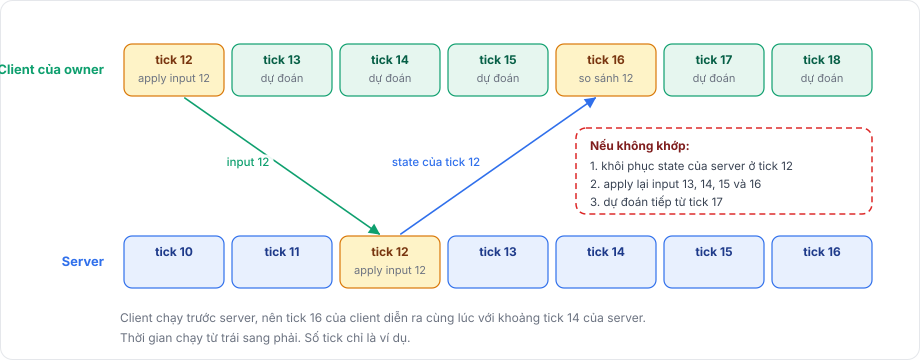

# Prediction

Không có prediction, một client thấy kết quả input của chính mình sau một round trip, vì input phải đi lên server, được áp ở đó rồi quay về. Với round trip 100 ms, đó là ba tick ở 30 tick mỗi giây.

Client-side prediction xóa độ trễ đó cho các object mà client sở hữu. Client áp input ngay, rồi tự sửa khi kết quả của server hóa ra khác.

## Vòng lặp 

<figure><figcaption>
Một input đi lên server và quay về. Client vẫn tiếp tục dự đoán trong lúc chờ.
</figcaption></figure>

1. Client của owner gather input cho prediction tick của nó.
2. Client apply input ngay và ghi lại kết quả của tick đó.
3. Server apply cùng input đó khi tick của chính nó tới số tick ấy.
4. Server gửi kết quả của tick đó cho owner.
5. Client so kết quả của server với bản ghi của nó ở cùng tick.
6. Nếu không khớp, client khôi phục kết quả của server và apply lại input đã ghi cho mọi tick sau đó.

## Các thuật ngữ hay bị nhầm 

| Thuật ngữ | Chạy ở đâu | Là gì |
|---|---|---|
| Server simulation | Server | Server apply input của mỗi client đúng ở tick mà input thuộc về. Kết quả của nó là authoritative state. |
| Client prediction | Client của owner | Client apply input của chính mình trước khi server xác nhận. |
| Authoritative state | Server, gửi cho owner | Kết quả của server cho một tick, được chụp bằng reconcile model. |
| Reconciliation | Client của owner | So authoritative state với prediction ở cùng tick, và sửa chỗ không khớp bằng cách rollback rồi replay. |
| Interpolation | Mọi client, với object nó không dự đoán | Hiển thị object từ xa ở giữa hai vị trí đã nhận, lùi vài tick về quá khứ. Nó không đoán tương lai và không dùng input. |

Prediction và interpolation áp dụng cho các object khác nhau. Client dự đoán các object mà nó sở hữu và có input model, còn mọi object khác được interpolation qua `NetworkTransform`. Một object thôi được dự đoán, ví dụ sau khi đổi owner, sẽ quay về interpolation.

## Yêu cầu 

Prediction cần `NetworkManager` dùng timing mode Tick, và object cần một `NetworkBehaviour` đăng ký input model bằng `NetworkInput.Use`. Để dự đoán, behaviour còn cần một reconcile model; thiếu nó, client chỉ gửi input.

Callback `apply` phải cho ra cùng kết quả trên server và client từ cùng input và cùng state ban đầu. Trên thực tế, nó chỉ đọc input, state riêng của behaviour và `TimeManager.TickDelta`. Kết quả không cần giống nhau tới từng bit: một hàm `matches` quyết định thế nào là đủ gần, và chênh lệch nhỏ sẽ được sửa, như [mô phỏng tất định](deterministic-simulation.md) giải thích.

## Hướng dẫn 

[Tổng quan prediction](../prediction/overview.md) dựng một nhân vật dự đoán hoàn chỉnh. [Input](../prediction/input.md) nói về gather, gửi và apply input, [reconciliation](../prediction/reconciliation.md) nói về capture, restore, so sánh và replay, còn [rollback với physics](../prediction/rollback.md) cho thấy cách rollback các physics world của Unity.
