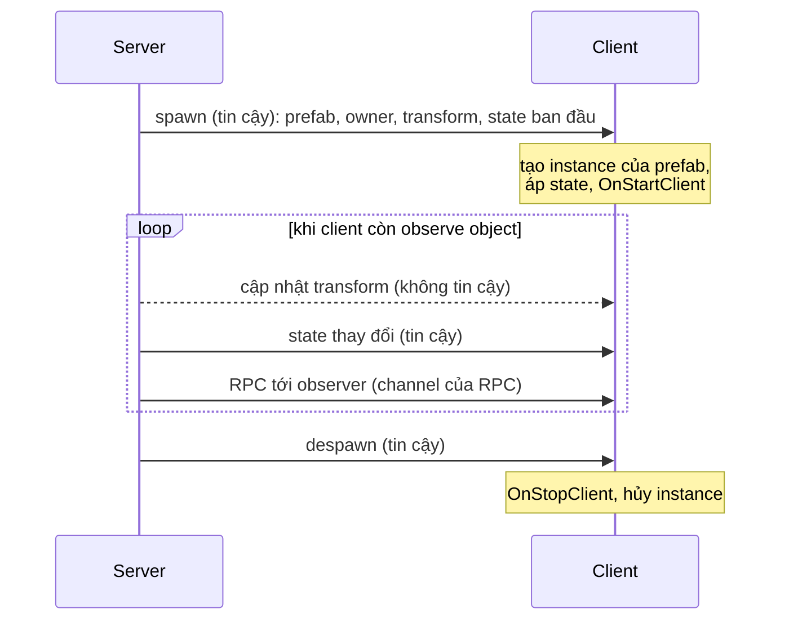

# Replication

Replication là cách các object của server và dữ liệu của chúng tới được client. Mọi thứ đều được gửi từ server, và mỗi client chỉ nhận các object mà nó observe.

## Đời sống của một object trên client 

Nhìn từ phía client, một object tới bằng một message spawn, thay đổi qua các message state và transform, và rời đi bằng một message despawn:

Mũi tên liền là tin cậy và có thứ tự; mũi tên đứt là không tin cậy.

## Client nhận được gì về một object 

| Sự kiện trên server | Message gửi tới observer | Channel |
|---|---|---|
| `ServerManager.Spawn` | Message spawn: object id, prefab id hoặc scene object id, fingerprint của prefab, owner, vị trí, góc xoay và tỉ lệ, state và collection ban đầu của mọi behaviour, và network scene | Tin cậy, có thứ tự |
| Một state model thay đổi | State mới, dạng bản đầy đủ hoặc delta | Tin cậy, có thứ tự |
| Một collection thay đổi | Các thao tác gọi trên nó từ tick trước | Tin cậy, có thứ tự |
| Một `NetworkTransform` di chuyển | Một cập nhật transform kèm tick | Không tin cậy |
| Một `NetworkTransform` dừng lại, được spawn hoặc teleport | Một message settle mang transform cuối cùng | Tin cậy, có thứ tự |
| Parameter của `NetworkAnimator` thay đổi | State của animator, qua cơ chế state | Tin cậy, có thứ tự |
| Một RPC tới observer | RPC đó | Channel của RPC |
| `ServerManager.ChangeOwner` | Một message đổi owner | Tin cậy, có thứ tự |
| `ServerManager.Despawn`, hoặc client ngừng observe | Một message despawn | Tin cậy, có thứ tự |

Message tin cậy tới theo đúng thứ tự server gửi. Vì vậy client luôn có object trước mọi thay đổi state của nó, và không bao giờ nhận thay đổi state sau khi đã despawn. Message không tin cậy cho một object client chưa có sẽ bị bỏ qua.

## Spawn trên client 

Khi một message spawn tới, client đi qua ba bước.

1. Client tìm prefab theo prefab id, hoặc scene object theo scene object id, và so fingerprint, tức mô tả danh sách các type `NetworkBehaviour`. Prefab thiếu hoặc khác sẽ làm client dừng với `PrefabMismatch`.
2. Client tạo instance của prefab tại vị trí và góc xoay của message spawn rồi đặt tỉ lệ, hoặc kích hoạt scene object rồi đặt vị trí cho nó.
3. Client gọi các callback đăng ký của mọi `NetworkBehaviour`, áp state ban đầu, rồi gọi `OnStartClient`.

Trên host, client không tạo instance thứ hai mà dùng luôn instance của server, như mô tả trong [host mode](../connections/host-mode.md).

## Client vào muộn 

Một client kết nối sau khi các object đã được spawn sẽ nhận message spawn cho mọi object nó observe ngay khi tới `Started`. Message đó mang transform hiện tại của object và state cuối cùng server đã chụp, nên client vào muộn bắt đầu từ giá trị hiện tại, không phải từ giá trị lúc spawn ban đầu.

## Observer quyết định ai nhận 

Với mỗi object, server giữ tập các peer đang observe nó. Peer vào tập sẽ nhận spawn, peer rời tập sẽ nhận despawn, còn state, transform và RPC tới observer chỉ đi tới các peer trong tập. Owner của một object luôn observe nó, trừ khi object nằm trong một network scene mà owner chưa load. [Observer](../objects/observers.md) giải thích cách dựng tập này.

## Những gì không được replicate 

Chỉ những gì component của package và model của bạn gửi đi mới được replicate. Các component khác, field của MonoBehaviour thông thường, object con tạo lúc chạy, và material đều chỉ nằm cục bộ. Hãy đưa mọi dữ liệu client cần vào một [state model](../synchronization/state.md), hoặc gửi nó bằng [RPC](../messaging/rpc.md).

Một `NetworkObject` có thể có component `NetworkBehaviour` trên các object con, kể cả `NetworkTransform`. Mỗi `NetworkTransform` replicate vị trí, góc xoay và tỉ lệ cục bộ của GameObject mà nó gắn vào.

Các hướng dẫn về [spawn](../objects/spawning.md), [state](../synchronization/state.md) và [NetworkTransform](../synchronization/transform.md) nói chi tiết về từng loại message, còn [authority](authority.md) giải thích vì sao mọi thứ đều đi từ server.
