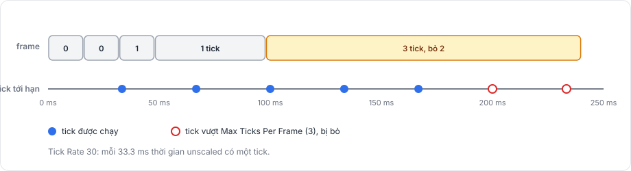
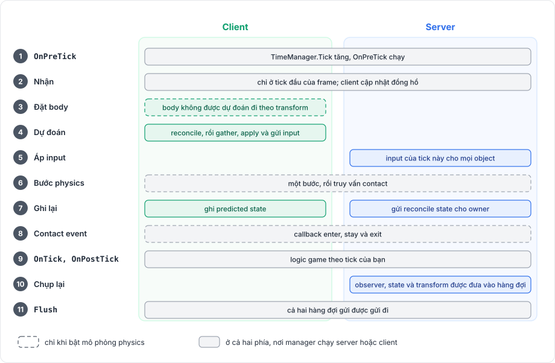
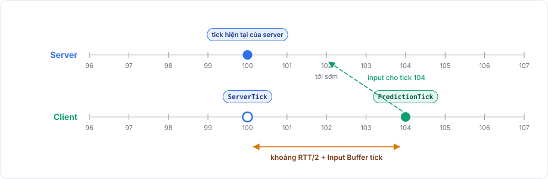

# Tick và thời gian

Package cho mạng tiến lên theo từng bước cố định gọi là tick. Trong một tick, server áp input, cho physics chạy một bước, chụp lại state và transform, và message được gửi đi ở cuối tick. Nhờ bước cố định, server và mọi client thống nhất được chuyện gì đã xảy ra ở tick 100, dù frame rate của chúng khác nhau.

Tick thuộc về `TimeManager`, bạn truy cập nó qua `NetworkManager.TimeManager`.

## Tick rate <a href="#tick-rate" id="tick-rate"></a>

Field **Tick Rate** của `NetworkManager` đặt số tick mỗi giây, mặc định là 30. `TimeManager.TickDelta` cho độ dài một tick tính bằng giây, `1.0 / TickRate`.

Server quyết định tick rate. Khi một client kết nối, server báo tick rate cho nó, và `TimeManager.TickRate` của client theo giá trị đó cho tới khi kết nối dừng. Field **Tick Rate** của client chỉ có tác dụng khi client chưa kết nối.

## Tick và frame <a href="#ticks-and-frames" id="ticks-and-frames"></a>

Một `NetworkManager` đang bật có hai mục trong player loop của Unity: một ở đầu `EarlyUpdate` và một ở cuối `PostLateUpdate`. Nó thêm hai mục này khi được bật và gỡ chúng khi bị tắt.

Ở đầu mỗi frame, manager cộng thời gian unscaled của frame (`Time.unscaledDeltaTime`) vào một bộ tích lũy và chạy mọi tick đã tới hạn, tối đa **Max Ticks Per Frame** (mặc định 3). Một frame ngắn có thể không chạy tick nào, còn một frame dài chạy nhiều tick.

<figure><figcaption><p>Ở 30 tick mỗi giây, mỗi frame chạy trọn từng tick. Tick vượt Max Ticks Per Frame bị bỏ.</p></figcaption></figure>

Tick vượt giới hạn bị bỏ, không dồn sang frame sau, nên một frame dài không gây ra một loạt tick đuổi theo ở các frame kế tiếp. Vì bộ tích lũy dùng thời gian unscaled, `Time.timeScale` không làm mạng chậm lại.

Trên client kết nối tới một server từ xa, manager còn chạy tick nhanh hơn hoặc chậm hơn một chút để giữ prediction tick ở đúng khoảng cách phía trước server, như mô tả ở mục [đồng bộ đồng hồ](#clock-synchronization).

## Thứ tự của một tick <a href="#order-of-one-tick" id="order-of-one-tick"></a>

Ở timing mode Tick, một tick chạy các bước sau theo thứ tự. Mô phỏng physics được bật khi component `RigidbodyPhysics` của `NetworkManager` có **Simulate Physics** được chọn, như mô tả trong [tổng quan physics](../physics/overview.md).

<figure><figcaption><p>Phía nào làm gì trong một tick. Manager chỉ chạy server thì bỏ qua làn client, còn client thì bỏ qua làn server.</p></figcaption></figure>

1. `TimeManager.Tick` tăng một và `OnPreTick` chạy.
2. Chỉ ở tick đầu tiên của frame, cả hai manager đọc các message đã tới, và client cập nhật ước lượng đồng hồ.
3. Khi bật mô phỏng physics, client đặt các body networking mà nó không dự đoán vào vị trí transform của chúng.
4. Client reconcile, rồi gather input cho các object nó dự đoán, apply input và gửi đi.
5. Server áp input của tick này cho mọi object có input model.
6. Khi bật mô phỏng physics, manager cho physics chạy một bước và truy vấn contact.
7. Client ghi lại predicted state của tick này, cùng state physics khi bật mô phỏng physics. Server gửi reconcile state cho các owner.
8. Khi bật mô phỏng physics, các contact event chạy.
9. `OnTick` chạy, rồi tới `OnPostTick`.
10. Server dựng lại một phần tập observer, chụp state và transform, và đưa những gì thay đổi vào hàng đợi.
11. Cả hai manager flush hàng đợi gửi.

Ở timing mode Variable, bước 2 chạy một lần ở đầu mỗi frame, trước các tick, và bước 11 chạy một lần ở cuối frame thay vì sau mỗi tick. Input và prediction không dùng được ở mode này.

## Timing mode <a href="#timing-modes" id="timing-modes"></a>

| Mode | Nhận | Gửi | Prediction |
|---|---|---|---|
| `Tick` (mặc định) | Ở tick đầu của frame | Sau mỗi tick | Có |
| `Variable` | Ở đầu mỗi frame | Ở cuối mỗi frame | Không; đăng ký input model sẽ ném exception |

Ở cả hai mode, state, transform và observer đều được xử lý theo tick.

## Event của tick <a href="#tick-events" id="tick-events"></a>

`OnPreTick`, `OnTick` và `OnPostTick` chạy ở cả hai phía cho mỗi tick. State và transform được chụp sau chúng, ở bước 10, nên logic game phía server cần đổi state trước khi gửi đi thuộc về `OnTick` hoặc `OnPostTick`.

```csharp
using Fomoxa.Networking;
using Fomoxa.Networking.Sessions;
using Fomoxa.Unity;
using UnityEngine;

public sealed class RoundClock : MonoBehaviour
{
    [SerializeField] private NetworkManager manager;

    public double Elapsed { get; private set; }

    private void Start()
    {
        manager.TimeManager.OnTick += CountTick;
    }

    private void OnDestroy()
    {
        if (manager != null && manager.TimeManager != null)
        {
            manager.TimeManager.OnTick -= CountTick;
        }
    }

    private void CountTick()
    {
        if (manager.ServerManager.State == ServerState.Started)
        {
            Elapsed += manager.TimeManager.TickDelta;
        }
    }
}
```

Ví dụ đăng ký trong `Start` vì `NetworkManager` tạo `TimeManager` trong `Awake`, và Unity chạy mọi `Awake` của một scene trước mọi `Start`.

## Ba số tick <a href="#three-tick-numbers" id="three-tick-numbers"></a>

Một client kết nối tới server từ xa làm việc với ba số tick: bộ đếm của chính nó, ước lượng tick của server, và tick mà input của nó dành cho, số này đi trước server.

<figure><figcaption><p>Client gửi input cho một tick server chưa tới, nên input đến kịp lúc.</p></figcaption></figure>

| Property | Trên manager chạy server, kể cả host | Trên client kết nối tới server từ xa |
|---|---|---|
| `TimeManager.Tick` | Bộ đếm tick cục bộ | Bộ đếm tick cục bộ |
| `TimeManager.ServerTick` | Giống `Tick` | Ước lượng của client về tick hiện tại của server |
| `TimeManager.PredictionTick` | Giống `Tick` | Tick mà input của client dành cho, đi trước server |

Trên manager không chạy server cũng không có client đang kết nối, `ServerTick` và `PredictionTick` bằng 0 và `ClockSynced` là false.

Client gửi input cho `PredictionTick`. Tick này đi trước server khoảng nửa round trip cộng một khoảng đệm nhỏ, nên input tới server trước khi server cần đến.

## Đồng bộ đồng hồ <a href="#clock-synchronization" id="clock-synchronization"></a>

Một client từ xa gửi ping ba lần ngay sau khi kết nối, rồi mỗi **Clock Ping Interval Seconds** (mặc định 1) một lần. Server trả lời bằng tick của nó và cho biết input của client đã tới sớm bao nhiêu. Từ các câu trả lời này, client ước lượng round-trip time (`ClientManager.Rtt`) và tick của server.

Client nhắm tới khoảng đi trước bằng nửa round trip, tính theo tick, cộng **Input Buffer** tick (mặc định 2). Khi server báo khoảng đi trước thực tế của input, client chỉnh về mức dư **Input Buffer** tick tại server. Nó thu hẹp chênh lệch bằng cách chạy tick nhanh hơn hoặc chậm hơn tối đa **Max Tick Speed Adjust** (0.1, tức 10 %). Khi sai số vượt **Clock Reset Ticks** (10), nó nhảy thẳng tới mục tiêu.

`TimeManager.ClockSynced` là false cho tới khi câu trả lời đầu tiên tới, và client không dự đoán trước lúc đó.

[Tổng quan prediction](../prediction/overview.md) cho thấy prediction dùng các tick này thế nào, [vòng đời](lifecycle.md) đưa ra thứ tự event của kết nối và network object, và [tham chiếu TimeManager](../reference/time-manager.md) liệt kê các member của nó.
