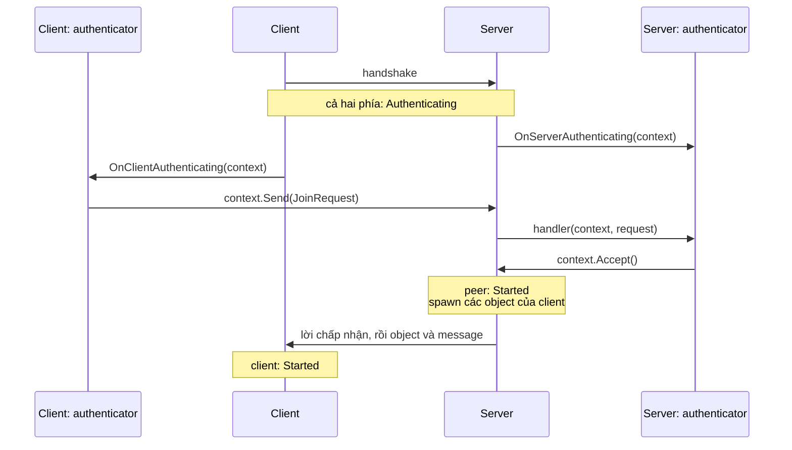

# Xác thực

Authenticator quyết định một client có được vào hay không. Sau handshake của Fomoxa, server giữ mỗi kết nối mới lại cho tới khi authenticator của bạn chấp nhận hoặc từ chối nó. Dùng nó để kiểm tra mật khẩu hay vé từ dịch vụ đăng nhập của bạn trước khi client nhận được object hay message nào của game.

Khi không có authenticator, server cho mọi client vào ngay khi handshake thành công.

## Cách hoạt động <a href="#how-it-works" id="how-it-works"></a>

Một kết nối đi qua `Authenticating` giữa `Starting` và `Started`, ở cả server lẫn client:



Khi một kết nối đang `Authenticating`, chỉ các model mà authenticator đã đăng ký đi qua nó, theo cả hai chiều, cùng với các message xác nhận và mảnh của chính package và thông báo đóng của server. Message mà code game của bạn gửi trước `Started`, ở phía nào cũng vậy, chờ trong send queue và đi khi kết nối đã khởi động. Lệnh gửi của authenticator có queue riêng, với cùng Message Capacity và Byte Capacity.

Khi server chấp nhận, peer chuyển sang `Started`. Server gửi những gì authenticator còn xếp trong queue, rồi lời chấp nhận và các object của client, rồi các message code của bạn đã xếp cho peer. Client chuyển sang `Started` khi lời chấp nhận tới.

## Khai báo model <a href="#declare-a-model" id="declare-a-model"></a>

Message của authenticator là [model](../messaging/models.md) bình thường. Hãy khai báo chúng là `ReliableOrdered`, vì một message không tin cậy bị mất sẽ để client chờ tới khi hết hạn xác thực.

```csharp
[Network]
[Codec("net")]
[NetworkChannel("net", Channel.ReliableOrdered)]
public class JoinRequest
{
    [Network("string")]
    [Codec("net")]
    public string RoomCode { get; set; }
}
```

Model đăng ký trên authenticator chỉ do authenticator xử lý. Message id của nó không thể có thêm handler trên một `Dispatcher`; đăng ký cả hai sẽ ném `HandlerRegistrationException`. Khi kết nối đã khởi động, model đó được coi là message không có handler.

## Viết một authenticator <a href="#write-an-authenticator" id="write-an-authenticator"></a>

Trong Unity, hãy kế thừa component `NetworkAuthenticator` và override các method bạn cần. Authenticator dưới đây cho vào những client biết mã phòng:

```csharp
using Fomoxa.Networking;
using Fomoxa.Unity;
using Generated;
using MyGame.Network.Models;
using UnityEngine;

public sealed class RoomCodeAuthenticator : NetworkAuthenticator
{
    [SerializeField] private string roomCode;

    public string EnteredCode { get; set; }

    private static JoinRequestNetAdapter Codec => JoinRequestNetAdapter.Instance;

    public override void RegisterServer(ServerAuthentication server) =>
        server.On(Codec, OnJoinRequest);

    public override void OnClientAuthenticating(ClientAuthenticationContext context) =>
        context.Send(Codec, new JoinRequest { RoomCode = EnteredCode });

    private void OnJoinRequest(ServerAuthenticationContext context, JoinRequest request)
    {
        if (request.RoomCode == roomCode)
        {
            context.Accept();
        }
        else
        {
            context.Reject();
        }
    }
}
```

| Method | Phía | Được gọi |
|---|---|---|
| `RegisterServer(ServerAuthentication server)` | Server | Một lần, khi authenticator được gán. Đăng ký các model client gửi bằng `server.On(codec, handler)`. |
| `OnServerAuthenticating(ServerAuthenticationContext context)` | Server | Khi một peer chuyển sang `Authenticating` |
| `RegisterClient(ClientAuthentication client)` | Client | Một lần, khi authenticator được gán. Đăng ký các model server gửi bằng `client.On(codec, handler)`. |
| `OnClientAuthenticating(ClientAuthenticationContext context)` | Client | Khi client chuyển sang `Authenticating` |

Lần xác thực của mỗi kết nối có context riêng. Server truyền context của peer vào `OnServerAuthenticating` và vào mọi handler của message từ peer đó, nên handler biết peer nào đã gửi.

| Member | Context | Mục đích |
|---|---|---|
| `PeerId` | Server | Peer đang được xác thực |
| `Send(codec, value)` | Cả hai | Gửi một model sang phía kia; trả về một `SendResult` |
| `Accept()` | Server | Cho peer vào; trả về true |
| `Reject()` | Server | Đóng kết nối của peer kèm lý do; trả về true |
| `CancellationToken` | Cả hai | Bị huỷ khi lần xác thực này kết thúc, vì bất kỳ lý do nào |
| `Ticket` | Client | Vé của một lần [chuyển server](transfer.md#the-ticket); rỗng khi kết nối không phải một lần chuyển |

## Gắn vào NetworkManager <a href="#add-it-to-the-networkmanager" id="add-it-to-the-networkmanager"></a>

Thêm component vào một GameObject và gán nó vào field **Authenticator** của `NetworkManager`. Cùng một component phục vụ cả server lẫn client, nên bản build server và bản build client có thể dùng chung một cách dựng scene. Ở [host mode](host-mode.md), client của chính host cũng đi qua authenticator.

Manager gán authenticator trong `Awake`. Muốn gán từ code, hãy đặt `ServerManager.Authenticator` và `ClientManager.Authenticator` khi phía đó đã dừng; đặt khi đang chạy sẽ ném `InvalidOperationException`. Đặt null là bỏ authenticator. Exception từ `RegisterServer` hay `RegisterClient` ném ra khỏi lệnh gán, và manager không còn authenticator nào.

## Từ chối và hết hạn <a href="#reject-and-time-out" id="reject-and-time-out"></a>

`Reject()` đóng kết nối như [`Kick`](server.md#peers). Peer dừng với `StopReason.AuthenticationFailed`. Client dừng với `ServerClosed` và `CloseReason` là `AuthenticationFailed`, và nó không kết nối lại. Muốn nói rõ hơn với người chơi, ví dụ phòng đã đầy, hãy gửi một model của authenticator trước; nó tới trước lệnh đóng.

Server cho mỗi kết nối **Authentication Timeout Seconds** (mặc định 30) để được chấp nhận. Hết thời gian đó, server đóng kết nối theo cùng cách, với `AuthenticationTimeout` vừa là lý do dừng vừa là lý do đóng. Giá trị 0 tắt giới hạn này.

## Kiểm tra bất đồng bộ <a href="#asynchronous-checks" id="asynchronous-checks"></a>

Nếu việc kiểm tra mất thời gian, như một request tới dịch vụ đăng nhập của bạn, hãy chấp nhận hoặc từ chối khi có câu trả lời, và truyền `context.CancellationToken` vào request đó. Package huỷ token khi lần xác thực kết thúc: sau khi chấp nhận, từ chối hay hết hạn, khi kết nối rớt, hoặc khi server hay client dừng.

Bạn không cần dựa vào token để an toàn. Một context có lần xác thực đã kết thúc không gây hại: `Send` trả `NotConnected`, còn `Accept` và `Reject` trả false. Chỉ lỗi lập trình mới ném exception: gọi `Send`, `Accept` hay `Reject` trên một context đã được chấp nhận sẽ ném `InvalidOperationException`. Như mọi member của package, các lời gọi này phải chạy trên [main thread](../reference/network-manager.md#threading) của Unity.

## Message ngoài bước xác thực <a href="#messages-outside-the-authentication" id="messages-outside-the-authentication"></a>

Package không tự vi phạm các luật này, nên một vi phạm thường có nghĩa là client và server được build từ hai phiên bản khác nhau của authenticator.

- Khi client gửi bất cứ thứ gì khác model của authenticator trong lúc đang `Authenticating`, server đóng kết nối của nó ngay, không gửi thông báo đóng, và peer dừng với `UnauthenticatedMessage`. Message rời phiên cũng tính.
- Khi server gửi cho client bất cứ thứ gì khác model của authenticator hay lời chấp nhận, client dừng với `UnauthenticatedMessage` và không kết nối lại.

Client dừng khi đang `Authenticating` sẽ đóng kết nối mà không gửi message rời phiên, nên server thấy peer dừng với `PeerClosed` qua TCP và WebSocket, hoặc với `Timeout` qua UDP.

## Lỗi <a href="#errors" id="errors"></a>

Exception ném từ `OnServerAuthenticating`, `OnClientAuthenticating` hay một handler của authenticator được tính là [exception của handler](server.md#errors-in-handlers). `OnHandlerException` mang message id 0 khi exception đến từ `OnServerAuthenticating` hoặc `OnClientAuthenticating`, và message id của model khi nó đến từ một handler. Trên server, peer bị đóng với `HandlerException`; trên client, client dừng với `HandlerException`.

Exception do một callback bạn đăng ký trên `CancellationToken` ném ra được báo theo cùng cách. Nếu nó xảy ra lúc kết nối đang được chấp nhận, kết nối sau đó dừng với `HandlerException`. Nếu kết nối đã đang kết thúc vì lý do khác, package chỉ phát `OnHandlerException`, và kết nối dừng với lý do ban đầu.

## Không dùng Unity <a href="#without-unity" id="without-unity"></a>

[Console server](../console-server/overview.md) không có component `NetworkAuthenticator`. Hãy hiện thực `IServerAuthenticator` trong `Fomoxa.Networking` và gán nó vào `ServerManager.Authenticator` trước khi khởi động server. `IClientAuthenticator` là phần tương ứng ở client; `NetworkAuthenticator` hiện thực cả hai.
