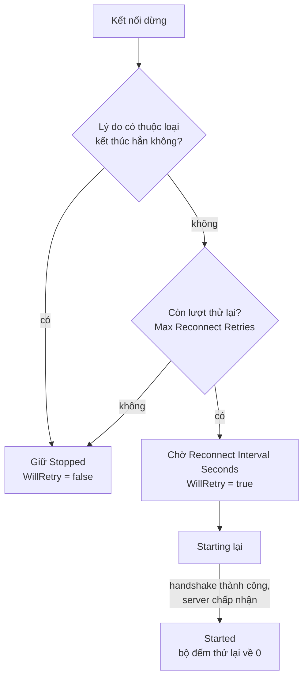

# Client

`ClientManager`, truy cập qua `NetworkManager.ClientManager`, kết nối tới server và giữ kết nối sống, tự kết nối lại khi bị rớt. Nó cũng giữ các object server đã spawn trên client này.

## Kết nối và ngắt kết nối <a href="#connect-and-disconnect" id="connect-and-disconnect"></a>

```csharp
manager.ClientManager.StartConnection("game.example.com", 7777);

manager.ClientManager.StopConnection();
```

`StartConnection(address, port)` nhận host name hoặc địa chỉ IP. Host name được phân giải mà không chặn main thread, và địa chỉ IPv4 được thử trước. Với transport WebSocket, địa chỉ cũng có thể là một URL `ws://`, như mô tả trong [WebSocket](transports/websocket.md). Gọi `StartConnection` trên client đang chạy sẽ ném `the client is already running`.

Trên transport [UDP mã hóa](transports/encrypted-udp.md), client kết nối bằng vé kết nối do dịch vụ đăng nhập của bạn cấp, qua `StartConnection(address, port, grant)`. Khi đó `StartConnection(address, port)` ném `InvalidOperationException`, và vé trên transport không mã hóa ném `ArgumentException`.

Nếu cùng `NetworkManager` đang chạy server, `StartConnection` bỏ qua địa chỉ và port và kết nối qua kết nối trong tiến trình. Đây là [host mode](host-mode.md).

`StopConnection()` gửi message rời đi tới server, đóng kết nối, despawn mọi object trên client và hủy mọi lần kết nối lại đang chờ.

## Trạng thái kết nối <a href="#connection-states" id="connection-states"></a>

Sau handshake, client ở `Authenticating` cho tới khi server cho nó vào, việc này xảy ra ngay nếu server không có [authenticator](authentication.md).

`State` là một `ConnectionState`, một trong `Stopped`, `Starting`, `Authenticating` và `Started`, và `OnClientConnectionState` báo mỗi lần thay đổi kèm một `ConnectionStateArgs`:

| Field | Ý nghĩa |
|---|---|
| `State` | Trạng thái mới |
| `Reason` | Lý do kết nối dừng; `None` ở các trạng thái khác |
| `Failure` | Lỗi handshake khi `Reason` là `HandshakeFailed` |
| `DiscardedMessages` | Số message còn trong queue bị bỏ khi kết nối dừng |
| `WillRetry` | True khi client sẽ khởi động lại sau khoảng chờ kết nối lại, hoặc ngay lập tức sau một lần [chuyển server](transfer.md) |

```csharp
manager.ClientManager.OnClientConnectionState += args =>
{
    if (args.State == ConnectionState.Stopped && !args.WillRetry)
    {
        Debug.Log($"disconnected for good: {args.Reason} {args.Failure}");
    }
};
```

## Kết nối lại <a href="#reconnection" id="reconnection"></a>

Khi kết nối dừng, client quyết định có khởi động lại hay không:



Sau khi kết nối thất bại hoặc bị rớt, client khởi động lại sau Reconnect Interval Seconds (mặc định 0.5), tối đa Max Reconnect Retries lần (mặc định -1, tức không giới hạn). Bộ đếm thử lại được đặt lại mỗi khi một kết nối tới `Started`.

Một số lý do dừng khiến kết nối kết thúc hẳn. Client không thử lại sau `LocalStop`, nghĩa là code của bạn đã gọi `StopConnection`, hay sau `HandlerException`, nghĩa là một message handler trên client đã ném exception. Nó cũng dừng hẳn sau `PrefabMismatch` hoặc `ObjectMismatch`, khi không áp dụng được một object message, sau `PhysicsBackendMismatch`, khi server dùng physics backend khác, sau `InvalidFragment`, khi server gửi các mảnh không ghép được với nhau, sau `ServerClosed`, khi server chủ động đóng kết nối và cho biết lý do trong `CloseReason`, sau `UnauthenticatedMessage`, khi server vi phạm luật của [bước xác thực](authentication.md#messages-outside-the-authentication), sau `TlsRejected`, khi client từ chối chứng chỉ TLS của server hoặc server kết thúc bước bắt tay TLS bằng một cảnh báo (xem [TLS phía client](transports/tls.md)), và sau `HandshakeFailed` với failure khác `Timeout`. Client trong tiến trình của host không bao giờ thử lại.

Mỗi lần kết nối lại là một kết nối mới. Client despawn mọi object khi kết nối dừng, trước khi báo `Stopped`, và server spawn lại chúng sau khi kết nối mới đã khởi động.

Client được server chuyển sang server khác bằng `ServerManager.Transfer` dừng với `Transferred` và kết nối ngay tới server mới. Các lần thử lại sau đó đi tới địa chỉ mới. Khi lệnh chuyển không mang vé kết nối mà transport của client cần, client ghi một lỗi và dừng với `Transferred` và `WillRetry` false. [Chuyển server](transfer.md) mô tả toàn bộ trình tự.

Trên transport mã hóa, mọi lần thử lại dùng lại vé kết nối của lần `StartConnection` hoặc lần chuyển gần nhất. Sau khi vé hết hạn, server bỏ qua client, nên hãy lấy vé mới và gọi lại `StartConnection`.

## Object và thời gian <a href="#objects-and-timing" id="objects-and-timing"></a>

| Member | Mục đích |
|---|---|
| `Spawned` | Các object đã spawn trên client này, theo object id. Giá trị là `INetworkEntity`; trong Unity mỗi giá trị là một `NetworkObject`. |
| `Rtt` | Round-trip time tới server; 0 với client của host |
| `IsReplaying` | True khi client đang replay input trong lúc reconciliation |

`NetworkObject.IsOwner` cho biết client này có sở hữu một object hay không. Client không cung cấp peer id của chính nó, nên hãy xác định ownership qua `IsOwner`.

## Message <a href="#messages" id="messages"></a>

`Send(messageId, payload)` và `SendToObject(...)` gửi các message không phải RPC, còn `Dispatcher` đăng ký handler cho message tới, như hướng dẫn trong [raw message](../messaging/messages.md).

## Lỗi <a href="#errors" id="errors"></a>

Message handler ném exception, ví dụ một client RPC, sẽ dừng client với `HandlerException` và phát `OnHandlerException`. Khi một handler trên server ném exception với message của client này, client thấy khác: nó dừng với `ServerClosed` và `CloseReason` là `HandlerException`, còn `OnHandlerException` được phát trên server chứ không trên client. Object message mà client không áp dụng được sẽ dừng nó với `PrefabMismatch` hoặc `ObjectMismatch` và phát `OnObjectMismatch`. Trong cả hai trường hợp, package tự log vấn đề khi không có ai subscribe, với mismatch là thông báo `Fomoxa stopped the client: object mismatch ...`. Message không decode được chỉ bị bỏ và phát `OnReceiveDropped`. [Xử lý sự cố](../getting-started/troubleshooting.md#client-connects-then-stops-with-prefabmismatch-or-objectmismatch) giải thích ý nghĩa của từng loại mismatch.

[Tham chiếu ClientManager](../reference/client-manager.md) liệt kê mọi member, [vòng đời](../concepts/lifecycle.md) đưa ra thứ tự các event của client, và [transport](transports/README.md) mô tả những gì client kết nối qua.
