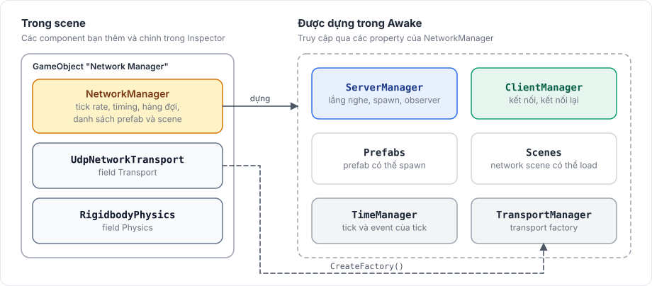

# NetworkManager

`NetworkManager` là component chạy networking cho một scene. Nó giữ cấu hình, chạy tick bên trong player loop của Unity, và sở hữu server, client và đồng hồ của scene đó.

<figure><figcaption><p>Các component bạn thêm, và các object manager dựng từ chúng.</p></figcaption></figure>

Package không có cách truy cập manager dạng static. Hãy giữ một tham chiếu tới nó, ví dụ trong một serialized field, và truy cập server và client qua tham chiếu đó.

## Thêm một NetworkManager <a href="#add-a-networkmanager" id="add-a-networkmanager"></a>

1. Tạo một GameObject trống và đặt tên `Network Manager`.
2. Thêm một component transport, như `UdpNetworkTransport`.
3. Thêm `NetworkManager` và kéo transport vào field **Transport** của nó.
4. Kéo `FomoxaPrefabList.asset` đã sinh vào **Collected Prefabs** và `FomoxaSceneList.asset` vào **Collected Scenes**. [Danh sách prefab và scene](#prefab-and-scene-lists) giải thích lý do.

Sau đó khởi động nó từ code:

```csharp
manager.ServerManager.StartConnection(7777);
manager.ClientManager.StartConnection("127.0.0.1", 7777);
```

Gọi cả hai method trên cùng một manager sẽ biến nó thành [host](host-mode.md).

## Manager sở hữu những gì <a href="#what-the-manager-owns" id="what-the-manager-owns"></a>

| Property | Type | Mục đích |
|---|---|---|
| `ServerManager` | [`ServerManager`](server.md) | Khởi động và dừng server, spawn object, observer, network scene |
| `ClientManager` | [`ClientManager`](client.md) | Kết nối tới server, kết nối lại, các object đã spawn trên client |
| `TimeManager` | [`TimeManager`](../reference/time-manager.md) | Tick rate, số tick, tick event |
| `TransportManager` | `TransportManager` | Component transport và factory tạo từ nó |
| `Prefabs` | `PrefabRegistry` | Các prefab manager có thể spawn; xem [spawn](../objects/spawning.md) |
| `Scenes` | `SceneRegistry` | Các network scene manager có thể load; xem [network scene](../objects/scenes.md) |
| `Registry` | `FomoxaRegistry` | Schema, codec, channel và RPC id. Mặc định là `FomoxaRegistry.Default`, do code sinh ra điền vào |

`ServerManager`, `ClientManager`, `TimeManager` và `TransportManager` được tạo trong `Awake` và là null trước đó, nên hãy dùng chúng từ `Start` trở đi.

## Khi nào nó chạy <a href="#when-it-runs" id="when-it-runs"></a>

Khi đang bật, manager thêm hai bước vào player loop của Unity: một bước ở ngay đầu `EarlyUpdate` và một bước ở ngay cuối `PostLateUpdate`.

Với timing mode mặc định là Tick, mọi tick đến hạn trong một frame chạy ở bước đầu, trước mọi method `Update` của bạn. Việc nhận, logic game trong tick callback và việc gửi đều diễn ra ở đó. Với Variable, bước đầu nhận và bước cuối gửi, nên thay đổi mà code `Update` tạo ra trong cùng frame sẽ được gửi ở cuối frame đó. [Tick và thời gian](../concepts/tick.md#ticks-and-frames) minh họa cả hai trường hợp.

Tắt component sẽ gỡ cả hai bước, nên không gì được nhận, chạy tick hay gửi cho tới khi bạn bật lại.

## Inspector <a href="#inspector" id="inspector"></a>

<figure><figcaption><p>NetworkManager của tutorial. Mọi giá trị trừ ba tham chiếu đều là mặc định.</p></figcaption></figure>

Manager đọc các field này một lần, trong `Awake`. Thay đổi chúng trong Play Mode không có tác dụng.

### Transport và thời gian <a href="#transport-and-timing" id="transport-and-timing"></a>

| Field | Mặc định | Ý nghĩa |
|---|---|---|
| Transport | không có | Component transport. Nếu không có, manager thêm một `UdpNetworkTransport` vào GameObject của nó. |
| Tick Rate | 30 | Số tick mỗi giây. Client theo tick rate của server khi đang kết nối. |
| Timing Mode | Tick | `Tick` nhận và gửi theo tick và cho phép prediction. `Variable` nhận ở đầu và gửi ở cuối mỗi frame. |
| Max Ticks Per Frame | 3 | Số tick tối đa một frame được chạy. Tick vượt quá bị bỏ, không chạy bù sau. |

### Send queue <a href="#send-queue" id="send-queue"></a>

| Field | Mặc định | Ý nghĩa |
|---|---|---|
| Message Capacity | 1024 | Số message queue của một kết nối giữ được trước khi lệnh gửi trả về `Full` |
| Byte Capacity | 1048576 | Số byte queue của một kết nối giữ được trước khi lệnh gửi trả về `BytesFull` |
| Reliable Window | 1024 | Số message reliable đang bay chưa được acknowledge, theo từng kết nối |
| Close Timeout Seconds | 1 | Thời gian server dành để gửi nốt hàng đợi của một peer bị kick trước khi vẫn đóng kết nối |
| Log Send Dropped | bật | Log cảnh báo khi một message trong queue không gửi được |
| Log Receive Dropped | bật | Log cảnh báo khi một bundle nhận được không đọc được |

### Kết nối <a href="#connection" id="connection"></a>

| Field | Mặc định | Ý nghĩa |
|---|---|---|
| Max Reconnect Retries | -1 | Số lần client thử lại sau khi mất hoặc không tạo được kết nối. -1 là thử mãi. |
| Reconnect Interval Seconds | 0.5 | Thời gian chờ trước mỗi lần thử lại |
| Handshake Timeout Seconds | 5 | Thời gian handshake được phép kéo dài trước khi kết nối thất bại |
| Heartbeat Interval Seconds | 5 | Khoảng im lặng mà sau đó kết nối gửi một probe |
| Heartbeat Timeout Seconds | 15 | Thời gian một probe được phép không có trả lời trước khi kết nối dừng với `Timeout` |

### Prefab và scene <a href="#prefabs-and-scenes" id="prefabs-and-scenes"></a>

| Field | Mặc định | Ý nghĩa |
|---|---|---|
| Collect Prefabs | bật | Đăng ký các prefab của Collected Prefabs. Khi tắt, danh sách cũng không được đưa vào bản build. |
| Collected Prefabs | không có | `FomoxaPrefabList.asset` đã sinh |
| Collected Scenes | không có | `FomoxaSceneList.asset` đã sinh |
| Prefabs | trống | Các prefab đăng ký thêm |

### Observer <a href="#observers" id="observers"></a>

| Field | Mặc định | Ý nghĩa |
|---|---|---|
| Observer Rule | không có | Một asset [`ObserverRule`](../objects/observers.md). Nếu không có, mọi client observe mọi object. |
| Observer Interval | 15 | Số tick mà server trải một lần tính lại toàn bộ các tập observer |

### Prediction <a href="#prediction" id="prediction"></a>

| Field | Mặc định | Ý nghĩa |
|---|---|---|
| Clock Ping Interval Seconds | 1 | Khoảng cách giữa các clock ping của client ở xa |
| Input Buffer | 2 | Số tick biên mà client giữ giữa lúc input tới server và lúc server dùng nó |
| Max Tick Speed Adjust | 0.1 | Mức thay đổi lớn nhất của tốc độ tick trên client khi đuổi theo, dưới dạng tỉ lệ |
| Clock Reset Ticks | 10 | Sai số đồng hồ, tính theo tick, mà từ đó client nhảy thẳng thay vì điều chỉnh tốc độ |
| Input Redundancy | 3 | Số input trong mỗi input message: input hiện tại và các input trước, để bù gói bị mất |
| Max Input Lead | 30 | Số tick tối đa input được đi trước server; input xa hơn bị bỏ |
| Prediction History | 64 | Số tick input, state dự đoán và physics mà client giữ để replay |
| Reconcile Interval | 1 | Server gửi state cho owner sau mỗi chừng này tick |

[Prediction](../prediction/overview.md) giải thích các giá trị này phối hợp với nhau ra sao.

### Physics <a href="#physics" id="physics"></a>

| Field | Mặc định | Ý nghĩa |
|---|---|---|
| Physics | không có | Component physics. Khi trống, manager tự thêm một `RigidbodyPhysics` với Simulate Physics tắt. |

`RigidbodyPhysics` có một field là Simulate Physics, mặc định tắt. Khi bật, manager step physics của Unity mỗi tick một lần và bật rollback physics. Package tùy chọn [Rapier](../rapier/overview.md) thêm `RapierPhysics` làm lựa chọn thứ hai. Server và client phải dùng cùng một backend; xem [physics](../physics/overview.md#turning-it-on).

## Danh sách prefab và scene <a href="#prefab-and-scene-lists" id="prefab-and-scene-lists"></a>

Trong `Awake`, manager đăng ký các prefab của Collected Prefabs khi Collect Prefabs đang bật, các prefab trong danh sách Prefabs của nó, rồi các scene của Collected Scenes. Client chỉ tạo được object có prefab đã đăng ký, và spawn một prefab chưa đăng ký sẽ thất bại với `prefab id 0x... of <name> is not registered`.

Editor cũng tự gán cả hai danh sách cho mọi `NetworkManager` nằm trong một scene, ở hai thời điểm:

- Trong lúc build player, nên bản build luôn có danh sách mới nhất.
- Khi bạn vào Play Mode. Lần gán này tới sau khi `Awake` của manager đã chạy, nên nó không đăng ký gì trong phiên Play Mode đó.

Hãy gán cả hai danh sách trong scene, như trong [tutorial](../getting-started/tutorial/project-setup.md#5-give-the-networkmanager-the-generated-lists), để Play Mode trong Editor có chúng. Một `NetworkManager` mà bạn tạo từ prefab lúc chạy không bao giờ được gán tự động, nên hãy đặt danh sách lên chính prefab đó.

## Nhiều manager <a href="#several-managers" id="several-managers"></a>

Một scene có thể có nhiều hơn một `NetworkManager`, ví dụ một server và một client trong cùng tiến trình để test, và mỗi manager có server, client và tick riêng. Hai manager kết nối với nhau qua transport của chúng. Kết nối trong tiến trình của host không áp dụng ở đây, vì nó chỉ nối một client với server của cùng manager.

Mỗi physics scene chỉ do một manager step; xem [physics](../physics/overview.md#one-world-one-owner).

## Giới hạn <a href="#limitations" id="limitations"></a>

Không thể đặt các field từ code; `Registry` là property duy nhất có thể gán. Do đó manager thêm bằng `AddComponent` dùng giá trị mặc định, và nó tự thêm `UdpNetworkTransport` và `RigidbodyPhysics` trừ khi các component đó được gán qua Inspector. Manager chỉ chạy tick khi đang bật và nằm trong một scene đã load.

[Tham chiếu NetworkManager](../reference/network-manager.md) và [cấu hình](../reference/configuration.md) liệt kê mọi member và field. Các trang [server](server.md), [client](client.md) và [host mode](host-mode.md) mô tả những gì manager chạy.
