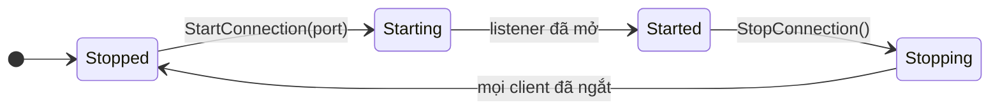

# Server

`ServerManager`, truy cập qua `NetworkManager.ServerManager`, chạy phía server của game. Nó lắng nghe client, theo dõi các peer đã kết nối, spawn object và quyết định ai observe chúng.

## Khởi động và dừng <a href="#start-and-stop" id="start-and-stop"></a>

```csharp
manager.ServerManager.StartConnection(7777);
Debug.Log($"listening on {manager.ServerManager.Port}");

manager.ServerManager.StopConnection();
```

`State` là một `ServerState`, và `OnServerConnectionState` báo mỗi lần thay đổi:



`StartConnection(port)` mở listener của transport, cùng một listener trong tiến trình cho client của host. Port 0 để hệ điều hành chọn port, và `Port` báo port đang dùng, hoặc 0 khi server đã dừng. Gọi `StartConnection` trên server đang chạy sẽ ném `the server is already running`. Ngay sau khi tới `Started`, server spawn mọi `NetworkObject` đặt trong các scene đã load, như mô tả trong [spawn](../objects/spawning.md#scene-objects).

`StopConnection()` ngắt mọi client. Khi state đã là `Stopped`, server despawn mọi object theo thứ tự ngược với lúc spawn, hủy các instance prefab và tắt các scene object, rồi unload các network scene nó đã load.

## Peer <a href="#peers" id="peers"></a>

Mỗi client nhận một peer id khi transport của nó kết nối, và `OnRemoteConnectionState` báo các trạng thái của client:

```csharp
manager.ServerManager.OnRemoteConnectionState += args =>
{
    switch (args.State)
    {
        case ConnectionState.Starting:
            Debug.Log($"peer {args.PeerId} is connecting");
            break;
        case ConnectionState.Authenticating:
            Debug.Log($"peer {args.PeerId} is authenticating");
            break;
        case ConnectionState.Started:
            Debug.Log($"peer {args.PeerId} joined");
            break;
        case ConnectionState.Stopped:
            Debug.Log($"peer {args.PeerId} left: {args.Reason}, {args.DiscardedMessages} messages discarded");
            break;
    }
};
```

Một peer ở `Starting` trong lúc handshake chạy, ở `Authenticating` trong lúc [authenticator](authentication.md) của bạn kiểm tra nó, và tới `Started` khi được cho vào. Khi không có authenticator, peer đi qua `Authenticating` và tới `Started` trong cùng một lần cập nhật. Hãy spawn object của peer ở `Started`, vì trước đó nó chưa nhận được chúng. Server không cung cấp danh sách peer id, nên nếu cần, hãy tự giữ một tập từ các event này. [Vòng đời](../concepts/lifecycle.md#server) đưa ra toàn bộ trình tự cho một client.

| Member | Mục đích |
|---|---|
| `PeerCount` | Số peer đã kết nối, kể cả peer chưa khởi động xong |
| `PeerState(peerId)` | `ConnectionState` của một peer; `Stopped` với peer không biết |
| `Disconnect(peerId)` | Đóng kết nối của một peer ngay lập tức; nó dừng với `LocalStop`, còn client thấy kết nối rớt và kết nối lại |
| `Kick(peerId)` | Báo cho client rằng nó bị kick, rồi đóng kết nối; peer dừng với `LocalStop`, còn client dừng với `ServerClosed` và không kết nối lại |
| `Transfer(peerId, address, port, ticket)` | Chuyển client sang server khác, rồi đóng kết nối như `Kick`; peer dừng với `Transferred`. Xem [chuyển server](transfer.md). |
| `HasRtt(peerId)`, `RttOf(peerId)` | Round-trip time mà client của peer báo qua các clock ping |
| `DroppedInputsOf(peerId)` | Số input từ peer mà server không dùng được |
| `FrameBudgetOf(peerId)` | Frame budget của transport mà peer kết nối qua |

`Kick` gửi những gì đã xếp cho peer, rồi tới thông báo kick, rồi đóng kết nối. Từ lúc gọi, lệnh gửi tới peer đó trả `NotConnected` và message của nó không còn được xử lý. Nếu hàng đợi không gửi hết được trong Close Timeout Seconds (mặc định 1), ví dụ vì client đã ngừng đọc, server vẫn đóng kết nối. Muốn báo cho người chơi lý do, như bị cấm hay phòng đã đầy, hãy gửi message của bạn trước khi gọi `Kick`; nó sẽ tới trước. `Kick` trả false với peer không tồn tại và với peer đang bị đóng. Peer còn trong handshake chưa nhận được message, nên nó bị đóng ngay mà không có thông báo. Peer đang `Authenticating` thì vẫn nhận được thông báo.

Khi một peer dừng, server despawn các object nó sở hữu. Object có `NetworkObject` tắt Despawn With Owner thì được giữ lại và chuyển sang do server sở hữu; xem [ownership](../objects/ownership.md).

## Object <a href="#objects" id="objects"></a>

| Member | Hướng dẫn |
|---|---|
| `Spawn(networkObject, ownerId)`, `Despawn(networkObject)` | [Spawn](../objects/spawning.md) |
| `ChangeOwner(networkObject, ownerId)` | [Ownership](../objects/ownership.md) |
| `IsObserver`, `RebuildObservers`, `ObserverRule`, `ObserverInterval`, `Groups` | [Observer](../objects/observers.md) |
| `Scenes` | [Network scene](../objects/scenes.md) |
| `Spawned` | Mọi object server này đã spawn, theo object id. Giá trị là `INetworkEntity`; trong Unity mỗi giá trị là một `NetworkObject`. |

## Message <a href="#messages" id="messages"></a>

`Send(peerId, messageId, payload)`, `SendToObject(...)` và `Broadcast(messageId, payload)` gửi các message không gắn với RPC, còn `Dispatcher` đăng ký handler cho message tới. [Raw message](../messaging/messages.md) hướng dẫn cách dùng chúng.

## Lỗi trong handler <a href="#errors-in-handlers" id="errors-in-handlers"></a>

Khi một handler ném exception lúc server xử lý message của một peer, ví dụ một server RPC, server phát `OnHandlerException` kèm peer id, message id và exception, rồi đóng kết nối của peer đó giống như `Kick`. Peer dừng với `StopReason.HandlerException`, còn client dừng với `ServerClosed` và `CloseReason` là `HandlerException`, nên nó không kết nối lại rồi gặp lại đúng lỗi đó. Nếu không có ai subscribe event này, package tự log exception. Message không decode được thì không làm ngắt kết nối peer; nó bị bỏ và phát `OnReceiveDropped`.

Exception ném ra trong `apply` của input model hoặc trong một `ObserverRule` được log và không ngắt kết nối ai.

[Tham chiếu ServerManager](../reference/server-manager.md) liệt kê mọi member. Để chạy server riêng hoặc cùng một client, xem [dedicated server](../deploy/dedicated-server.md) và [host mode](host-mode.md).
