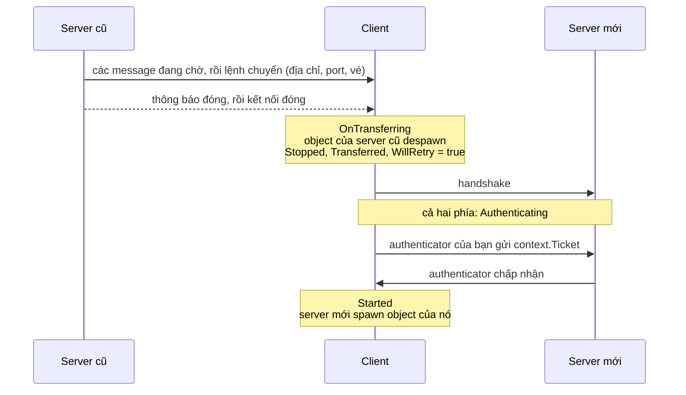

# Chuyển server

Game chạy trên nhiều server, như một lobby với các server trận đấu của nó, hay mỗi vùng một server, chuyển người chơi từ server này sang server khác bằng `ServerManager.Transfer`. Server cũ báo cho client nơi cần tới và đưa nó một vé, rồi đóng kết nối. Client tự kết nối tới server mới và đưa vé cho [authenticator](authentication.md) của server mới, nơi quyết định có cho nó vào hay không.

Chuyển server là một kết nối mới. Client despawn mọi object của server cũ, còn server mới spawn object của nó sau khi client đã `Started` ở đó. Không có gì đang sống trên server cũ đi theo, trừ những gì bạn đặt vào vé.



## Trên server cũ <a href="#on-the-old-server" id="on-the-old-server"></a>

```csharp
bool started = manager.ServerManager.Transfer(peerId, "arena-2.example.com", 7777, ticket);
```

`Transfer(peerId, address, port, ticket)` hoạt động như [`Kick`](server.md#peers). Server gửi những gì đang chờ cho peer, rồi lệnh chuyển, rồi một thông báo đóng, và đóng kết nối trong Close Timeout Seconds. Kể từ lời gọi, việc gửi tới peer đó trả về `NotConnected` và message của nó không còn được xử lý. Peer dừng với `StopReason.Transferred`, và server despawn các object peer đó sở hữu như với mọi peer dừng.

`address` và `port` mang đúng nghĩa của chúng trong `StartConnection` của client: host name, địa chỉ IP, hoặc một URL `ws://` với transport [WebSocket](transports/websocket.md). Package không đọc vé; nó chuyển nguyên các byte tới client.

`Transfer` trả về false với peer không tồn tại, peer đang bị đóng, và peer chưa tới `Started`. Nó ném `ArgumentNullException` khi `address` là null, và `InvalidOperationException` với peer của client chính host, vì [host mode](host-mode.md) không chuyển được client của nó sang server khác.

Server không chờ client đồng ý. Client làm ngơ lệnh chuyển vẫn bị ngắt kết nối.

## Trên client <a href="#on-the-client" id="on-the-client"></a>

Client tự theo lệnh chuyển, bạn không cần viết code. Nó phát các sự kiện sau, theo thứ tự này:

1. `ClientManager.OnTransferring`, kèm một `TransferringArgs` giữ `Address` và `Port` mới. Object của server cũ vẫn còn, nên đây là chỗ bật màn hình chờ hay đọc những gì bạn cần từ chúng.
2. `OnStopClient` trên mọi object của server cũ, khi chúng despawn theo thứ tự ngược thứ tự spawn.
3. `OnClientConnectionState` với `Stopped`, `StopReason.Transferred` và `WillRetry` là true.
4. `Starting`, `Authenticating` và `Started` trên server mới.

```csharp
manager.ClientManager.OnTransferring += args => loadingScreen.SetActive(true);

manager.ClientManager.OnClientConnectionState += args =>
{
    if (args.State == ConnectionState.Started)
    {
        loadingScreen.SetActive(false);
    }
};
```

Client kết nối ngay tới địa chỉ mới, như khi bạn gọi `StartConnection` với nó. Khi kết nối đó thất bại hay rớt, client thử lại theo các luật [kết nối lại](client.md#reconnection) thông thường, luôn tới địa chỉ mới. Nó không bao giờ quay về server cũ. Nếu server mới từ chối vé, client dừng với `ServerClosed` và `CloseReason` là `AuthenticationFailed`, và không thử lại.

Muốn từ chối lệnh chuyển, gọi `StopConnection()` trong `OnTransferring` hoặc trong handler của `Stopped`. Client khi đó giữ trạng thái dừng.

## Vé <a href="#the-ticket" id="the-ticket"></a>

Trên client, `ClientAuthenticationContext.Ticket` giữ vé của lần chuyển. Authenticator phía client của bạn gửi nó tới server mới trong một model của chính nó, và authenticator phía server kiểm tra vé. Vé rỗng khi kết nối không phải một lần chuyển. Client giữ vé cho mọi lần thử của cùng lần chuyển đó và quên nó khi client tới `Started`, hoặc khi bạn gọi `StartConnection`.

Nếu server mới không có authenticator, vé không đi đâu cả và server cho client vào như mọi client khác.

Đặt vào vé dữ liệu server mới cần từ server cũ, như id hay điểm của người chơi. Chỉ vé được ký, nên server mới không tin được bất cứ điều gì khác client nói về nơi nó tới từ.

## TransferTickets <a href="#transfertickets" id="transfertickets"></a>

`TransferTickets`, trong `Fomoxa.Networking`, phát và kiểm tra vé có chữ ký. Tạo một cái trên mỗi server với cùng một khoá:

```csharp
var tickets = new TransferTickets(FomoxaRegistry.Default, key);

byte[] ticket = tickets.Issue("arena-2", playerData);

if (tickets.TryVerify(ticket, "arena-2", out ReadOnlyMemory<byte> data))
{
    // data is playerData
}
```

`Issue(target, data)` trả về một vé chứa `data`, tên server mà vé dành cho, một thời điểm hết hạn và một nonce ngẫu nhiên 128 bit, tất cả được ký bằng HMAC-SHA256 với khoá. Tên server do bạn đặt. `TryVerify(ticket, target, out data)` trả về true và dữ liệu chỉ khi chữ ký khớp với khoá, vé dành cho `target`, vé chưa hết hạn, và nonce của nó chưa được dùng. Mỗi vé chỉ kiểm tra được một lần; `TryVerify` lần thứ hai trên cùng vé trả về false.

| Member | Mục đích |
|---|---|
| `TransferTickets(FomoxaRegistry registry, byte[] key)` | Dùng kho nonce trong bộ nhớ và đồng hồ hệ thống. Khoá được sao chép. |
| `TransferTickets(FomoxaRegistry registry, byte[] key, IUsedTicketStore usedTickets, Func<DateTime> utcNow)` | Dùng kho nonce và đồng hồ của bạn; null cho cái nào thì cái đó lấy mặc định |
| `byte[] Issue(string target, ReadOnlyMemory<byte> data)` | Một vé mới có chữ ký |
| `bool TryVerify(ReadOnlyMemory<byte> ticket, string target, out ReadOnlyMemory<byte> data)` | Kiểm tra một vé và dùng hết nonce của nó |
| `TimeSpan Lifetime` | Vé mới còn hiệu lực bao lâu; mặc định 30 giây |
| `IUsedTicketStore UsedTickets` | Nơi giữ các nonce đã dùng |
| `const int NonceLength` | 16, độ dài một nonce tính bằng byte |

Registry phải chứa các system model của package. `FomoxaRegistry.Default` chứa chúng sau khi phần đăng ký được sinh ra đã chạy lúc khởi động, còn một [console server](../console-server/runtime.md) truyền registry nó đã điền bằng `FomoxaAdapters.RegisterAll`. Registry thiếu chúng làm constructor ném `InvalidOperationException`. Registry hoặc khoá null ném `ArgumentNullException`, và khoá rỗng ném `ArgumentException`. Hãy dùng một khoá ngẫu nhiên dài và chỉ giữ nó trên server. Một `TransferTickets` dùng được từ nhiều thread.

Thời điểm hết hạn là giờ UTC theo đồng hồ của server phát vé, còn server kiểm vé so với đồng hồ của chính nó. Độ lệch giữa hai đồng hồ cộng vào hoặc trừ đi khỏi `Lifetime`, nên hãy giữ đồng hồ các server khớp nhau.

### Nonce đã dùng <a href="#used-nonces" id="used-nonces"></a>

`IUsedTicketStore` có một method, `bool TryUse(ReadOnlySpan<byte> nonce, DateTime expiresUtc, DateTime nowUtc)`. Nó trả về true và nhớ nonce tới `expiresUtc` khi nonce còn mới, và false khi đã thấy nó. `TryVerify` gọi nó sau cùng, chỉ với vé đã qua mọi phép kiểm khác.

Mặc định, `MemoryUsedTicketStore` giữ nonce trong bộ nhớ của một process và quên chúng khi vé của chúng hết hạn. Như vậy là đủ khi mỗi server chỉ nhận vé mang tên của chính nó. Khi nhiều process server cùng nhận vé cho một tên, chúng cần một kho chung, ví dụ trong Redis, để vé đã dùng trên một process bị từ chối ở các process khác.

## Ví dụ <a href="#example" id="example"></a>

Cả hai server dùng cùng một component authenticator. Phía client gửi vé; phía server kiểm tra nó với tên của server nó đang chạy:

```csharp
[Network]
[Codec("net")]
[NetworkChannel("net", Channel.ReliableOrdered)]
public class TransferRequest
{
    [Network("bytes")]
    [Codec("net")]
    public byte[] Ticket { get; set; }
}
```

```csharp
using System;
using System.Collections.Generic;
using System.Text;
using Fomoxa.Networking;
using Fomoxa.Unity;
using Generated;
using MyGame.Network.Models;
using UnityEngine;

public sealed class ArenaTicketAuthenticator : NetworkAuthenticator
{
    [SerializeField] private string serverName;
    [SerializeField] private string ticketKey;

    private readonly Dictionary<ulong, int> scores = new Dictionary<ulong, int>();
    private TransferTickets tickets;

    public TransferTickets Tickets =>
        tickets ??= new TransferTickets(FomoxaRegistry.Default, Encoding.UTF8.GetBytes(ticketKey));

    public int ScoreOf(ulong peerId) => scores.TryGetValue(peerId, out int score) ? score : 0;

    private static TransferRequestNetAdapter Codec => TransferRequestNetAdapter.Instance;

    public override void RegisterServer(ServerAuthentication server) =>
        server.On(Codec, OnTransferRequest);

    public override void OnClientAuthenticating(ClientAuthenticationContext context) =>
        context.Send(Codec, new TransferRequest { Ticket = context.Ticket.ToArray() });

    private void OnTransferRequest(ServerAuthenticationContext context, TransferRequest request)
    {
        if (Tickets.TryVerify(request.Ticket, serverName, out ReadOnlyMemory<byte> data))
        {
            scores[context.PeerId] = BitConverter.ToInt32(data.Span);
            context.Accept();
        }
        else
        {
            context.Reject();
        }
    }
}
```

Server này chỉ cho vào client mang vé hợp lệ. Một lobby mà người chơi vào thẳng sẽ nhận cả vé rỗng, hoặc kiểm tra đăng nhập thay vào đó.

Server cũ phát vé cho arena và chuyển người chơi:

```csharp
using System;
using Fomoxa.Unity;
using UnityEngine;

public sealed class ArenaExit : MonoBehaviour
{
    [SerializeField] private NetworkManager manager;
    [SerializeField] private ArenaTicketAuthenticator authenticator;

    public bool SendToArena(ulong peerId, int score, string arenaName, string address, ushort port)
    {
        byte[] ticket = authenticator.Tickets.Issue(arenaName, BitConverter.GetBytes(score));
        return manager.ServerManager.Transfer(peerId, address, port, ticket);
    }
}
```

Tài liệu tham khảo [ServerManager](../reference/server-manager.md) và [ClientManager](../reference/client-manager.md) liệt kê các member, còn [lỗi và lý do dừng](../reference/errors.md) mô tả `Transferred`.
