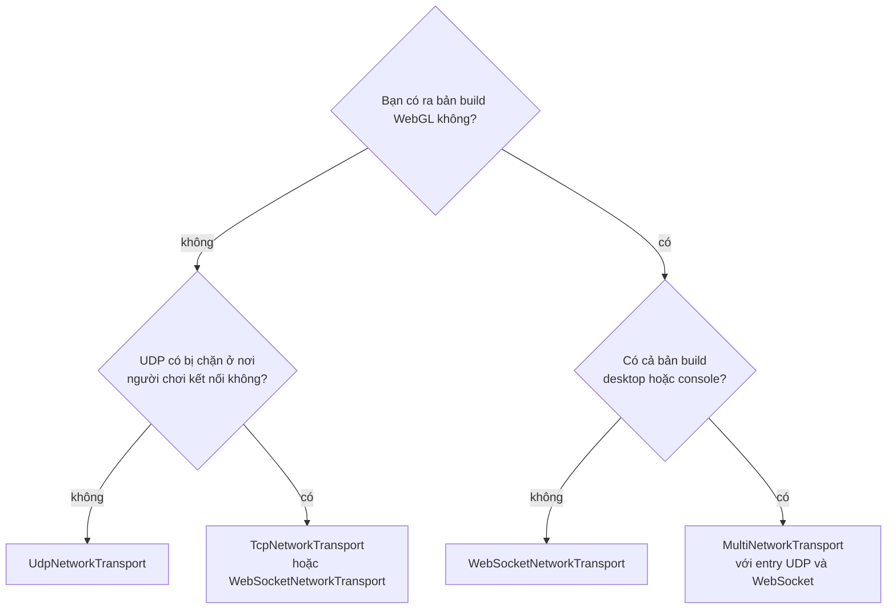

# Tổng quan transport

Transport chuyển byte giữa client và server. Giao thức, độ tin cậy và object của package hoạt động như nhau trên mọi transport, nên game chọn transport bằng cách thêm một component vào `NetworkManager`, không cần đổi code.

| Component | Giao thức | Server | Client | Client trình duyệt (WebGL) |
|---|---|---|---|---|
| [`UdpNetworkTransport`](udp.md) | Datagram UDP | Có | Có | Không |
| [`EncryptedUdpNetworkTransport`](encrypted-udp.md) | Datagram UDP mã hóa bằng ChaCha20-Poly1305 | Có | Có, với vé kết nối từ dịch vụ đăng nhập của bạn | Không |
| [`EncryptedWebSocketNetworkTransport`](encrypted-websocket.md) | Datagram UDP mã hóa thành message WebSocket, qua `fomoxa-gateway` | Không; pod chạy UDP mã hóa sau gateway | Có, với vé kết nối | Có |
| [`TcpNetworkTransport`](tcp.md) | Stream TCP | Có | Có | Không |
| [`WebSocketNetworkTransport`](websocket.md) | WebSocket (RFC 6455) qua TCP | Có | Có | Có |
| [`MultiNetworkTransport`](multi-transport.md) | Nhiều transport ở trên cho một server | Có | Có, qua transport đầu tiên | Có, qua mục WebSocket |

Dù dùng transport nào, client của chính host luôn dùng kết nối [loopback](loopback.md) trong tiến trình.

## Khả năng <a href="#capabilities" id="capabilities"></a>

| | UDP | TCP | WebSocket |
|---|---|---|---|
| Mô hình kết nối | Không kết nối; handshake Fomoxa thiết lập session | Kết nối TCP, rồi handshake | Kết nối TCP, HTTP upgrade, rồi handshake |
| Độ tin cậy của transport | Không | Reliable | Reliable |
| Thứ tự của transport | Không | Có thứ tự | Có thứ tự |
| Frame budget cho bundle | 1200 byte | Frame Fomoxa lớn nhất | Frame Fomoxa lớn nhất |
| Địa chỉ | Host name hoặc IP, và port | Host name hoặc IP, và port | Host name, IP, hoặc URL `ws://` hay `wss://`, và port |
| Server lắng nghe trên | Mọi interface IPv4 | Mọi interface IPv4 | Mọi interface IPv4 |
| Mã hóa | Không; [UDP mã hóa](encrypted-udp.md) thêm mã hóa | [TLS phía client](tls.md) với Use Tls, qua proxy | [TLS phía client](tls.md) cho URL `wss://`, qua proxy |

UDP mã hóa hoạt động như UDP, với frame budget 1175 byte.

Các channel của package hoạt động như nhau trên mọi transport: message `ReliableOrdered` được acknowledge và gửi lại, message `Unreliable` thì không. Qua một transport reliable, message unreliable trên thực tế không bị mất, nhưng package không dựa vào điều đó.

## Hoạt động không chặn <a href="#non-blocking-operation" id="non-blocking-operation"></a>

Package không tạo thread. Thay vào đó nó poll transport mỗi tick. Client phân giải host name bằng `Dns.GetHostAddressesAsync` và kiểm tra kết quả ở các tick sau, ưu tiên địa chỉ IPv4. Client TCP và WebSocket kết nối bằng socket không chặn và thử lần lượt từng địa chỉ đã phân giải, còn listener nhận kết nối mà không chặn.

## Chọn transport <a href="#choosing-a-transport" id="choosing-a-transport"></a>



UDP có độ trễ thấp nhất khi mất gói, vì một message unreliable bị mất không giữ lại các message phía sau, nên nó là lựa chọn cho game desktop và console. TCP hoạt động ở nơi UDP bị chặn, nhưng một gói bị mất làm chậm mọi thứ phía sau. WebSocket bắt buộc với client WebGL và cũng hoạt động ở nơi chỉ mở port HTTP. Với `MultiNetworkTransport`, một server có thể nhận client desktop qua UDP và client trình duyệt qua WebSocket cùng lúc.

## Transport được gắn vào thế nào <a href="#how-a-transport-plugs-in" id="how-a-transport-plugs-in"></a>

`NetworkTransport` là một `MonoBehaviour` trừu tượng có một method:

```csharp
public abstract ITransportFactory CreateFactory();
```

`NetworkManager` gọi nó một lần trong `Awake`. `ITransportFactory` trả về, nằm trong `Fomoxa.Networking.Transports`, tạo listener cho server và connector cho client:

| Member | Ý nghĩa |
|---|---|
| `FrameBudget` | Frame lớn nhất package nên dựng cho transport này |
| `CreateListener(ushort port, out ushort boundPort)` | Mở một listener và báo port nó đã bind |
| `CreateConnector(string address, ushort port)` | Bắt đầu một kết nối; client poll nó cho tới khi kết nối được hoặc thất bại |

Transport cần vé kết nối, như UDP mã hóa, cài thêm `IConnectionTransportFactory`, gồm `RequiresConnection`, `CanUseConnection(connection)` và `CreateConnector(address, port, connection)`. [Transport tùy chỉnh](custom-transport.md) hướng dẫn cách viết transport riêng.

Transport được [client](../client.md) và [server](../server.md) sử dụng, [vòng đời](../../concepts/lifecycle.md) đưa ra thứ tự các event kết nối, và [triển khai](../../deploy/deployment.md) nói về port và firewall trên một server thật.
