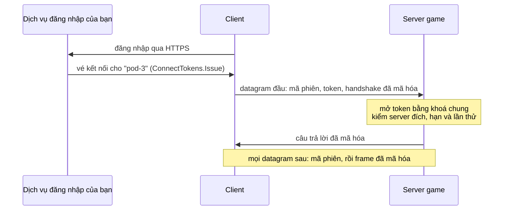

# UDP mã hóa

`EncryptedUdpNetworkTransport` gửi frame Fomoxa qua UDP và mã hóa mọi datagram bằng ChaCha20-Poly1305. Client chỉ kết nối được khi có vé kết nối (grant) do một dịch vụ của bạn cấp trước: một token ngắn hạn cùng các khoá phiên đi kèm. Dịch vụ đó thường là server đăng nhập hoặc matchmaker, hoặc server cũ trong lúc [chuyển server](../transfer.md).

Mã hóa tắt cho tới khi bạn bật. `NetworkManager` không có transport sẽ dùng [UDP](udp.md) thường, và không gì trong package tự chuyển sang mã hóa. Mỗi datagram tốn CPU để mã hóa và mở, khoảng 23 µs cho 1200 byte trên Mono của Unity, và `fomoxa-inspect` không đọc được dữ liệu đã mã hóa, nên hãy giữ UDP thường khi test cục bộ.



## Khoá chung <a href="#the-shared-key" id="the-shared-key"></a>

Dịch vụ cấp vé và mọi server nhận vé dùng chung một khoá 32 byte. Mỗi bên tạo một `ConnectTokens` với khoá đó:

```csharp
var tokens = new ConnectTokens(FomoxaRegistry.Default, key);
```

Giữ khoá trên máy của bạn, trong kho bí mật hoặc biến môi trường, không bao giờ đưa vào bản build của client. Ai có khoá đều cấp được vé mà server của bạn chấp nhận.

## Trên server <a href="#on-the-server" id="on-the-server"></a>

Thêm `EncryptedUdpNetworkTransport` vào GameObject của `NetworkManager` và gán nó vào field Transport. Trước `ServerManager.StartConnection`, đưa cho component `ConnectTokens` của nó và đặt Target là tên của server này:

```csharp
using System;
using Fomoxa.Networking;
using Fomoxa.Unity;
using UnityEngine;

public sealed class PodServer : MonoBehaviour
{
    [SerializeField] private NetworkManager manager;
    [SerializeField] private EncryptedUdpNetworkTransport transport;
    [SerializeField] private ushort port = 7777;

    private void Start()
    {
        byte[] key = Convert.FromBase64String(Environment.GetEnvironmentVariable("CONNECT_KEY"));
        transport.Tokens = new ConnectTokens(FomoxaRegistry.Default, key);
        transport.Target = Environment.GetEnvironmentVariable("POD_NAME");
        manager.ServerManager.StartConnection(port);
    }
}
```

| Thành viên | Mục đích |
|---|---|
| Target (Inspector), `string Target` | Tên của server này. Server chỉ nhận vé cấp cho tên này. |
| `ConnectTokens Tokens` | Mở token của client tới. Bắt buộc để lắng nghe; bản build client để null. |
| `FomoxaRegistry Registry` | Registry chứa các model hệ thống của package; null nghĩa là `FomoxaRegistry.Default` |

Component đọc `Tokens` và Target lúc server bắt đầu lắng nghe, nên bạn đặt chúng lúc nào cũng được, miễn là trước `StartConnection`. Không có `Tokens` thì `ServerManager.StartConnection` ném `InvalidOperationException`.

Tên server do bạn chọn. Khi mỗi tiến trình server có một tên riêng, vé cấp cho server này bị mọi server khác từ chối, dù tất cả dùng chung khoá.

## Cấp vé <a href="#issuing-grants" id="issuing-grants"></a>

Dịch vụ của bạn cấp vé cho server mà client cần vào:

```csharp
byte[] grant = tokens.Issue("pod-3", BitConverter.GetBytes(playerId));
```

`Issue(target, data)` trả vé dưới dạng một mảng byte. Vé chứa token và hai khoá phiên của client. Phần rõ của token có mã phiên, hạn và nonce; phần kín có `target`, `data` và các khoá phiên, được mã hóa và ký bằng khoá chung. Gửi vé cho client qua kênh đã mã hóa như HTTPS, vì ai đọc được vé đều kết nối được thay client đó cho tới khi vé hết hạn.

`data` tới [authenticator](../authentication.md) của server dưới tên `context.ConnectionData`. Hãy đặt vào đó những gì server cần biết về người chơi, như id tài khoản lấy từ lần đăng nhập.

`Issue(target, sessionId, data)` nhận mã phiên thay vì chọn ngẫu nhiên. Gateway UDP đứng trước nhiều server có thể định tuyến datagram theo mã phiên, nên dịch vụ biết client sẽ vào server nào có thể mã hóa server đó vào mã. Mã phiên 0 ném `ArgumentOutOfRangeException`.

| Thành viên | Mục đích |
|---|---|
| `ConnectTokens(FomoxaRegistry registry, byte[] key)` | Dùng kho lần thử trong bộ nhớ và đồng hồ hệ thống. Khoá được sao chép. |
| `ConnectTokens(FomoxaRegistry registry, byte[] key, IUsedTicketStore usedAttempts, Func<DateTime> utcNow)` | Dùng kho lần thử và đồng hồ của bạn; null ở tham số nào thì tham số đó lấy mặc định |
| `byte[] Issue(string target, ReadOnlyMemory<byte> data)` | Một vé mới với mã phiên ngẫu nhiên |
| `byte[] Issue(string target, ulong sessionId, ReadOnlyMemory<byte> data)` | Một vé mới với mã phiên của bạn |
| `TimeSpan Lifetime` | Thời gian một token mới còn hiệu lực; mặc định 30 giây |
| `IUsedTicketStore UsedAttempts` | Nơi server ghi nhớ các lần thử kết nối |
| `const int KeyLength` | 32, độ dài khoá tính bằng byte |
| `const byte Version` | 1, định dạng token mà package này ghi và nhận |

Registry, khoá hoặc target null ném `ArgumentNullException`, khoá không đúng 32 byte ném `ArgumentException`, và `Lifetime` bằng 0 hoặc nhỏ hơn ném `ArgumentOutOfRangeException`. Registry không có các model hệ thống của package ném `InvalidOperationException`; `FomoxaRegistry.Default` có chúng sau khi phần đăng ký sinh ra đã chạy, còn [server console](../../console-server/runtime.md) truyền registry nó đã điền bằng `FomoxaAdapters.RegisterAll`. Một `ConnectTokens` dùng được từ nhiều thread.

Hạn lấy theo đồng hồ của dịch vụ cấp token, còn server so với đồng hồ của chính nó, nên hãy giữ đồng hồ của chúng khớp nhau.

## Trên client <a href="#on-the-client" id="on-the-client"></a>

Client dùng cùng component, không có `Tokens`, và kết nối bằng vé:

```csharp
manager.ClientManager.StartConnection(address, port, grant);
```

`StartConnection(address, port)` ném `InvalidOperationException` trên transport mã hóa, vì server bỏ qua client không có vé. `StartConnection(address, port, connection)` ném `ArgumentException` khi transport không nhận vé, như UDP thường, hoặc khi các byte không phải là vé. Client chính của host kết nối qua [loopback](loopback.md) với overload nào cũng được và bỏ qua vé.

Client dùng lại vé cho mọi lần thử lại của cùng một `StartConnection`, và mỗi lần thử chọn khoá phiên mới, nên lần thử lại sau khi mất câu trả lời vẫn kết nối bình thường. Khi token đã hết hạn, server bỏ qua client, và các lần thử lại thất bại như khi server không tới được. Hãy lấy vé mới và gọi lại `StartConnection`.

## Trong authenticator <a href="#in-the-authenticator" id="in-the-authenticator"></a>

`ServerAuthenticationContext.ConnectionData` chứa `data` trong vé của client. Nó rỗng trên transport thường và với client chính của host.

```csharp
using System;
using System.Collections.Generic;
using Fomoxa.Networking;
using Fomoxa.Unity;

public sealed class PlayerIdAuthenticator : NetworkAuthenticator
{
    private readonly Dictionary<ulong, int> players = new Dictionary<ulong, int>();

    public int PlayerOf(ulong peerId) => players.TryGetValue(peerId, out int player) ? player : 0;

    public override void OnServerAuthenticating(ServerAuthenticationContext context)
    {
        if (context.ConnectionData.Length == sizeof(int))
        {
            players[context.PeerId] = BitConverter.ToInt32(context.ConnectionData.Span);
            context.Accept();
        }
        else
        {
            context.Reject();
        }
    }
}
```

Dữ liệu được niêm phong bằng khoá chung, nên client không đọc được và cũng không sửa được nó.

## Chuyển server <a href="#server-transfers" id="server-transfers"></a>

Để chuyển client sang một server mã hóa khác, cấp vé cho server đó và truyền nó vào `Transfer`:

```csharp
byte[] grant = tokens.Issue("pod-7", BitConverter.GetBytes(playerId));
manager.ServerManager.Transfer(peerId, "pod-7.example.com", 7777, ReadOnlyMemory<byte>.Empty, grant);
```

Client kết nối tới server mới bằng vé đó. Vé đi tới client bên trong session cũ, nên chỉ giữ được bí mật khi server cũ cũng mã hóa. Khi vé và transport của client không khớp, client dừng với `Transferred` và `WillRetry` false, không kết nối: client mã hóa nhận lệnh chuyển không có vé, hoặc client thường nhận lệnh chuyển có vé. Sau đó nó ghi một lỗi có địa chỉ. [Chuyển server](../transfer.md) mô tả phần còn lại của trình tự.

## Sau gateway <a href="#behind-a-gateway" id="behind-a-gateway"></a>

Trong một cụm Fomoxa, client có thể tới pod qua `fomoxa-gateway` thay vì kết nối thẳng. Gateway đọc id pod từ mã phiên của mỗi datagram và chuyển datagram tới pod đó, kèm một đầu 20 byte chứa địa chỉ IP và port của client. Pod gửi câu trả lời về gateway với cùng loại đầu đó, và gateway chuyển tiếp chúng tới client từ địa chỉ công khai của nó.

Bật Behind Gateway trên `EncryptedUdpNetworkTransport` của pod, hoặc đặt `BehindGateway` trong code trước `StartConnection`:

```csharp
transport.BehindGateway = true;
```

Console server truyền cờ này vào factory:

```csharp
new EncryptedUdpTransportFactory(registry, tokens, target, behindGateway: true)
```

| Thành viên | Mục đích |
|---|---|
| Behind Gateway (Inspector), `bool BehindGateway` | Server chỉ nhận datagram mang đầu của gateway, và trả lời qua gateway. Mặc định tắt. |
| `EncryptedUdpTransportFactory(FomoxaRegistry registry, ConnectTokens tokens, string target, bool behindGateway)` | Factory phía server với cùng cờ đó; constructor ba tham số để cờ tắt |

Khi bật cờ, server bỏ mọi datagram không có đầu hợp lệ, nên client gửi thẳng tới địa chỉ riêng của pod không mở được session. Client không đổi gì: nó kết nối tới địa chỉ của gateway bằng vé của mình và không bao giờ thấy đầu này.

Server gửi mỗi câu trả lời tới gateway đã mang datagram mở được gần nhất của session đó, và đầu ghi địa chỉ client lấy từ datagram ấy. Đầu giả mạo trên một datagram không mở được không đổi địa chỉ nào. Gateway không giữ trạng thái theo session, nên câu trả lời vẫn tới nơi khi load balancer đưa các datagram tiếp theo của client sang gateway khác.

Directory trao cho client địa chỉ của gateway khi cấu hình của nó ghi địa chỉ đó ở `public_address`; pod vẫn đăng ký địa chỉ riêng của mình, là địa chỉ gateway dùng để tới pod. README của `com.fomoxa.rpc` mô tả phía pod ở mục "Behind a gateway".

Đầu này chỉ đi giữa gateway và pod. Datagram giữa client và gateway giữ các kích thước trong bảng dưới.

Cùng pod đó cũng phục vụ client tới gateway qua WebSocket bằng [WebSocket mã hóa](encrypted-websocket.md). Đầu của các client này mang địa chỉ kết nối WebSocket và một dấu do gateway đặt, và `ServerManager.ArrivedOverWebSocket(peerId)` cho biết client nào tới bằng đường đó.

## Hành vi <a href="#behavior" id="behavior"></a>

| | |
|---|---|
| Frame budget | 1175 byte. Ngoài frame, một datagram mang 33 byte (mã phiên, loại, số thứ tự, tag), và giữ ở mức 1208 byte của một datagram UDP thường. |
| Datagram đầu | Client gửi token kèm các datagram của nó cho tới khi server trả lời, nên các datagram đó dài thêm độ dài token và 18 byte. |
| Mã phiên | Lấy từ vé và đi dạng rõ trong mọi datagram. Client giữ session khi địa chỉ đổi, nhưng chỉ datagram mở được mới chuyển session sang địa chỉ mới. |
| Phát lại | Mỗi bên bỏ datagram có số thứ tự đã thấy, hoặc cũ hơn số mới nhất từ 64 trở lên. Datagram đầu đã dùng rồi không mở được gì. |
| Cùng vé lần nữa | Lần thử mới với vé của một session đang chạy thay session đó trên server; session cũ dừng như khi kết nối của nó đóng. Datagram đầu của vé khác mang cùng mã phiên bị bỏ. |
| Datagram bị bỏ | Datagram không qua một phép kiểm nào bị bỏ, không trả lời, nên sai khoá, sai target hoặc token hết hạn trông như server không tới được từ phía client. |
| Giới hạn | 1024 session cho mỗi server; mỗi session giữ tối đa 64 frame package chưa đọc và bỏ frame cũ nhất khi đầy. |
| Địa chỉ | Tên host hoặc địa chỉ IP, và port, như UDP thường |

Server ghi nhớ mỗi lần thử trong `UsedAttempts` cho tới khi token của nó hết hạn. Kho mặc định giữ chúng trong bộ nhớ của một tiến trình, đủ khi mỗi tiến trình có Target riêng. Nhiều tiến trình dùng chung Target cần một kho chung; [chuyển server](../transfer.md#used-nonces) mô tả `IUsedTicketStore`.

## Giới hạn nền tảng <a href="#platform-limitations" id="platform-limitations"></a>

UDP mã hóa không có trong bản build WebGL. Tạo factory trong trình duyệt ném `EncryptedUdpNetworkTransport cannot run in a browser; assign a WebSocketNetworkTransport or a MultiNetworkTransport to the NetworkManager for WebGL builds`. Client WebGL vào pod mã hóa qua gateway bằng [WebSocket mã hóa](encrypted-websocket.md).

Với [`MultiNetworkTransport`](multi-transport.md), client kết nối qua mục đầu tiên, nên nó cần vé khi mục đó là transport mã hóa.

Mã hóa giữ bí mật frame và phát hiện mọi thay đổi trên frame. Mã phiên, kích thước và thời điểm của datagram vẫn nhìn thấy được, và datagram gửi ồ ạt vẫn tới được server.

Phần mã hóa chạy trên BouncyCastle vì `AesGcm` không chạy được trên Mono của Unity. Unity chuyển sang CoreCLR từ Unity 6.8, và phiên bản của package dành cho Unity chạy trên CoreCLR sẽ dùng `AesGcm` của .NET ([yêu cầu](../../getting-started/installation.md#requirements)).
