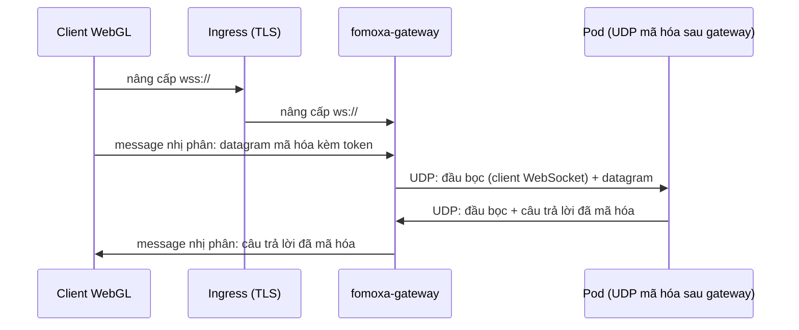

# WebSocket mã hóa

`EncryptedWebSocketNetworkTransport` cho client không gửi được UDP, như bản build WebGL, vào pod chạy [UDP mã hóa](encrypted-udp.md) sau `fomoxa-gateway`. Client gửi đúng các datagram mã hóa như client UDP mã hóa, mỗi datagram một message nhị phân WebSocket, tới gateway. Gateway chuyển chúng tới pod thành datagram UDP và gửi câu trả lời của pod về trên kết nối WebSocket.

Transport này chỉ có phía client. Pod không đổi gì: nó nghe bằng `EncryptedUdpNetworkTransport` ở chế độ sau gateway, và một pod phục vụ cùng lúc client UDP và client WebSocket. Client cần gateway ở giữa; nó không nối thẳng tới pod được.



## Trên client <a href="#on-the-client" id="on-the-client"></a>

Thêm `EncryptedWebSocketNetworkTransport` vào GameObject của `NetworkManager` và gán nó vào field Transport. Kết nối bằng URL WebSocket của gateway và một vé:

```csharp
manager.ClientManager.StartConnection(ticket.WebSocketUrl, 0, ticket.Connection);
```

Directory trao URL đó khi cấu hình của nó có `public_websocket`: `Allocate` và `Relocate` trả nó ở `WebSocketUrl`, cạnh `Address` và `Port` của UDP. [Backend của game](../../deploy/backend.md) đưa cả hai cho client, và client dùng địa chỉ hợp với transport của mình.

Địa chỉ theo luật của [transport WebSocket](websocket.md): URL `ws://` hoặc `wss://` với port 0, hoặc host và port cùng field Path. Bản build WebGL phục vụ qua HTTPS chỉ mở được URL `wss://`.

| Field | Mặc định | Ý nghĩa |
|---|---|---|
| Path | `/` | Đường dẫn client yêu cầu khi kết nối bằng host và port |
| Max Handshake Bytes | 8192 | Kích thước lớn nhất của câu trả lời nâng cấp HTTP mà client desktop đọc |
| Handshake Timeout Seconds | 5 | Thời gian cho phép để nâng cấp; ở client desktop với URL `wss://`, thời gian này gồm cả bắt tay TLS |
| Max Buffered Bytes | 1048576 | Trong trình duyệt, lượng dữ liệu chưa gửi mà vượt quá thì transport ngừng gửi cho tới khi trình duyệt gửi kịp |

| Thành viên | Mục đích |
|---|---|
| `TlsSettings Tls` | Kiểm chứng chỉ cho URL `wss://` ở client desktop, như [TLS phía client](tls.md) |
| `FomoxaRegistry Registry` | Registry chứa các model hệ thống của package; null nghĩa là `FomoxaRegistry.Default` |

Client console dùng thẳng factory:

```csharp
var factory = new EncryptedWebSocketTransportFactory(registry, new WebSocketSettings());
```

| Thành viên | Mục đích |
|---|---|
| `EncryptedWebSocketTransportFactory(FomoxaRegistry registry, WebSocketSettings settings = null)` | Factory phía client trên client WebSocket của package; settings null dùng giá trị mặc định |
| `int FrameBudget` | 1175 byte, như UDP mã hóa |
| `CreateListener` | Ném `InvalidOperationException`; pod nghe bằng UDP mã hóa |
| `CreateConnector(address, port)` | Ném `InvalidOperationException`; client cần vé |
| `CreateConnector(address, port, connection)` | Ném `ArgumentException` khi các byte không phải vé của `ConnectTokens.Issue` |

Vé, thử lại, hết hạn và `ConnectionData` của authenticator chạy như ở [UDP mã hóa](encrypted-udp.md#on-the-client).

## Trên pod <a href="#on-the-pod" id="on-the-pod"></a>

Pod chạy `EncryptedUdpNetworkTransport` với Behind Gateway bật, như mục [Sau gateway](encrypted-udp.md#behind-a-gateway). Gateway đánh dấu datagram của client WebSocket, và server cho biết mỗi client tới bằng đường nào:

```csharp
bool overWebSocket = manager.ServerManager.ArrivedOverWebSocket(peerId);
```

| Thành viên | Mục đích |
|---|---|
| `bool ArrivedOverWebSocket(ulong peerId)` | True khi datagram mở được gần nhất của peer này đi qua phía WebSocket của gateway. False với client UDP, với peer không có, và ở server không chạy sau gateway. |

Dùng nó khi chuyển người chơi sang pod khác. `Relocate` trả cả hai địa chỉ, và client kết nối bằng transport nó đang có, nên đưa URL cho client WebSocket:

```csharp
AllocateResponse moved = await pod.Relocate(roomKey, 1, data);
byte[] grant = moved.Connections[0];
if (manager.ServerManager.ArrivedOverWebSocket(peerId))
{
    manager.ServerManager.Transfer(peerId, moved.WebSocketUrl, 0, ReadOnlyMemory<byte>.Empty, grant);
}
else
{
    manager.ServerManager.Transfer(peerId, moved.Address, moved.Port, ReadOnlyMemory<byte>.Empty, grant);
}
```

## Hành vi <a href="#behavior" id="behavior"></a>

| | |
|---|---|
| Trên dây | Mỗi message nhị phân chứa một datagram mã hóa, giống từng byte với UDP mã hóa |
| Frame budget | 1175 byte |
| Thứ tự | Message đi trên TCP, nên một gói mất làm chậm các gói sau nó, như mọi transport WebSocket |
| Gateway | Bỏ message không qua phép kiểm datagram; đóng kết nối khi nhận message text, message dài hơn 65507 byte hoặc khung sai |
| Câu trả lời của pod | Về trên kết nối WebSocket mà datagram mở được gần nhất của client đi qua |
| Nền tảng | WebGL qua `WebSocket` của trình duyệt; client desktop hoặc console qua client WebSocket của package |
