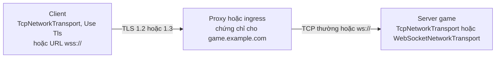

# TLS phía client

Client desktop, mobile hoặc console có thể mở kết nối TLS qua [TCP](tcp.md) hoặc [WebSocket](websocket.md) (`wss://`). TLS chỉ chạy ở client. Server game vẫn chạy kết nối thường, còn một reverse proxy hoặc một ingress của Kubernetes đặt phía trước server kết thúc TLS bằng chứng chỉ của bạn, rồi chuyển tiếp kết nối thường tới port của server. Trong WebGL, trình duyệt lo `wss://` nên trang này không áp dụng.



Package làm TLS bằng BouncyCastle, thư viện đi kèm package, và kiểm chứng chỉ bằng bộ chứng chỉ gốc riêng của nó. Kho chứng chỉ của hệ điều hành không được dùng. Bước bắt tay chạy trên luồng của client mà không chặn, như phần còn lại của kết nối.

## Bật TLS <a href="#turning-it-on" id="turning-it-on"></a>

Với TCP, TLS tắt cho tới khi bạn bật. Đánh dấu Use Tls trên `TcpNetworkTransport` của client, hoặc đặt `UseTls` từ code, rồi kết nối bằng đúng host name mà chứng chỉ cấp cho:

```csharp
manager.ClientManager.StartConnection("game.example.com", 443);
```

`TcpNetworkTransport` của server bỏ qua thiết lập này, vì server không làm TLS.

Client WebSocket dùng TLS khi kết nối bằng URL `wss://`, và dùng WebSocket thường với host name hoặc URL `ws://`. URL `wss://` không ghi port thì dùng port 443:

```csharp
manager.ClientManager.StartConnection("wss://game.example.com/play", 0);
```

Component đọc thiết lập TLS lúc client kết nối, nên bạn đổi được chúng bất cứ lúc nào trước `StartConnection`.

## Client kiểm chứng chỉ thế nào <a href="#how-the-client-checks-the-certificate" id="how-the-client-checks-the-certificate"></a>

Client nhận chứng chỉ của server khi mọi điều sau đều đúng:

- Chuỗi chứng chỉ server gửi dẫn tới một chứng chỉ gốc trong bộ gốc của package. Bộ gốc là danh sách gốc tin cậy của Mozilla, cũng là danh sách Firefox dùng, tính tới ngày ghi trong `TlsRoots.MozillaDate`, và được cập nhật theo mỗi bản phát hành của package.
- Mọi chứng chỉ trong chuỗi còn trong thời hạn hiệu lực.
- Nếu chứng chỉ của server ghi các mục đích dùng thì xác thực server là một trong số đó.
- Host name bạn kết nối tới có trong subject alternative name của chứng chỉ. Tên được so không phân biệt hoa thường, và ký tự đại diện như `*.example.com` thay cho đúng một nhãn: nó khớp `eu.example.com` nhưng không khớp `example.com` hay `a.eu.example.com`. Khi kết nối tới một địa chỉ IP, địa chỉ đó phải là một mục IP của chứng chỉ. Common name của chứng chỉ không bao giờ được dùng.

Client không kiểm chứng chỉ đã bị thu hồi hay chưa. Nó đề nghị TLS 1.3 và TLS 1.2, và gửi host name trong bước bắt tay (SNI), trừ khi bạn kết nối tới một địa chỉ IP. Client không gửi chứng chỉ của nó.

## Bộ gốc hoặc hàm kiểm của riêng bạn <a href="#your-own-roots-or-your-own-check" id="your-own-roots-or-your-own-check"></a>

Chứng chỉ của một CA công khai như Let's Encrypt dùng được ngay, không cần cấu hình. Với CA riêng, ví dụ trên cụm staging, hãy thêm chứng chỉ gốc của nó vào bộ của Mozilla:

```csharp
using Fomoxa.Networking.Transports;
using Fomoxa.Unity;
using UnityEngine;

public sealed class StagingRoots : MonoBehaviour
{
    [SerializeField] private TcpNetworkTransport transport;
    [SerializeField] private TextAsset stagingRoot;

    private void Awake()
    {
        TlsRoots roots = TlsRoots.Mozilla.With(TlsRoots.FromPem(stagingRoot.text));
        transport.Tls.CertificateCheck = new TlsCertificateCheck(roots);
    }
}
```

Chỉ dùng `TlsRoots.FromPem(pem)` thì bộ gốc được thay hoàn toàn, nên client chỉ tin các gốc bạn đưa. `FromPem` đọc mọi khối `BEGIN CERTIFICATE` trong văn bản và ném `ArgumentException` khi không có khối nào hoặc một khối không đọc được.

Để tự quyết định trong code của bạn, đặt `CertificateCheck` thành một `ITlsCertificateCheck` của bạn:

```csharp
bool Accepts(string host, IReadOnlyList<byte[]> chain, out string rejection);
```

`host` là địa chỉ bạn đã kết nối tới, `chain` chứa các chứng chỉ server gửi ở dạng DER, chứng chỉ của server đứng đầu. Trả về false kèm một lý do ngắn để từ chối server. Hàm kiểm của bạn thay hẳn hàm kiểm của package, nên khi muốn giữ các bước kiểm chuẩn và thêm bước của mình, hãy gọi một `TlsCertificateCheck` bên trong nó. Hàm kiểm ném exception cũng làm server bị từ chối.

| Thành viên | Công dụng |
|---|---|
| `TcpNetworkTransport.UseTls`, Use Tls (Inspector) | Bật TLS cho client |
| `TcpNetworkTransport.Tls`, `WebSocketNetworkTransport.Tls` | `TlsSettings` của component |
| `TlsSettings.CertificateCheck` | Hàm kiểm client chạy trên chứng chỉ của server; mặc định là một `TlsCertificateCheck` với `TlsRoots.Mozilla` |
| `TlsSettings.HandshakeTimeout` | Thời gian cho phép của bước bắt tay TLS qua TCP; mặc định 5 giây |
| `TlsRoots.Mozilla`, `TlsRoots.MozillaDate` | Bộ gốc đi kèm package và ngày của dữ liệu Mozilla trong đó |
| `TlsRoots.FromPem(pem)`, `roots.With(other)`, `roots.Count` | Bộ gốc đọc từ văn bản PEM; hai bộ gộp lại |

Ở tầng 1, `new TcpTransportFactory(tlsSettings)` cho một factory TCP có TLS, và `WebSocketSettings.Tls` giữ thiết lập cho URL `wss://`.

## Khi TLS thất bại <a href="#when-tls-fails" id="when-tls-fails"></a>

Client từ chối chứng chỉ của server, hoặc server kết thúc bước bắt tay bằng một cảnh báo TLS (alert), thì client dừng với `StopReason.TlsRejected`. Client không thử lại, vì lần sau vẫn gặp đúng chứng chỉ đó, và nó log lý do ở mức lỗi:

```text
Fomoxa stopped the client: the TLS server game.example.com was rejected: the server certificate is not for game.example.com
Fomoxa stopped the client: the TLS server game.example.com ended the handshake with alert handshake_failure(40)
```

Các lỗi khác dừng client với `TransportError` và nó thử lại như thường: kết nối bị từ chối, kết nối bị đóng giữa bước bắt tay, câu trả lời không phải TLS, và bước bắt tay không xong kịp thời hạn. Qua TCP, thời hạn là `TlsSettings.HandshakeTimeout`. Qua `wss://`, Handshake Timeout Seconds của component WebSocket tính cho cả bước bắt tay TLS lẫn HTTP upgrade.

Sau bước bắt tay, lỗi TLS và việc server đóng kết nối kết thúc session như mọi lỗi hay lần đóng khác của transport, và client thử lại.

## Giới hạn <a href="#limits" id="limits"></a>

- Server không làm TLS. Hãy đặt phía trước nó một proxy hoặc ingress kết thúc TLS, như [triển khai](../../deploy/deployment.md) mô tả.
- Client không nối lại session TLS cũ, nên mỗi kết nối chạy đủ bước bắt tay.
- UDP được mã hóa bằng [UDP mã hóa](encrypted-udp.md), không bằng TLS.
- Package tự kiểm chứng chỉ vì `X509Chain` không có kho chứng chỉ gốc trên Mono của Unity. Unity chuyển sang CoreCLR từ Unity 6.8, và phiên bản của package dành cho Unity chạy trên CoreCLR sẽ kiểm chứng chỉ bằng `X509Chain` của .NET ([yêu cầu](../../getting-started/installation.md#requirements)).
