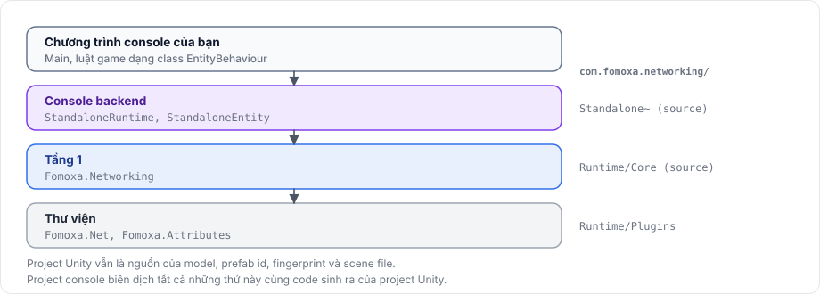

# Server console

Server console là một chương trình .NET chạy server của game mà không cần Unity Engine. Client Unity kết nối tới nó như kết nối tới một server Unity: cùng transport, cùng handshake và cùng message. Máy chủ chỉ cần .NET runtime, và tiến trình server không mang theo gì của player Unity.

Logic game phải viết hai lần cho nó, một lần thành component `NetworkBehaviour` cho Unity và một lần thành class `EntityBehaviour` cho console, hoặc chuyển vào một thư viện không tham chiếu Unity mà cả hai cùng gọi. Hãy đọc phần này nếu cái giá đó đáng với game của bạn. Nếu không, hãy chạy server như một player Unity, như mô tả trong [dedicated server](../deploy/dedicated-server.md).

## Nó gồm những gì 

<figure><figcaption>
Console server được dựng từ source của package và code sinh ra của project Unity.
</figcaption></figure>

Package đóng gói backend console dưới dạng mã nguồn trong `Standalone~`, một thư mục Unity không import. Project console biên dịch nó cùng mã nguồn của tầng 1, code sinh ra của project Unity và code riêng của project. Project Unity vẫn là nguồn của model, prefab id và fingerprint, và scene file.

| Trong Unity | Trong server console |
|---|---|
| `NetworkManager` | `NetworkRuntime`, do `StandaloneRuntime.Create` tạo và vòng lặp của bạn điều khiển |
| `NetworkObject` trên prefab | `StandaloneEntity` hoặc class con, do một factory đăng ký theo prefab id tạo ra |
| `NetworkBehaviour` | `EntityBehaviour`, với cùng callback và cùng phần đăng ký |
| `NetworkTransform` | `EntityBehaviour.SyncTransform` với một `TransformSync` |
| Network scene và scene object | Scene file đọc từ một thư mục; scene object được dựng từ file |
| `RigidbodyPhysics` | Không có physics của Unity. Physics đến từ một `IPhysicsScenes`, như `RapierScenes` của [Rapier](../rapier/overview.md) |

Backend còn có phía client, nên một chương trình console có thể kết nối tới server như một client, ví dụ để chạy bot hoặc test.

## Yêu cầu 

- .NET 8 SDK trở lên, trên nền tảng mà Fomoxa.Net chạy được. Với backend Rapier là Windows x64 hoặc Linux x64.
- Một project Unity đã sinh code và xuất [scene file](../advanced/editor-integration.md#scene-files), với `com.fomoxa.networking` cài từ Git hoặc clone về, để project console có mã nguồn của nó.
- C# 9. Tầng 1 và backend console được viết cho phiên bản C# mà Unity biên dịch, nên project console đặt `LangVersion` là 9.0.

## Giới hạn 

- Các luật game mà server chạy phải có dưới dạng class `EntityBehaviour`. Package không chạy được `NetworkBehaviour` khi không có Unity.
- Entity của server phải khớp prefab của client: cùng prefab id, cùng fingerprint, và behaviour theo cùng thứ tự với cùng model, như mô tả trong [runtime](runtime.md#prefabs).
- Console không có `NetworkAnimator` và không có host mode. Backend console không vẽ gì và không ẩn gì.
- Không có physics backend thì entity không có body, và prediction physics không áp dụng.

Tiếp tục với [project](project.md).
