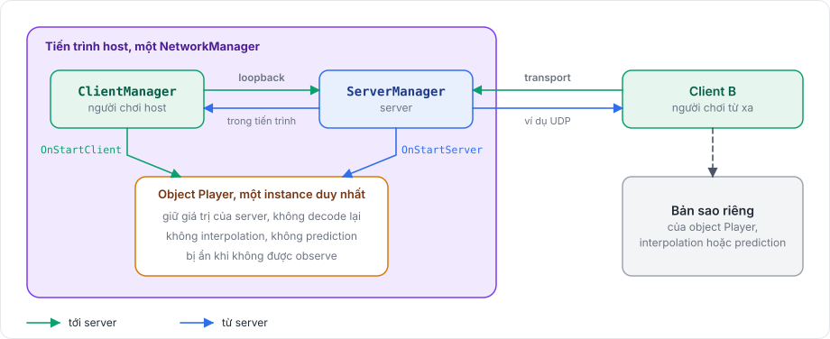

# Tài liệu

Tài liệu này nằm trong repository riêng, tách khỏi package, nên nó không thuộc phần người dùng cài đặt và Unity không bao giờ import nó. GitBook xuất bản nó qua Git Sync. `gitbook-docs.yaml` mô tả site và hai space của nó, tiếng Anh và tiếng Việt, còn `.gitbook.yaml` chỉ ra `README.md`, `SUMMARY.md` và liệt kê các redirect cho những trang đã dời chỗ; cả hai file nằm ở thư mục gốc của tài liệu.

## Cấu trúc <a href="#structure" id="structure"></a>

| Phần | Mục đích |
|---|---|
| Bắt đầu | Người dùng mới cài package và dựng một game nhỏ qua tutorial ba phần |
| Kiến thức nền | Package hoạt động thế nào: các tầng, server và client, tick, authority, replication, prediction, vòng đời |
| Kết nối, Network object, Messaging, Đồng bộ, Prediction, Physics | Mỗi tính năng một hướng dẫn, kèm code chạy được |
| Triển khai | Dedicated server, port, proxy và WebGL |
| Nâng cao | Tích hợp Editor, custom codec, hiệu năng, gỡ lỗi |
| Rapier physics, Server console | Backend Rapier tùy chọn và server chạy không cần Unity |
| Ví dụ | Các game có sẵn được port bằng package, từng bước, với code và commit thật. Giải thích chung nằm ở các hướng dẫn tính năng và được liên kết từ đây |
| Tham chiếu | Mô tả ngắn, chính xác về API public, để tra cứu |
| Đóng góp | Làm việc với package và với các trang này |

`SUMMARY.md` là mục lục, và mọi trang phải có trong đó. Khi một trang dời chỗ, hãy thêm đường dẫn cũ vào `redirects` trong `.gitbook.yaml` và trong `vi/.gitbook.yaml`, để link cũ vẫn hoạt động.

## Quy tắc <a href="#rules" id="rules"></a>

- Viết các trang tiếng Anh bằng văn kỹ thuật đơn giản. Heading viết hoa kiểu câu.
- Mô tả code hiện tại. Tính năng chưa có được ghi rõ là chưa có, không mô tả như thể nó đã chạy.
- Đối chiếu mọi type, member và message với source trước khi viết.
- Ví dụ code biên dịch được với API hiện tại và dùng tên adapter được sinh, như `ShotNetAdapter.Instance`.
- Dùng cùng một tên cho cùng một thứ ở mọi nơi: `NetworkObject`, `NetworkBehaviour`, `NetworkManager`, prediction, reconciliation, rollback, replay.
- Viết nhãn trên giao diện Unity đúng như hiển thị, in đậm, khi người đọc cần tìm chúng: **Tools > Fomoxa > Generate**, **Collected Prefabs**. Trong bảng field, chỉ cần tên field.
- Liên kết các trang liên quan bằng link tương đối, và giữ link tới heading còn hoạt động khi đổi tên heading.
- Chỉ dùng hint của GitBook (``) cho cảnh báo người đọc không được bỏ qua.

## Hình minh họa <a href="#figures" id="figures"></a>

Một trang giải thích luồng, dòng thời gian hay cấu trúc bằng hình, không bằng hình vẽ ASCII trong code block.

Luồng ngắn, state machine và trình tự message là các khối Mermaid, GitBook sẽ render chúng. Không dùng `;` và `#` trong nhãn Mermaid, và dùng `<br/>` để xuống dòng.

Sơ đồ lớn hơn là file SVG do các script trong `diagrams/` sinh ra. Mỗi sơ đồ là một hàm trong một module `d_*.py`, đánh dấu bằng `@diagram('<name>')`, và trả về bản tiếng Anh hoặc tiếng Việt qua `pick(language, english, vietnamese)`. `svg.py` chứa các hàm vẽ cơ bản và bảng màu: xanh dương cho server, xanh lá cho client, tím cho host, vàng hổ phách cho điều người đọc cần chú ý, đỏ cho lỗi.

```
python3 diagrams/build.py                       write every diagram, in both languages
python3 diagrams/build.py --only host-mode      write the diagrams whose names match
python3 diagrams/build.py --preview <folder>    also render PNG previews with Microsoft Edge
python3 diagrams/build.py --check               fail when a written SVG is out of date
```

Script ghi `.gitbook/assets/diagrams/<name>.svg` và `vi/.gitbook/assets/diagrams/<name>.svg`. Không bao giờ sửa tay các file này. Nhúng sơ đồ bằng một figure, với text `alt` nói hết những gì sơ đồ thể hiện và một chú thích ngắn:

```html
<figure><figcaption><p>...</p></figcaption></figure>
```

## Ảnh chụp màn hình <a href="#screenshots" id="screenshots"></a>

Ảnh chụp nằm trong `.gitbook/assets/screenshots/`, với cùng file trong `vi/.gitbook/assets/screenshots/`. Ảnh Inspector rộng 460 pixel và chỉ một component với các giá trị mà trang nói tới. Chúng được chụp bằng script từ một project Unity nhỏ trong repository phát triển của package, project này cũng chạy tutorial trong Play Mode để kiểm tra nó hoạt động, nên có thể chụp lại mỗi khi một component thay đổi. Mỗi ảnh có text `alt` liệt kê các giá trị nó thể hiện và `width="460"` trong thẻ `img`.

## Bản dịch tiếng Việt <a href="#vietnamese-translation" id="vietnamese-translation"></a>

Các trang tiếng Việt nằm trong `vi/`, có `README.md` và `SUMMARY.md` riêng, và phản chiếu các trang tiếng Anh từng file một. GitBook xuất bản chúng thành space thứ hai với ngôn ngữ `vi`, nên người đọc đổi ngôn ngữ bằng bộ chọn ngôn ngữ.

Trang tiếng Anh là nguồn. Khi đổi một trang tiếng Anh, hãy đổi trang tiếng Việt cùng đường dẫn trong cùng commit. Trang tiếng Việt giữ nguyên các code block của trang tiếng Anh và có cùng heading theo cùng thứ tự. Khối Mermaid là ngoại lệ: nhãn của chúng được dịch. Mỗi heading đã dịch kết thúc bằng một thẻ anchor mang anchor tiếng Anh, như `## Teleport <a href="#teleporting" id="teleporting"></a>`, để link tới heading hoạt động ở cả hai ngôn ngữ. Thuật ngữ kỹ thuật như model, codec, tick, peer và owner giữ nguyên tiếng Anh trong văn bản tiếng Việt.

GitBook chỉ phục vụ file nằm trong một space, nên trang tiếng Việt không bao giờ link tới ảnh nằm ngoài `vi/`. Mỗi ảnh mà trang tiếng Việt dùng có bản riêng dưới `vi/.gitbook/assets/`, ở cùng đường dẫn tương đối như trang tiếng Anh dùng.

## Kiểm tra các trang <a href="#checking-the-pages" id="checking-the-pages"></a>

```
python3 tools/check_docs.py
```

Checker đọc mọi trang của cả hai space và báo:

- link tới trang hay heading không tồn tại, và link đi ra ngoài space của nó
- trang mà `SUMMARY.md` không liệt kê
- trang tiếng Việt có heading, anchor, code block hay ảnh khác với trang tiếng Anh
- sơ đồ có file SVG đã cũ

Chạy nó trước mỗi commit; nó phải báo `0 problems`.

## Câu hỏi còn mở <a href="#open-questions" id="open-questions"></a>

`DOCUMENTATION-TODO.md` ở thư mục gốc của tài liệu liệt kê những gì tài liệu chưa xác định được từ code. Nó không thuộc mục lục được xuất bản.
