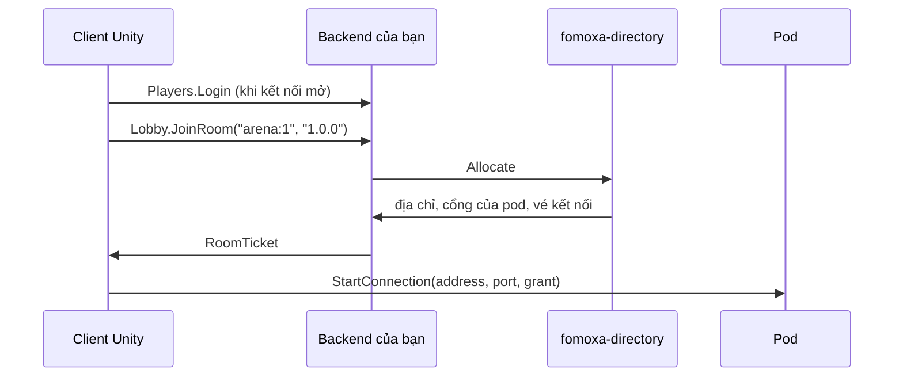

# Backend của game

Khi server game chạy thành các pod phía sau directory của Fomoxa, client không tự chọn pod được. Client cần vé kết nối (grant) cho pod đang giữ phòng của mình, và chỉ directory biết đó là pod nào. Backend của bạn đứng giữa hai bên: đăng nhập người chơi, hỏi directory xin phòng, rồi trả vé kết nối. Pod cũng gọi backend khi game chuyển một người chơi sang phòng khác.

Bạn tự viết backend, bắt đầu từ template `fomoxa-backend`. Template cho bạn một dịch vụ .NET chạy được, gồm phần đăng nhập để trống, lời gọi tới directory, health check và Dockerfile. Trang này đi từ một thư mục trống tới một client Unity vào được phòng qua backend.

> **Kết quả:** client Unity đăng nhập vào backend của bạn, nhận vé kết nối cho một phòng, rồi kết nối tới pod đang giữ phòng đó.

## Cần có trước

- .NET 8 SDK trên máy build backend.
- Một `fomoxa-directory` đang chạy, địa chỉ của nó, và khoá của vai `backend` trên directory.
- Các pod đăng ký với directory qua `DirectoryPod` và nghe bằng [UDP mã hóa](../connections/transports/encrypted-udp.md). README của `com.fomoxa.rpc` mô tả phía pod ở mục "Running as a pod".
- Một project Unity có `com.fomoxa.networking` và `com.fomoxa.rpc`.

## Bạn sẽ dựng gì



Backend có hai loại cổng. Người chơi tới các cổng công khai, một cổng TCP và một cổng WebSocket, và đăng nhập bằng `Players.Login`. Pod tới cổng nội bộ và đăng nhập bằng `Pods.Login`, mang khoá của pod. `TransferPlayer` chỉ có ở cổng nội bộ, nên người chơi đã đăng nhập không xin được vé tới phòng của người khác.

## 1. Tạo backend

Chạy các lệnh sau trong terminal, ở thư mục bạn muốn đặt backend:

```
dotnet new install Fomoxa.Backend.Templates
dotnet new fomoxa-backend -n MyGame.Backend
cd MyGame.Backend
dotnet build
```

`MyGame.Backend` là tên bạn chọn; template dùng nó cho thư mục, project và namespace. Thư mục mới có:

| Đường dẫn | Nội dung |
|---|---|
| `MyGame.Backend/` | Backend: `Program.cs`, các service, cấu hình |
| `MyGame.Backend/Models/` | Model của các lời gọi giữa client và backend |
| `MyGame.Backend/Generated/` | Codec do `fomoxac` sinh; hãy commit |
| `fomoxa-rpc/` | fRPC cho C# và model của directory, dạng mã nguồn |
| `tools/fomoxac/` | `fomoxac` cho Linux x64 và Windows x64 |
| `Dockerfile` | Image có backend và health check của nó |

**Kiểm tra:** build thành công. Build chạy `fomoxac generate` trước, và `Generated/` giữ nguyên cho tới khi bạn đổi một model. Trên macOS không có `fomoxac` đi kèm, nên build in một thông báo và dùng thư mục `Generated/` đã commit.

## 2. Trỏ backend tới directory

Mở `MyGame.Backend/appsettings.json`:

```json
{
  "Fomoxa": {
    "Directory": {
      "Address": "127.0.0.1:9500",
      "Key": { "File": "/run/secrets/fomoxa/backend" }
    },
    "Players": {
      "Tcp": "0.0.0.0:9600",
      "WebSocket": "0.0.0.0:9601"
    },
    "Pods": {
      "Tcp": "0.0.0.0:9602",
      "Key": { "File": "/run/secrets/fomoxa/pod" }
    }
  }
}
```

Đặt `Directory:Address` là `host:port` của directory. Tệp không bao giờ chứa khoá. Mỗi khoá khai một tệp (`"File"`) hoặc một biến môi trường (`"Env"`), đúng một trong hai. Backend bỏ một dấu xuống dòng ở cuối và từ chối khoá ngắn hơn 16 byte. `Directory:Key` là khoá `backend` của directory. `Pods:Key` là khoá mà pod của bạn sẽ trình ở cổng nội bộ.

Biến môi trường ghi đè tệp, với `__` giữa các phần của tên. Khi chạy cục bộ với khoá trong biến:

```
export Fomoxa__Directory__Address=127.0.0.1:9500
export Fomoxa__Directory__Key__File=
export Fomoxa__Directory__Key__Env=BACKEND_KEY
export BACKEND_KEY=<THE_DIRECTORY_BACKEND_KEY>
export Fomoxa__Pods__Key__File=
export Fomoxa__Pods__Key__Env=POD_KEY
export POD_KEY=<A_KEY_OF_16_BYTES_OR_MORE>
dotnet run --project MyGame.Backend
```

Phải xoá `__File`: khoá khai cả `File` lẫn `Env` bị từ chối. Địa chỉ rỗng tắt cổng đó, và khoá pod chỉ được đọc khi cổng nội bộ bật.

**Kiểm tra:** backend in một dòng ra stderr rồi tiếp tục chạy:

```
backend: players on tcp 0.0.0.0:9600, websocket 0.0.0.0:9601; pods on tcp 0.0.0.0:9602; directory at 127.0.0.1:9500
```

Cấu hình sai thì backend in lý do, ví dụ `backend: Directory:Key: the environment variable BACKEND_KEY is not set`, và process thoát với mã 1. Backend nối tới directory ở lời gọi `JoinRoom` đầu tiên, không phải lúc khởi động, nên địa chỉ hoặc khoá directory sai hiện ra thành lỗi của lời gọi đó.

## 3. Viết phần đăng nhập

`MyGame.Backend/Players.cs` chứa phần đăng nhập. Template nhận mọi tên người chơi khác rỗng và không kiểm gì khác:

```csharp
public (Identity Identity, PlayerWelcome Response) Authenticate(CallContext context, PlayerLogin request)
{
    if (string.IsNullOrEmpty(request.Player))
    {
        throw new RpcException(Status.Unauthenticated("a player name is required"));
    }

    return (new Identity(request.Player, new[] { Roles.Player }), new PlayerWelcome { Player = request.Player });
}
```

> **Cảnh báo:** với phần đăng nhập này, ai cũng chơi được dưới bất kỳ tên nào. Thay thân hàm bằng phép kiểm của game trước khi backend đón người chơi, và giữ `Roles.Player` trong danh tính, vì `JoinRoom` đòi quyền đó.

`PlayerLogin` có field `Secret` kiểu `bytes` cho những gì phép kiểm của bạn cần, và bạn đổi được model này. Giá trị đầu của danh tính là tên mà `JoinRoom` gửi cho directory. Tên đó tới [authenticator](../connections/authentication.md) của pod trong `context.ConnectionData`, dạng byte UTF-8.

## 4. Dùng chung model với project Unity

Client và backend phải khai cùng các model. Chép các tệp sau vào project Unity:

| Từ backend | Vào project Unity |
|---|---|
| `MyGame.Backend/Models/*.cs` | Models Folder của Fomoxa settings asset |
| `MyGame.Backend/Services.cs` | Assembly của Generated Folder, assembly này phải tham chiếu `Fomoxa.Rpc` |

Unity chạy `fomoxac` và source generator của fRPC; generator sinh `PlayersClient`, `LobbyClient`, `PodsClient`, `PodGateClient` cùng các lớp `Methods` của chúng từ `Services.cs`. Mỗi lần đổi model ở một bên, hãy chép sang bên kia. Nếu hai bên lệch nhau, handshake của fRPC so các model cả hai bên cùng biết và từ chối kết nối.

**Kiểm tra:** Unity biên dịch không lỗi, và `LobbyClient` dùng được trong script của bạn.

## 5. Xin phòng từ client

Client nói chuyện với backend qua một component transport khác với transport của `NetworkManager`. Thêm một `TcpNetworkTransport` thứ hai vào một GameObject khác cho bản build native, hoặc một `WebSocketNetworkTransport` cho WebGL, và không gán nó cho `NetworkManager`. Cấu hình của nó, như Use Tls, áp cho kết nối tới backend.

Thêm component sau vào một GameObject rồi gán các component transport và `NetworkManager` trong Inspector. `NetworkManager` dùng `EncryptedUdpNetworkTransport`, như với mọi pod.

```csharp
using System;
using System.Threading.Tasks;
using Fomoxa.Net;
using Fomoxa.Net.Transports;
using Fomoxa.Networking.Transports;
using Fomoxa.Rpc;
using Fomoxa.Rpc.Net;
using Fomoxa.Unity;
using MyGame.Backend;
using MyGame.Backend.Models;
using UnityEngine;

public sealed class RoomJoiner : MonoBehaviour
{
    [SerializeField] private NetworkManager manager;
    [SerializeField] private NetworkTransport backendTransport;
    [SerializeField] private string backendAddress = "backend.example.com";
    [SerializeField] private ushort backendPort = 9600;

    private ITransportConnector connector;
    private TaskCompletionSource<ITransport> connecting;
    private RpcConnection connection;

    public async Task Join(string player, string roomKey)
    {
        connecting = new TaskCompletionSource<ITransport>();
        connector = backendTransport.CreateFactory().CreateConnector(backendAddress, backendPort);
        ITransport transport = await connecting.Task;

        var options = new ConnectOptions
        {
            Credential = Credential.Of(PlayersMethods.Login, new PlayerLogin { Player = player }),
        };
        connection = RpcConnection.Driven(transport, NetSchema.Build(), LobbyClient.Declare(PlayersClient.Registry()).Build(), options);
        await connection.Opened;

        try
        {
            RoomTicket ticket = await new LobbyClient(connection).JoinRoomAsync(new JoinRoomRequest
            {
                RoomKey = roomKey,
                Version = Application.version,
            });
            manager.ClientManager.StartConnection(ticket.Address, ticket.Port, ticket.Connection);
        }
        catch (RpcException failed) when (failed.Status.Details is NoRoomForVersion missing)
        {
            Debug.LogWarning($"No server runs version {missing.Version}; update the game.");
        }
    }

    private void Update()
    {
        if (connector != null)
        {
            ConnectStatus status = connector.Poll(out ITransport transport);
            if (status == ConnectStatus.Connected)
            {
                connector.Dispose();
                connector = null;
                connecting.SetResult(transport);
            }
            else if (status != ConnectStatus.Pending)
            {
                connector.Dispose();
                connector = null;
                connecting.SetException(new InvalidOperationException($"cannot reach the backend: {status}"));
            }
        }

        connection?.Tick(MonotonicClock.Now);
    }

    private void OnDestroy()
    {
        connector?.Dispose();
        connection?.Dispose();
    }
}
```

`NetSchema` là lớp mà `fomoxac` sinh vào Generated Folder của bạn. Kết nối chạy trên main thread: `Update` poll connector và tick kết nối, và mọi `await` ở trên chạy tiếp bên trong lần tick đó. Kết nối đăng nhập một lần, khi mở, nên các lời gọi sau trên nó không cần credential. Đăng nhập bị từ chối làm `connection.Opened` lỗi với `ConnectException` có `Status` là `UNAUTHENTICATED`.

Code này đã được đối chiếu với mã nguồn của package; chưa chạy trong một game.

`JoinRoom` lỗi theo các cách sau:

| Status | Khi nào |
|---|---|
| `FAILED_PRECONDITION` kèm `NoRoomForVersion` | Không pod nào chạy phiên bản client gửi |
| `UNAVAILABLE` | Backend không nối được directory, hoặc directory từ chối khoá backend |
| `INVALID_ARGUMENT` | Khoá phòng rỗng |
| `UNAUTHENTICATED` | Kết nối chưa đăng nhập |

**Kiểm tra:** gọi `Join("ana", "arena:1")` khi có một pod cùng phiên bản đã đăng ký. Client tới `Started` trên pod, và authenticator của pod thấy `ana` trong `context.ConnectionData`. Hai người chơi vào cùng một khoá phòng nhận vé cho cùng một pod.

## 6. Chuyển người chơi từ pod

Khi game chuyển một người chơi sang phòng khác, pod xin backend vé kết nối ở cổng nội bộ. Pod mở kết nối riêng, như ở bước 5, với khoá pod và registry của pod:

```csharp
var options = new ConnectOptions
{
    Credential = Credential.Of(PodsMethods.Login, new PodLogin { Key = podKey }),
};
RpcConnection gate = RpcConnection.Driven(transport, NetSchema.Build(), PodGateClient.Declare(PodsClient.Registry()).Build(), options);
await gate.Opened;

RoomTicket ticket = await new PodGateClient(gate).TransferPlayerAsync(new TransferPlayerRequest
{
    Player = player,
    RoomKey = "arena:2",
    Version = Application.version,
});
manager.ServerManager.Transfer(peerId, ticket.Address, ticket.Port, ReadOnlyMemory<byte>.Empty, ticket.Connection);
```

`podKey` là khoá bạn đặt ở `Pods:Key`, pod đọc từ kho bí mật của bạn. Như client, pod tick `gate` mỗi frame. `Transfer` kèm vé kết nối được mô tả ở [chuyển server](../connections/transports/encrypted-udp.md#server-transfers); truyền vé chuyển đã ký thay cho `ReadOnlyMemory<byte>.Empty` khi pod mới cần dữ liệu từ pod cũ, như [chuyển server](../connections/transfer.md) giải thích. `TransferPlayer` lỗi giống `JoinRoom`.

**Kiểm tra:** người chơi dừng trên pod cũ với `StopReason.Transferred` và tới `Started` trên pod giữ `arena:2`.

## 7. Triển khai

Build image từ thư mục backend:

```
docker build -t mygame-backend .
```

Image chạy backend dưới user `app` và mở các cổng 9600, 9601 và 9602. Gắn khoá vào đúng đường dẫn trong `appsettings.json`, hoặc đặt các biến ở bước 2.

| Cổng | Ai tới | Ghi chú |
|---|---|---|
| 9600, TCP | Client native | Qua ingress hoặc load balancer kết thúc TLS |
| 9601, WebSocket | Client WebGL | Qua ingress kết thúc TLS và chuyển tiếp WebSocket upgrade; client dùng `wss://` |
| 9602, TCP | Pod | Chỉ trong cụm |

Các cổng chở fRPC không có TLS, nên không bao giờ mở thẳng ra ngoài. Backend có ingress riêng, không đi qua gateway UDP.

`HEALTHCHECK` của image hỏi `FRpc.Health` ở cổng 9600. Nếu bạn tắt hoặc đổi cổng đó, hãy đổi địa chỉ trong Dockerfile. Trong Kubernetes, dùng cùng lệnh làm exec probe:

```
dotnet /app/health/fomoxa-rpc-health.dll 127.0.0.1:9600
```

Lệnh in `SERVING` và thoát với mã 0 khi backend trả lời. Backend dừng gọn khi nhận SIGTERM.

## Kiểm tra kết quả

- [ ] `dotnet build` thành công và `Generated/` không đổi.
- [ ] Backend in các cổng và địa chỉ directory lúc khởi động.
- [ ] `fomoxa-rpc-health` in `SERVING` ở cổng 9600.
- [ ] Client đăng nhập, nhận `RoomTicket` và tới `Started` trên pod.
- [ ] Client của phiên bản không pod nào chạy nhận `NoRoomForVersion`.
- [ ] Từ ngoài cụm không tới được cổng 9602.

## Lỗi thường gặp

- **Mọi `JoinRoom` lỗi `UNAVAILABLE`:** địa chỉ directory sai, directory không chạy, hoặc `Directory:Key` không phải khoá `backend` của directory. Lời của status nói rõ trường hợp nào.
- **Backend thoát lúc khởi động với "needs exactly one of File and Env":** một biến thêm `Env` trong khi `appsettings.json` vẫn khai `File`. Xoá `Fomoxa__Directory__Key__File` như ở bước 2.
- **Client không mở được kết nối tới backend sau khi đổi model:** model của client và backend khác nhau. Chép lại các tệp đã đổi, như ở bước 4.
- **Health check lỗi dù backend đang chạy:** cổng 9600 đã tắt hoặc đổi, còn Dockerfile vẫn hỏi cổng đó.
- **`TransferPlayer` của pod bị từ chối:** pod gọi cổng công khai, nơi không có `TransferPlayer`, hoặc khoá của pod không phải `Pods:Key`.

## Bước tiếp theo

- [UDP mã hóa](../connections/transports/encrypted-udp.md): vé kết nối trên pod và trong authenticator của nó.
- [Chuyển server](../connections/transfer.md): vé chuyển đã ký giữa các pod.
- [TLS phía client](../connections/transports/tls.md) và [WebSocket](../connections/transports/websocket.md): kết nối tới backend phía sau ingress.
- [Đưa server lên môi trường thật](deployment.md): cổng và phiên bản của server game.
