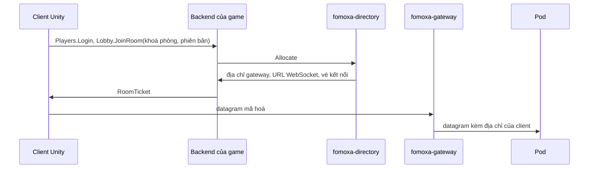

# Cụm server

Khi một server không chứa hết người chơi của game, game chạy nhiều server, gọi là pod, và mỗi người chơi kết nối tới pod đang giữ phòng của mình. Fomoxa cấp các phần cho việc này: một directory biết pod nào giữ phòng nào, một gateway cho mọi pod một địa chỉ công khai chung, một template cho backend của game, và phía pod trong `com.fomoxa.rpc`. Trang này cho thấy chúng ghép với nhau thế nào và dẫn tới trang của từng phần.

## Các phần 

| Phần | Làm gì | Lấy ở đâu |
|---|---|---|
| Client Unity | Đăng nhập vào backend, rồi kết nối tới pod của mình bằng [UDP mã hóa](../connections/transports/encrypted-udp.md) hoặc, trong WebGL, [WebSocket mã hóa](../connections/transports/encrypted-websocket.md) | Game của bạn, với `com.fomoxa.networking` và `com.fomoxa.rpc` |
| Backend của game | Đăng nhập người chơi, hỏi directory xin phòng, rồi trả vé kết nối | Bạn viết từ template `fomoxa-backend`; xem [backend của game](backend.md) |
| `fomoxa-directory` | Ánh xạ khoá phòng tới pod, xếp phòng mới, cấp vé kết nối, theo dõi pod khi chúng đăng ký, báo tải và bị rút | Mã nguồn ở [fomoxa/gateway](https://github.com/fomoxa/gateway) |
| `fomoxa-gateway` | Cho các pod một địa chỉ UDP công khai và, nếu cần, một endpoint WebSocket, rồi chuyển mỗi datagram tới pod của nó | Mã nguồn ở [fomoxa/gateway](https://github.com/fomoxa/gateway) |
| Pod | Server game của bạn. Nó đăng ký với directory qua `DirectoryPod` và nghe bằng UDP mã hoá sau gateway | Game của bạn; xem mục "Running as a pod" trong [README của `com.fomoxa.rpc`](https://github.com/fomoxa/com.fomoxa.rpc) |

Directory, backend và các pod nói chuyện với nhau qua fRPC. Gateway chỉ chở lưu lượng game. Backend có địa chỉ công khai riêng và không đi qua gateway.

## Vào phòng 

1. Client đăng nhập vào backend và gọi `JoinRoom` với khoá phòng và phiên bản build của mình. Khoá phòng là chuỗi do game của bạn đặt, ví dụ `arena:1`.
2. Backend gọi `Allocate` trên directory. Nếu đã có pod giữ phòng, directory trả pod đó. Nếu chưa, nó chọn một pod theo các luật xếp chỗ trong cấu hình, ví dụ chỉ pod chạy đúng phiên bản của client, rồi ánh xạ phòng tới pod đó.
3. Directory cấp vé kết nối cho pod đó. Hai khoá cấu hình `public_address` và `public_websocket` của directory ghi địa chỉ công khai và URL WebSocket của gateway, nên vé trỏ client tới gateway thay vì tới pod. Không dùng gateway thì bỏ hai khoá này, và vé mang địa chỉ của chính pod.
4. Client gọi `StartConnection` với địa chỉ, cổng và vé trên UDP mã hoá, hoặc với URL WebSocket và cổng 0 trên WebSocket mã hoá.
5. Gateway đọc id pod trong mã phiên của mỗi datagram và chuyển datagram tới pod đó. Pod trả lời qua gateway.
6. [Authenticator](../connections/authentication.md) của pod nhận tên người chơi trong vé dưới dạng `ConnectionData`. Game của bạn tự quyết client cho pod biết nó tới phòng nào, ví dụ trong message xác thực, và pod ghi lại phòng nó bắt đầu giữ bằng `AcquireRoom`.

## Rút pod 

Pod bị rút khi nhà vận hành gọi `Drain` trên service quản trị của directory, hoặc khi pod tự xin bằng `RequestDrain`, ví dụ lúc nền tảng sắp dừng nó. Directory ngừng xếp phòng mới lên pod và báo cho pod qua `OnDrain`, kèm hạn chót.

1. Với mỗi phòng, game gọi `pod.Relocate(roomKey, tickets, data)`. Directory chuyển phòng sang pod khác trong một bước và trả địa chỉ mới, URL WebSocket và mỗi người chơi một vé kết nối.
2. Game gọi `ServerManager.Transfer` cho từng người chơi. Người chơi giữ transport của mình khi chuyển, nên hãy kiểm `ServerManager.ArrivedOverWebSocket(peerId)` và đưa người chơi WebSocket URL WebSocket với cổng 0.
3. Mỗi client tự kết nối tới pod mới qua gateway. Xem [chuyển server](../connections/transfer.md).
4. Tới hạn chót, pod dừng server dù còn phòng hay không. Thoát process là việc của game hoặc của nền tảng.

## Khoá 

| Khoá | Ai giữ | Dùng cho |
|---|---|---|
| Khoá vai `backend` | Directory, backend | Lời gọi `Allocate` của backend |
| Khoá vai `pod` | Directory, các pod | Đăng ký, báo tải, phòng và rút pod |
| Khoá vai `gateway` | Directory, các gateway | Theo dõi bảng pod |
| Khoá vai `admin` | Directory, nhà vận hành | `Drain` và đọc trạng thái các pod |
| Khoá gốc | Chỉ directory | Sinh khoá vé của từng pod |
| Khoá pod của backend | Backend, các pod | Pod gọi cổng nội bộ của backend, ví dụ `TransferPlayer` |

Pod nhận khoá vé của mình từ directory khi đăng ký, và dùng nó để mở các vé cấp cho nó. Không process nào khác cần khoá đó. Directory và backend đọc khoá từ tệp hoặc biến môi trường, không bao giờ từ tệp cấu hình, nên tệp cấu hình đặt được trong ConfigMap hoặc Git.

## Chạy các phần 

| Phần | Cách chạy |
|---|---|
| Directory và gateway | Build cả hai từ [fomoxa/gateway](https://github.com/fomoxa/gateway) ở tag `0.2.0` bằng `cargo build --release -p fomoxa-directory -p fomoxa-gateway`. Binary nằm ở `target/release/`. README của repo mô tả cấu hình của chúng. |
| Backend | `dotnet run`, hoặc `Dockerfile` mà template tạo ra |
| Pod | Bản build server của game, là Unity player hoặc [console server](../console-server/overview.md) |

Các kết nối cần thông:

| Từ | Tới |
|---|---|
| Client | Các cổng công khai của backend, và địa chỉ UDP hoặc endpoint WebSocket của gateway |
| Backend | Cổng service của directory |
| Pod | Cổng service của directory, cổng nội bộ của backend, và địa chỉ của gateway mà pod trả lời về |
| Gateway | Cổng service của directory, và cổng UDP của các pod |
| Nhà vận hành | Cổng quản trị của directory |

Đặt một bộ kết thúc TLS trước các cổng công khai của backend và endpoint WebSocket của gateway nếu client kết nối bằng TLS hoặc `wss://`. Cả backend lẫn gateway đều không tự kết thúc TLS.

Directory và gateway chưa có binary build sẵn, container image hay manifest Kubernetes.
