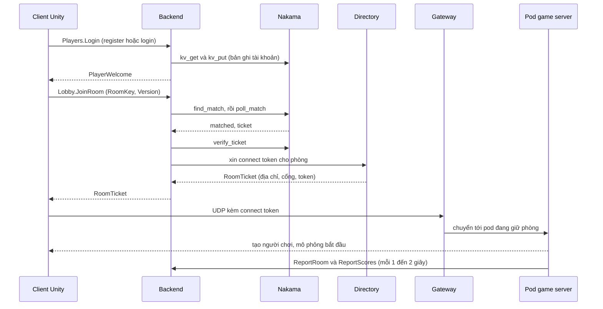

# Tổng quan kiến trúc

Lên đầu tài liệu: [trang chủ tài liệu](../README.md) · Tiếp: [backend.md](backend.md)

Phần này giải thích các thành phần khớp nhau thế nào và mỗi thành phần nằm ở đâu trong repo. Hãy đọc trước khi sửa code. Các trang còn lại nói về từng thành phần: [backend](backend.md), [module Nakama](nakama-module.md), [game server](game-server.md), [client Unity](client-code.md), [giao diện RPC](rpc-api.md) và [hướng dẫn phát triển](development.md).

## Các thành phần 

| Thành phần | Ở đâu | Ngôn ngữ | Việc làm |
|---|---|---|---|
| Client Unity | `MyGame/` | C# (Unity 6) | đăng nhập, sảnh, trận đấu, giao diện |
| Backend | `MyGame.Backend/` | C# (.NET 8) | server duy nhất client nói chuyện cho tài khoản, phòng, bạn bè và điểm |
| Directory | `gateway/` (build từ mã Rust) | Rust | sổ đăng ký các pod game server, phát ticket, theo dõi drain |
| Gateway | `gateway/` | Rust | cổng UDP chuyển lưu lượng game đã mã hoá tới đúng pod |
| Game server (pod) | `MyGame/Server~/` | C# (.NET 8) | chạy một phòng, mô phỏng di chuyển và nhảy |
| Nakama | `deploy/nakama/modules/main.lua` | Lua trong Nakama | ghép trận, ticket, và kho key-value cho tài khoản |
| Postgres | `deploy/k8s/postgres.yaml` | | cơ sở dữ liệu của Nakama |
| TLS proxy | `deploy/k8s/tls-proxy.yaml` | nginx | kết thúc TLS trước backend ([chi tiết](../deploy/traffic-and-tls.md)) |
| Agones | cài bằng Helm | Go | vòng đời game server: `Ready`, `Allocated`, `Shutdown` |
| Cụm giả | `tools/MockCluster/` | C# (.NET 8) | thay directory, backend và pod trên một máy |

## Các cổng 

| Cổng | Giao thức | Ai lắng nghe | Ai kết nối |
|---|---|---|---|
| 9600 | TCP, fRPC | backend | client (không mã hoá) và TLS proxy |
| 9601 | WebSocket, fRPC | backend | client trình duyệt |
| 9643 | TCP, TLS | TLS proxy | client |
| 7777 | UDP | gateway | client (lưu lượng game) |
| 7778 | UDP | từng pod game server | gateway |
| 9602 | TCP, fRPC | backend, chỉ trong cụm | pod game server |
| 9500 | TCP, fRPC | directory | backend, gateway, pod |
| 9501 | TCP, fRPC | directory | công cụ quản trị |
| 7350 | HTTP | Nakama | backend, script test |
| 9610, 9611 | HTTP | backend, pod | Prometheus (`/metrics`) |

Client chỉ chạm tới TCP 9600 hoặc 9643 và UDP 7777. Mọi thứ còn lại nằm trong cụm.

## Từ đăng nhập đến vào chơi 

Bằng lời:

1. Client mở kết nối fRPC tới backend và đăng nhập. Backend kiểm tra tài khoản trong storage của Nakama.
2. Client xin vào phòng. Với `auto`, backend gửi yêu cầu cho Nakama, Nakama ghép hai người và trả ticket. Với phòng có tên như `arena:1`, cùng module đó ghép hai người xin cùng phòng.
3. Backend xác minh ticket với Nakama, rồi xin directory connect token cho pod đang giữ phòng.
4. Client gửi gói UDP kèm token tới gateway. Gateway chuyển tới pod đó. Mọi lưu lượng game được mã hoá bằng khoá sinh từ token.
5. Pod báo số người và điểm về backend qua cổng 9602, nuôi danh sách phòng, bảng điểm và kỷ lục.

## Ai được tin việc gì 

Mỗi kết nối giữa các thành phần xác thực bằng một khoá trong `deploy/secrets` ([danh sách](../reference.md#3-secrets)). Mỗi khoá chỉ mở một cánh cửa.

| Khoá | Dùng giữa | Mục đích |
|---|---|---|
| `directory/root` | chính directory | khoá gốc của nó; 64 ký tự hex |
| `directory/backend` | backend và directory | backend xin directory ticket |
| `directory/gateway` | gateway và directory | gateway hỏi directory chuyển tiếp tới đâu |
| `directory/pod` | game server và directory | pod đăng ký và giữ phòng |
| `directory/admin` | công cụ quản trị và directory | quản trị directory (`Drain`, `ReadPods`) |
| `backend-pod` | game server và backend | `ReportRoom` và `ReportScores` ở cổng 9602 |
| `http-key` của Nakama | backend và Nakama | các RPC chỉ dành cho backend (`verify_ticket`, `kv_get`, `kv_put`, `reset_match`) |
| `server-key` của Nakama | phía client của API Nakama | xác thực bằng thiết bị và email |

Một pod game server chỉ giữ `pod` và `backend-pod`. Nếu một pod bị chiếm, nó không thể phát ticket hay đọc tài khoản.

## Dữ liệu nằm ở đâu 

| Dữ liệu | Lưu ở | Thời gian sống |
|---|---|---|
| Tài khoản, băm mật khẩu, băm mã khôi phục | storage Nakama, collection `account` | vĩnh viễn |
| Hồ sơ (bậc cao nhất, số trận) | storage Nakama, collection `profile` | vĩnh viễn |
| Bạn bè và lời mời | storage Nakama, collection `social` | vĩnh viễn |
| Hàng chờ ghép trận, ticket, kết quả | storage Nakama, collection `match_queue`, `match_ticket`, `match_result`, `room_stat` | vài giây đến vài phút |
| Trạng thái online | bộ nhớ backend | 20 giây không có tín hiệu |
| Số người trong phòng, bảng điểm | bộ nhớ backend, do pod báo | đến lần báo kế tiếp |
| Bộ đếm đăng nhập sai | bộ nhớ backend | khoá 60 giây |

Vì trạng thái online, bảng điểm và bộ đếm đăng nhập sai nằm trong bộ nhớ, backend chạy một bản duy nhất. Khởi động lại sẽ xoá chúng, và người chơi hiện lại khi gửi tín hiệu tiếp.
