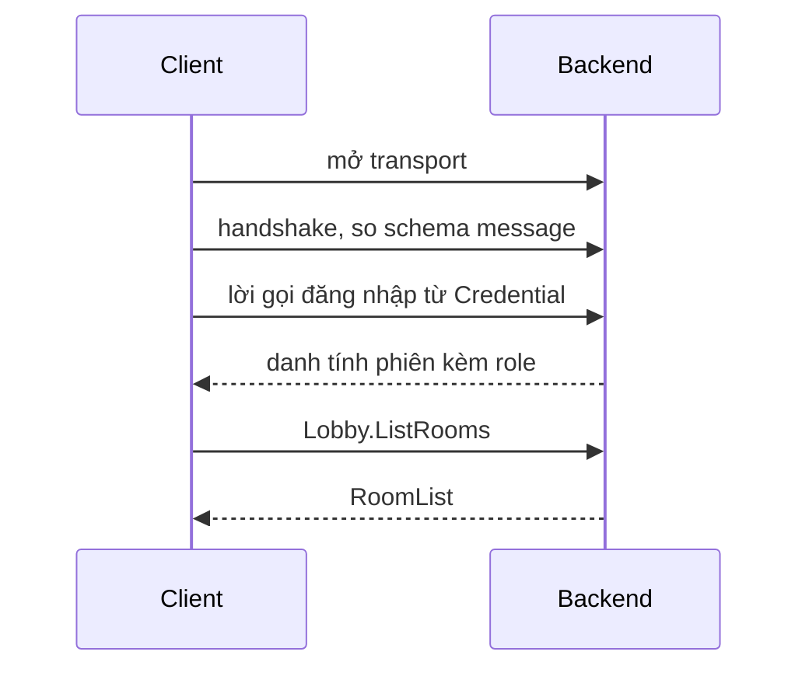

# Dùng fRPC

Lên đầu tài liệu: [trang chủ tài liệu](../README.md) · Trước: [rpc-api.md](rpc-api.md) · Tiếp: [frpc-add-a-method.md](frpc-add-a-method.md)

fRPC là thư viện RPC mà demo dùng cho mọi việc ngoài gameplay: đăng nhập, liệt kê phòng, xin vé, báo điểm. Bạn khai báo một dịch vụ bằng interface C#, rồi công cụ sinh ra client và server có kiểu từ interface đó.

Trang [Giao diện RPC](rpc-api.md) liệt kê các dịch vụ và message đang có. Để thêm phương thức của riêng bạn, làm theo [Thêm một phương thức fRPC](frpc-add-a-method.md).

## Demo dùng fRPC ở đâu <a href="#where-the-demo-uses-frpc" id="where-the-demo-uses-frpc"></a>

| Bên gọi | Bên được gọi | Cổng | Dịch vụ | Kết nối trong mã |
|---|---|---|---|---|
| Client Unity | backend | TCP 9600, hoặc WebSocket 9601 | `Players`, `Lobby` | `RoomJoiner` |
| Game server | backend | TCP 9602 | `Pods`, `PodGate` | `BackendReporter` |
| Backend | directory | TCP 9500 | `Directory` | `DirectoryLink` |
| Game server | directory | TCP 9500 | `Directory` | `DirectoryPod` trong `com.fomoxa.rpc` |

`MoveInput` và state được đồng bộ đi qua UDP mã hoá, nằm ngoài fRPC.

Một kết nối qua ba giai đoạn trước lời gọi đầu tiên của bạn:



Nếu schema xung đột hoặc đăng nhập bị từ chối, kết nối thất bại và không lời gọi nào chạy.

## Các phần của một phương thức <a href="#the-parts-of-a-method" id="the-parts-of-a-method"></a>

| Phần | Nằm ở đâu | Ai viết |
|---|---|---|
| Message (lớp có `[Network]` và `[Codec("rpc")]`) | `Models/*.cs` trong mỗi cây | bạn |
| Interface của dịch vụ (`[Service]`, `[Unary]`) | `Services.cs` trong mỗi cây | bạn |
| Codec và `NetSchema` | `Generated/` trong mỗi cây | `fomoxac` |
| `LobbyClient`, `LobbyServer`, `LobbyMethods` | không có trên đĩa, sinh ra lúc biên dịch | source generator trong `Fomoxa.Rpc.Generator` |
| Lớp handler cài đặt `ILobby` | `Players.cs`, `MockBackend.cs` | bạn |

Repo có hai cây mã, mỗi cây giữ bản riêng của các message và của `Services.cs`:

| Cây | Message | Dịch vụ | Mã sinh | Biên dịch vào |
|---|---|---|---|---|
| Backend | `MyGame.Backend/MyGame.Backend/Models/` | `MyGame.Backend/MyGame.Backend/Services.cs` | `MyGame.Backend/MyGame.Backend/Generated/` | backend thật |
| Unity | `MyGame/Assets/Network/Models/Backend/` | `MyGame/Assets/Network/Rpc/Services.cs` | `MyGame/Assets/Network/Generated/` | client Unity, game server và cụm giả |

## Mở kết nối <a href="#open-a-connection" id="open-a-connection"></a>

`RpcConnection` có ba cách khởi động, và demo dùng cả ba:

| Lời gọi | Ai chạy phần mạng | Dùng bởi |
|---|---|---|
| `RpcConnection.Connect(address, ...)` | chính kết nối, qua TCP | game server, backend, selftest của cụm giả |
| `RpcConnection.Open(transport, ...)` | chính kết nối, qua transport bạn đã mở | selftest của cụm giả với TLS |
| `RpcConnection.Driven(transport, ...)` | vòng lặp của bạn, qua `connection.Tick(now)` | client Unity |

Đây là cách game server kết nối, trong `BackendReporter.cs`:

```csharp
var options = new ConnectOptions
{
    Credential = Credential.Of(PodsMethods.Login, new PodLogin { Key = key }),
};
return RpcConnection.Connect(address, NetSchema.Build(), PodGateClient.Declare(PodsClient.Registry()).Build(), options);
```

- `NetSchema` là lớp sinh ra của cây mà bạn đang biên dịch.
- Registry liệt kê mọi dịch vụ mà kết nối này gọi. `Registry()` bắt đầu danh sách và `Declare` thêm một dịch vụ vào đó.
- `Credential` chỉ định phương thức đăng nhập và request của nó. Kết nối gửi nó ngay sau handshake.

Trong Unity, `connection.Tick` phải chạy mỗi frame, như `RoomJoiner.Update` đang làm. Lời gọi đang `await` hoàn tất bên trong `Tick`, trên main thread, nên không có `Tick` thì nó không bao giờ hoàn tất. `RoomJoiner.LoginCore` chờ `connection.Opened` rồi mới gọi.

Mặc định kết nối không thử lại lời gọi. Sau khi kết nối rớt, `IsOpen` là false và các lời gọi thất bại với `UNAVAILABLE`. Mã của demo xử lý việc này ở ba chỗ: `BackendReporter` kết nối lại ở vòng kế tiếp, `DirectoryLink` mở kết nối mới và gọi lại một lần, còn `RoomJoiner.JoinWithRetry` thử `JoinRoom` tối đa ba lần.


Lời gọi đăng nhập mang mật khẩu của người chơi, và trên cổng 9600 nó đi không mã hoá. Ra ngoài mạng nội bộ của bạn, hãy kết nối qua TLS ở cổng 9643 ([đường đi của lưu lượng và TLS](../deploy/traffic-and-tls.md)).


## Đăng nhập và kiểm role <a href="#log-in-and-check-roles" id="log-in-and-check-roles"></a>

Đăng nhập là một phương thức trên dịch vụ riêng, do một lớp cài đặt `IAuthenticator` xử lý. Nó trả về một `Identity`, gồm principal (tên của bên gọi) và các quyền. `PodKeys` trong `Pods.cs` là ví dụ ngắn nhất:

```csharp
if (!CryptographicOperations.FixedTimeEquals(request.Key, key))
{
    throw new RpcException(Status.Unauthenticated("the pod key does not match"));
}

return (new Identity(Roles.Pod, new[] { Roles.Pod }), new FRpcVoid());
```

`Backend.cs` gắn nó vào server bằng `.Authenticate(new PodKeys(settings.PodKey))`. Mọi lời gọi sau đó trên kết nối đều mang danh tính này, và handler đọc nó từ `context.Session.Principal`.

| Tình huống | Bên gọi nhận được |
|---|---|
| Đăng nhập bị từ chối, ví dụ sai mật khẩu | `ConnectException` lúc kết nối, lý do nằm trong `.Status` |
| Kết nối không gửi `Credential` | `RpcException` với `UNAUTHENTICATED` ở lời gọi đầu tiên |
| Danh tính thiếu role trong `Requires` | `RpcException` với `PERMISSION_DENIED` |
| Không có gì nghe ở địa chỉ đó | `ConnectException` sau `ConnectOptions.Timeout` (mặc định 5 giây), và `.Status` là null |

## Xử lý lỗi <a href="#handle-errors" id="handle-errors"></a>

Handler từ chối một lời gọi bằng cách ném `RpcException` kèm status, và bên gọi nhận đúng code và message đó:

```csharp
throw new RpcException(Status.InvalidArgument("Echo needs some text"));
```

Bên gọi bắt exception và đọc status. Ví dụ này còn đọc một detail có kiểu:

```csharp
try
{
    await lobby.JoinRoomAsync(request, CallOptions.Within(TimeSpan.FromSeconds(30)));
}
catch (RpcException failed) when (failed.Status.Details is NoRoomForVersion missing)
{
    Debug.LogWarning($"no pod runs version {missing.Version}");
}
```

Phương thức liệt kê các lớp detail nó được gửi trong `Details`, ví dụ `Details = new[] { typeof(NoRoomForVersion) }`, và handler truyền một detail vào status: `Status.FailedPrecondition(message, new NoRoomForVersion { Version = version })`. Detail mà phương thức không liệt kê sẽ tới bên gọi thành `INTERNAL`.


Mọi exception khác cũng tới được bên gọi, dưới dạng `INTERNAL` kèm message của exception. Nếu message đó có thể chứa địa chỉ nội bộ hoặc dữ liệu, hãy bắt exception và ném `RpcException` với nội dung của riêng bạn.


Trang [Giao diện RPC](rpc-api.md#errors) liệt kê các code mà client gặp trong demo này.

## Deadline và handler chậm <a href="#deadlines-and-slow-handlers" id="deadlines-and-slow-handlers"></a>

Lời gọi hết thời gian sẽ kết thúc với `DEADLINE_EXCEEDED`.

| Bạn truyền | Deadline |
|---|---|
| không truyền gì | option `Deadline` của phương thức, nếu không có thì 5 giây |
| `CallOptions.Within(TimeSpan.FromSeconds(10))` | 10 giây |
| `CallOptions.WithoutDeadline` | không có ở phía bên gọi |

Chọn deadline theo việc mà lời gọi làm. `RoomJoiner` cho `JoinRoom` 30 giây vì backend có thể chờ ghép trận 15 giây. Server cũng giới hạn mỗi handler unary ở 30 giây.

Handler trả về giá trị thường chạy trên vòng lặp của kết nối, và các lời gọi sau từ kết nối đó phải chờ nó. Trên backend giả, handler thường ngủ 1,5 giây làm lời gọi kế tiếp trên cùng kết nối chậm 1,5 giây, còn lời gọi từ kết nối khác trả lời trong 1 ms. Với handler `Task` dùng `await` chờ cùng khoảng đó, lời gọi kế tiếp trên kết nối đó cũng trả lời trong 1 ms. Hãy trả về `Task` cho mọi việc phải chờ Nakama, directory hoặc file, như `JoinRoom` và `ListRooms`. Giá trị thường phù hợp với việc nhanh như `Presence`.

## Các option trên phương thức <a href="#options-on-a-method" id="options-on-a-method"></a>

| Option | Ví dụ | Tác dụng | Demo có dùng |
|---|---|---|---|
| `Requires` | `Requires = Roles.Player` | danh tính của bên gọi phải có quyền này | có |
| `Details` | `Details = new[] { typeof(NoRoomForVersion) }` | các detail có kiểu mà phương thức được gửi | có |
| `Deadline` | `Deadline = "10s"` | deadline khi bên gọi không truyền. Đơn vị là `ms`, `s`, `m`, `h` | không |
| `Idempotent` | `Idempotent = true` | cho phép retry policy gọi lại sau `UNAVAILABLE` | không |

Các dịch vụ trong demo này chỉ khai báo phương thức `[Unary]`, một request và một response. Thư viện còn có `[ServerStream]`, trang này không đề cập.

## Đổi message an toàn <a href="#change-a-message-safely" id="change-a-message-safely"></a>

Handshake so các message mà cả hai bên cùng biết, nên hai cây có thể có schema khác nhau: cây Unity có các message gameplay mà backend không có. Message có ở cả hai bên thì phải có cùng các field. Kết quả với backend thật:

| Thay đổi | Kết quả |
|---|---|
| Backend có thêm phương thức và message mới, client chưa cập nhật | client kết nối được, các lời gọi đang có vẫn chạy |
| Client gọi một phương thức mà backend không có | lời gọi đó thất bại với `UNIMPLEMENTED`, các lời gọi khác vẫn chạy |
| Một cây thêm field vào message mà cả hai bên dùng | kết nối thất bại: `ConnectException: the handshake failed: SchemaConflict` |

Với hệ thống đang chạy, từ đó có hai quy tắc:

- Để thêm phương thức, triển khai backend trước, rồi đến client.
- Đổi field của một message đang có sẽ khoá mọi client và pod không build từ cùng model, nên phải cập nhật chúng cùng lúc. Muốn tránh điều đó, hãy thêm message và phương thức mới rồi bỏ cái cũ sau.

Game server được build từ cây Unity, nên đổi ở đó thì cũng phải build lại image server ([cập nhật](../operations/01-status-and-updates.md)).

## Lỗi thường gặp <a href="#common-mistakes" id="common-mistakes"></a>

| Triệu chứng | Nguyên nhân | Cách sửa |
|---|---|---|
| `FRPC003: Lobby.X uses YRequest, which is not a [Network] model with an rpc codec` | codec chưa được sinh, hoặc lớp thiếu `[Codec("rpc")]` | kiểm các attribute, rồi [sinh lại mã](development.md#regenerate-the-code) |
| `FRPC001: Lobby.A and Lobby.B share the request model` | hai phương thức dùng chung một lớp request | cho mỗi phương thức một lớp request riêng |
| `CS0535` trên `MockLobby` hoặc `Lobby` | đã thêm phương thức vào `ILobby` mà chưa có handler | cài đặt nó trong cả hai lớp |
| `the handshake failed: SchemaConflict` | một message khác nhau giữa hai cây, hoặc mã sinh đã cũ | chép model sang cây kia, sinh lại cả hai, build lại cả hai |
| CI lỗi ở `generate --check` | các file sinh ra chưa được commit | sinh lại và commit `Generated/` cùng `.fomoxa/` |
| `UNIMPLEMENTED`, `no handler for request type` | backend đang chạy cũ hơn client | triển khai backend |
| `UNAUTHENTICATED`, `the session has no identity` | kết nối không có `Credential` | đặt nó trong `ConnectOptions` |
| `DEADLINE_EXCEEDED` sau đúng 5 giây | lời gọi không truyền deadline và chạy lâu hơn mặc định | truyền `CallOptions.Within` với thời gian dài hơn |
| `the session was not ready before the timeout` | không có gì nghe ở địa chỉ và cổng đó | khởi động backend, hoặc kiểm lại địa chỉ |
| Lời gọi `await` không bao giờ xong trong Unity | `connection.Tick` không chạy | tick kết nối trong `Update`, trên một object đang active |

## Bước tiếp theo <a href="#next-steps" id="next-steps"></a>

- [Thêm một phương thức fRPC](frpc-add-a-method.md): mọi file cần sửa khi thêm phương thức mới, kèm ví dụ chạy được.
- [Giao diện RPC](rpc-api.md): mọi dịch vụ, message và mã lỗi trong demo.
- [`com.fomoxa.rpc`](https://github.com/fomoxa/com.fomoxa.rpc): README của package, gồm cả `DirectoryPod`.
