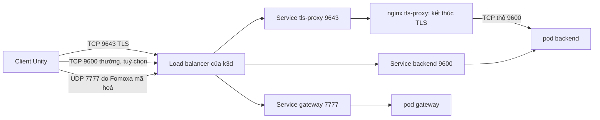

# Đường đi của lưu lượng và nơi cấu hình TLS

Lên đầu tài liệu: [03-TRIEN-KHAI-K8S](README.md) · Trước: [manifest-walkthrough.md](manifest-walkthrough.md)

Trang này trả lời một câu hỏi: cái gì đứng trước backend, và thành phần nào lo TLS. Trong repo này câu trả lời là một proxy nginx nhỏ tên `tls-proxy`, cùng các Service kiểu `LoadBalancer` của Kubernetes để mở nó ra ngoài. Bản thân backend chỉ nói TCP thường và không biết gì về chứng chỉ.

## Đường đi của một request <a href="#the-path-of-a-request" id="the-path-of-a-request"></a>



Có ba lớp, từ ngoài vào trong:

| Lớp | Là gì | Cấu hình ở |
|---|---|---|
| 1. Ánh xạ cổng trên máy bạn | container load balancer `k3d-fomoxa-serverlb` đưa các cổng 7777/udp, 9600, 9643 và 7350 của máy vào cụm | `k3d cluster create ... --port ...` ([bước 5](03-cluster-and-agones.md)) |
| 2. Service kiểu `LoadBalancer` của Kubernetes | `tls-proxy` (9643), `backend` (9600, 9601), `gateway` (7777/udp), `nakama` (7350) | `deploy/k8s/*.yaml` |
| 3. Nơi kết thúc TLS | nginx trong pod `tls-proxy` giải mã TLS rồi chuyển byte thô sang `backend:9600` | `deploy/k8s/tls-proxy.yaml` và secret `fomoxa-tls` |

Lưu lượng game qua UDP 7777 không đi qua nginx. Fomoxa tự mã hoá nó bằng khoá trong ConnectToken mà client nhận sau khi đăng nhập, nên không cần chứng chỉ.

## Cấu hình của proxy <a href="#the-proxy-configuration" id="the-proxy-configuration"></a>

Đây là cấu hình nginx lưu trong ConfigMap `tls-proxy-config` (file `deploy/k8s/tls-proxy.yaml`):

```
worker_processes 1;
pid /tmp/nginx.pid;
events { worker_connections 1024; }
stream {
  server {
    listen 9643 ssl;
    ssl_certificate     /tls/tls.crt;
    ssl_certificate_key /tls/tls.key;
    ssl_protocols       TLSv1.2 TLSv1.3;
    proxy_pass          backend.fomoxa.svc.cluster.local:9600;
    proxy_connect_timeout 5s;
    proxy_timeout       1h;
  }
}
```

Đọc từng dòng:

| Dòng | Ý nghĩa |
|---|---|
| `stream { }` | chế độ TCP thô của nginx. Giao thức fRPC không phải HTTP nên khối `http { }` không dùng được |
| `listen 9643 ssl` | nhận kết nối TLS ở cổng 9643 và giải mã |
| `ssl_certificate`, `ssl_certificate_key` | chứng chỉ và khoá riêng, gắn từ secret `fomoxa-tls` vào `/tls` |
| `ssl_protocols TLSv1.2 TLSv1.3` | từ chối các phiên bản giao thức cũ hơn |
| `proxy_pass backend.fomoxa.svc.cluster.local:9600` | sau khi giải mã, chuyển byte tới Service backend trong cụm |
| `proxy_connect_timeout 5s` | bỏ cuộc nếu backend không nhận kết nối trong 5 giây |
| `proxy_timeout 1h` | đóng kết nối nếu rảnh một giờ |
| `pid /tmp/nginx.pid` | image không đặc quyền không ghi được chỗ khác |

Pod proxy gắn hai thứ: ConfigMap thành `/etc/nginx/nginx.conf` và secret thành `/tls`. Cả hai chỉ đọc.

```bash
kubectl get configmap tls-proxy-config -n fomoxa -o jsonpath='{.data.nginx\.conf}'
kubectl exec deploy/tls-proxy -n fomoxa -- ls /tls
```

Lệnh thứ hai phải liệt kê `tls.crt` và `tls.key`.

## Service mở nó ra ngoài <a href="#the-service-that-exposes-it" id="the-service-that-exposes-it"></a>

```yaml
apiVersion: v1
kind: Service
metadata:
  name: tls-proxy
  namespace: fomoxa
spec:
  type: LoadBalancer
  selector:
    app: tls-proxy
  ports:
    - name: tls
      port: 9643
      targetPort: 9643
```

`type: LoadBalancer` là thứ cho phép load balancer của k3d chuyển cổng 9643 của máy vào Service này. Kiểm tra:

```bash
kubectl get svc tls-proxy -n fomoxa
docker port k3d-fomoxa-serverlb | grep 9643
```

## Chứng chỉ đến từ đâu <a href="#where-the-certificate-comes-from" id="where-the-certificate-comes-from"></a>

| Mục | Giá trị |
|---|---|
| File trên đĩa | `deploy/secrets/tls/tls.crt` và `tls.key`, tạo bằng `./scripts/gen-tls-cert.sh` ([bước 2](01-prepare-and-keys.md)) |
| Đối tượng Kubernetes | secret `fomoxa-tls` kiểu `kubernetes.io/tls`, tạo ở [bước 8](04-secrets.md) |
| Ai gắn | chỉ `tls-proxy`, tại `/tls` |
| Loại chứng chỉ | tự ký; script in ra vân tay SHA-256 của nó, gọi là pin |

## Client tin nó thế nào <a href="#how-the-client-trusts-it" id="how-the-client-trusts-it"></a>

Client nối vào cổng 9643 với `-tls` hoặc với pin:

```
MyGame.exe -backend:127.0.0.1:9643 -tlspin:<SHA-256 fingerprint without colons>
```

Khi có pin, client so SHA-256 của chứng chỉ server đưa ra với pin và từ chối mọi chứng chỉ khác. Đây là cách tin một chứng chỉ tự ký mà không cần nhà cấp chứng chỉ. Với chứng chỉ của CA công khai, chỉ cần truyền `-tls`.

Cụm giả có sẵn cùng cơ chế (`TlsTerminator` trong `tools/MockCluster`), nên bạn thử được phía client mà không cần Kubernetes: nó lắng nghe cổng 9643 và in pin lúc khởi động.

## Các lựa chọn cho môi trường thật <a href="#options-for-production" id="options-for-production"></a>

| Lựa chọn | Khi nào dùng | Thay đổi gì |
|---|---|---|
| Giữ nginx `tls-proxy`, dùng chứng chỉ của CA | một cụm, có tên miền | thay secret `fomoxa-tls` (cert-manager có thể quản lý); client truyền `-tls`, không cần pin |
| Load balancer TCP của cloud kết thúc TLS | cloud có quản lý | load balancer giữ chứng chỉ và chuyển TCP thô tới Service `backend` cổng 9600. Khi đó không cần pod `tls-proxy` |
| Đóng cổng thường | luôn luôn trên môi trường thật | `TLS_ONLY=1 ./scripts/k8s-up.sh`, hoặc đổi `backend` thành `ClusterIP` ([vận hành phần 3](../operations/03-tls-and-keys.md#83-allow-only-the-encrypted-path)) |

Dù chọn nginx hay load balancer của cloud, nó phải chuyển byte nguyên vẹn. Backend nhận ra người chơi qua lệnh đăng nhập trong luồng fRPC, không qua địa chỉ nguồn.

## Kiểm tra <a href="#checks" id="checks"></a>

```bash
# The proxy answers TLS and shows its certificate
openssl s_client -connect 127.0.0.1:9643 </dev/null 2>/dev/null | openssl x509 -noout -fingerprint -sha256

# The proxy forwards to the backend (logs show connections)
kubectl logs deploy/tls-proxy -n fomoxa --tail=20
```

Nếu vân tay không khớp pin của client, xem [vận hành phần 3](../operations/03-tls-and-keys.md#82-replace-the-certificate). Nếu cổng 9643 không trả lời, xem [xử lý sự cố](../troubleshooting.md).
