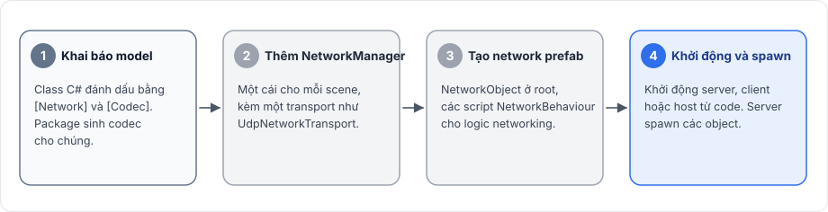

# Giới thiệu

Fomoxa for Unity thêm networking nhiều người chơi vào một project Unity. Package theo mô hình server-authoritative: một tiến trình chạy server và nắm game state, còn mỗi người chơi chạy một client gửi yêu cầu và input lên server rồi hiển thị những gì server gửi về.

Server có thể chạy riêng, gọi là dedicated server, hoặc chạy chung một tiến trình với client của một người chơi, gọi là host.

<figure><figcaption>
Dedicated server và host. Trong cả hai trường hợp, mọi message giữa các người chơi đều đi qua server.
</figcaption></figure>

## Game dùng package như thế nào 

Một game đi qua bốn bước để dùng package.

<figure><figcaption>
Bốn bước, theo đúng thứ tự tutorial đi qua.
</figcaption></figure>

1. Game khai báo dữ liệu cần gửi bằng các class C# gọi là model, đánh dấu bằng `[Network]` và `[Codec]`. Package chạy trình biên dịch `fomoxac` trên các model và sinh một codec cho mỗi model, codec này chuyển model thành byte và ngược lại.
2. Game đặt một `NetworkManager` vào scene, kèm một component transport như `UdpNetworkTransport`.
3. Game thêm `NetworkObject` vào mọi prefab tồn tại trên mạng, và viết các script `NetworkBehaviour` cho phần logic networking của những prefab đó.
4. Game khởi động server, client hoặc host từ code. Server spawn các object, và các object đó xuất hiện trên client.

Khi một object đã được spawn, các script `NetworkBehaviour` của nó có thể gọi RPC, giữ một state mà server gửi xuống client, và đăng ký input để client của owner tự dự đoán nhân vật của mình. Một `NetworkTransform` trên prefab gửi vị trí, góc xoay và tỉ lệ của object.

## Các type chính 

| Type | Vai trò |
|---|---|
| [`NetworkManager`](../connections/network-manager.md) | Component chạy networking trong một scene: cấu hình, vòng lặp tick, server và client |
| [`ServerManager`](../connections/server.md) | Khởi động và dừng server, spawn và despawn object, đổi owner |
| [`ClientManager`](../connections/client.md) | Kết nối tới server, kết nối lại, và giữ các object đã spawn trên client này |
| [`NetworkObject`](../objects/network-object.md) | Đánh dấu một GameObject là network object, có object id và owner |
| [`NetworkBehaviour`](../objects/network-behaviour.md) | Base class cho script networking: callback vòng đời, RPC, state và input |
| [`NetworkTransform`](../synchronization/transform.md) | Gửi vị trí, góc xoay và tỉ lệ từ server xuống client |
| [`NetworkAnimator`](../synchronization/animator.md) | Gửi parameter, trigger và trạng thái layer của Animator |
| [`NetworkTransport`](../connections/transports/README.md) | Base class của các component transport: UDP, TCP, WebSocket và nhiều transport cùng lúc |

## Tình trạng tính năng 

| Tính năng | Tình trạng |
|---|---|
| Transport UDP, TCP và WebSocket, nhiều transport trên một server | Có |
| Host mode qua kết nối trong cùng tiến trình | Có |
| Spawn, scene object, ownership, observer | Có |
| RPC có và không có model, khai báo bằng attribute hoặc đăng ký thủ công | Có |
| State với delta encoding, `NetworkTransform`, `NetworkAnimator` | Có |
| Network scene | Có |
| Client-side prediction, reconciliation và replay | Có |
| Rollback physics của Unity (`Rigidbody` và `Rigidbody2D`) | Có, gần đúng (xem [rollback](../prediction/rollback.md)) |
| Client WebGL | Có |
| Binary `fomoxac` cho macOS | Không đi kèm; sinh code thất bại trong Editor trên macOS |

## Những gì không có 

Package không có mô phỏng lockstep, và không ghi lại được cả một trận đấu để phát lại sau. Package cũng không có bộ sinh số ngẫu nhiên tất định và không có state hashing.

Matchmaking, relay server, lobby và NAT traversal nằm ngoài package, mã hóa và xác thực kết nối cũng vậy. Client WebSocket trong trình duyệt vẫn có thể tới server qua TLS thông qua một proxy, như mô tả trong [WebSocket](../connections/transports/websocket.md).

## Bước tiếp theo 

Cài package theo trang [cài đặt](installation.md), rồi làm theo [tutorial](tutorial/README.md), tutorial này dựng một game nhỏ với server, host và client. Các trang trong [Kiến thức nền](../concepts/architecture.md) giải thích package hoạt động bên dưới ra sao.
