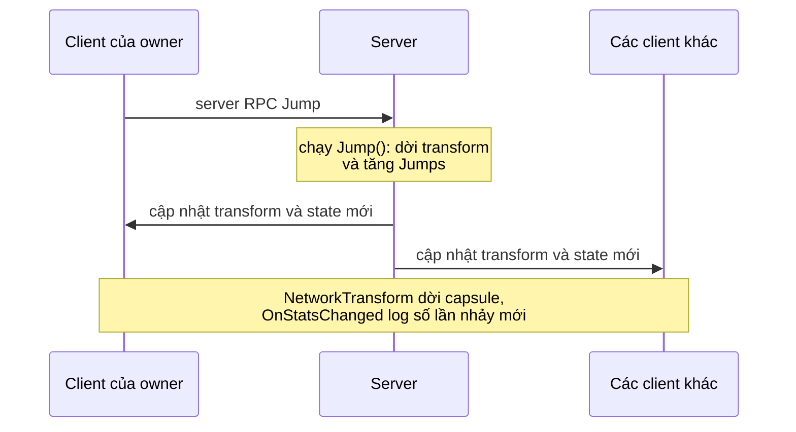

# Tutorial: game nhiều người chơi đầu tiên

Tutorial này dựng một game nhiều người chơi nhỏ qua ba phần. Mỗi người chơi đang kết nối là một capsule. Người sở hữu capsule bấm **Jump**, server nâng capsule lên và đếm số lần nhảy, rồi mọi client đều thấy capsule di chuyển và con số thay đổi.

<figure><figcaption>
Game hoàn chỉnh, chạy dưới dạng host với một client thứ hai đã kết nối.
</figcaption></figure>

## Bạn sẽ làm gì 

| Phần | Bạn thêm | Bạn học được |
|---|---|---|
| [1. Chuẩn bị project](project-setup.md) | Một `NetworkManager`, một model và một player prefab | Model và code sinh ra, `NetworkObject`, `NetworkBehaviour`, state, RPC |
| [2. Khởi động server](server.md) | Một launcher khởi động server và spawn một player cho mỗi client | `ServerManager`, event kết nối, spawn, dedicated server |
| [3. Kết nối client](clients.md) | Client và host | `ClientManager`, kết nối lại, host mode |

## Trước khi bắt đầu 

- Hoàn thành [cài đặt](../installation.md), với thư mục model `Assets/Network/Models` và thư mục sinh code `Assets/Network/Generated`.
- Biết cách tạo script, prefab và scene trong Unity.

Game vẽ nút bấm bằng `OnGUI`, nên không cần thiết lập UI.

## Chuyện gì xảy ra khi người chơi nhảy 

Mọi thứ trong game đi theo một đường. Client của owner xin server cho nhảy, server thay đổi capsule, rồi server gửi kết quả cho mọi client.

Client không bao giờ tự dời capsule, vì server nắm game state. [Authority](../../concepts/authority.md) giải thích lý do, và [prediction](../../prediction/overview.md) cho thấy cách một game làm nhân vật của chính người chơi phản hồi ngay lập tức.

## Kết quả đã kiểm thử 

Code trong tutorial này đã được chạy trên Unity 6000.5.7f1: dưới dạng host, cùng một client thứ hai kết nối qua UDP, nhảy, rồi ngắt kết nối. Các ảnh chụp lấy từ lần chạy đó.

Bắt đầu với [phần 1](project-setup.md).
