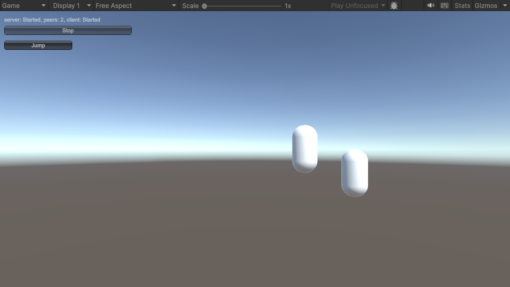

# 3. Kết nối client

Trong phần này bạn kết nối client vào server của [phần 2](server.md), thử RPC Jump và state, rồi chạy game dưới dạng host.

## Phần client hoạt động thế nào <a href="#how-the-client-part-works" id="how-the-client-part-works"></a>

Nút **Client** của launcher gọi:

```csharp
manager.ClientManager.StartConnection(address, port);
```

Địa chỉ có thể là host name hoặc địa chỉ IP. Client phân giải địa chỉ, mở transport và chạy handshake của Fomoxa, còn `ClientManager.OnClientConnectionState` báo tiến trình: `Starting` khi đang kết nối, `Authenticating` cho tới khi server cho nó vào, `Started` khi message đã đi được, và `Stopped` khi kết nối kết thúc.

Nếu kết nối thất bại hoặc bị rớt, client thử lại sau mỗi 0.5 giây, mặc định không giới hạn số lần. Ở event `Stopped`, `ConnectionStateArgs.Reason` cho biết vì sao kết nối dừng, và `ConnectionStateArgs.WillRetry` cho biết còn lần thử tiếp theo hay không. [Client](../../connections/client.md) giải thích việc kết nối lại và các thiết lập của nó.

Khi client tới `Started`, server spawn một player cho nó, và client tạo instance riêng của prefab `Player`. Các object server đã spawn trước đó, như player của các client khác, cũng tới theo cách này.

## 1. Kết nối một client tới server <a href="#1-connect-a-client-to-the-server" id="1-connect-a-client-to-the-server"></a>

1. Khởi động dedicated server từ phần 2. Bạn cũng có thể vào Play Mode trong một bản copy thứ hai của project và bấm **Server**.
2. Trong Editor, vào Play Mode, giữ `127.0.0.1` trong ô nhập và bấm **Client**.

Bạn sẽ thấy:

- Console hiện `client: Starting None`, `client: Authenticating None`, rồi `client: Started None`.
- Một capsule xuất hiện ở tọa độ x bằng hai lần peer id của client.
- Console hiện `player <id> spawned, owner <peer id>, mine: True, jumps: 0`.
- Một nút **Jump** hiện bên dưới dòng trạng thái, vì client này sở hữu capsule đó.
- Với dedicated server, `server.log` hiện `peer <id>: Starting None`, `peer <id>: Authenticating None` và `peer <id>: Started None`.

## 2. Gọi RPC <a href="#2-call-the-rpc" id="2-call-the-rpc"></a>

Bấm **Jump**. Capsule nâng lên một đơn vị và Console hiện `player <id> jumps: 0 -> 1`.

Cú bấm đã gửi một server RPC. Server chạy `Jump`, hàm này dời transform và đổi state, và ở cuối tick server gửi vị trí mới qua `NetworkTransform` và state mới qua state model. Client áp dụng cả hai, và việc áp state mới gọi `OnStatsChanged`.

## 3. Thêm client thứ hai <a href="#3-add-a-second-client" id="3-add-a-second-client"></a>

Build player lại, hoặc dùng lại bản build ở phần 2, và khởi động nó không kèm `-server` để nó mở cửa sổ. Bấm **Client** trong cửa sổ đó.

Giờ cả hai client đều thấy hai capsule, và mỗi client hiện một nút **Jump** cho capsule mà nó sở hữu. Một cú nhảy trên một client làm capsule của nó di chuyển trên cả hai client và log số lần nhảy mới ở cả hai.

<figure><figcaption><p>Hai người chơi đã kết nối. Capsule bên trái đã nhảy một lần. Ảnh này chụp từ một host, chính là bước tiếp theo.</p></figcaption></figure>

## 4. Chạy host <a href="#4-run-a-host" id="4-run-a-host"></a>

Dừng mọi thứ, vào Play Mode trong Editor và bấm **Host**. Launcher khởi động server rồi kết nối một client trong cùng tiến trình. Client đó bỏ qua địa chỉ và kết nối qua một kết nối loopback trong tiến trình thay vì UDP.

Bạn sẽ thấy:

- Dòng chữ hiện `server: Started, peers: 1, client: Started`.
- Một capsule được spawn cho client của chính host, kèm nút **Jump**.
- Một client ở tiến trình khác có thể kết nối tới host bằng **Client**, giống như với dedicated server, và dòng chữ khi đó hiện `peers: 2`.

<figure><figcaption><p>Một host sau khi player của nó nhảy một lần.</p></figcaption></figure>

Trong host mode, server và client của host dùng chung một instance cho mỗi object. [Host mode](../../connections/host-mode.md) giải thích điều này ảnh hưởng thế nào tới code của bạn.

## 5. Ngắt kết nối <a href="#5-disconnect" id="5-disconnect"></a>

Bấm **Stop** trên một client. Client dừng và các object của nó biến mất, còn server despawn player của client đó với mọi người khác.

## Bạn đã làm được gì <a href="#what-you-built" id="what-you-built"></a>

| Bước | Tính năng | Hướng dẫn |
|---|---|---|
| Network Manager với transport UDP | Transport và vòng lặp tick | [NetworkManager](../../connections/network-manager.md), [UDP](../../connections/transports/udp.md) |
| Model `PlayerStats` | Model và codec sinh ra | [Model và codec](../../messaging/models.md) |
| Player prefab có `NetworkObject` | Network object và prefab id | [NetworkObject](../../objects/network-object.md), [Spawn](../../objects/spawning.md) |
| `ServerManager.Spawn` kèm owner | Spawn và ownership | [Ownership](../../objects/ownership.md) |
| `[ServerRpc] Jump` | RPC | [RPC](../../messaging/rpc.md) |
| `state.Use` | State | [State](../../synchronization/state.md) |
| `NetworkTransform` | Replication transform | [NetworkTransform](../../synchronization/transform.md) |
| Nút **Host** | Host mode | [Host mode](../../connections/host-mode.md) |

Trong game này cú nhảy phải đợi server rồi mới thấy di chuyển. Một game mà nhân vật di chuyển mỗi frame sẽ để mỗi client tự dự đoán nhân vật của mình, như trang [prediction](../../prediction/overview.md) trình bày. Nếu một bước không chạy, xem [xử lý sự cố](../troubleshooting.md).
