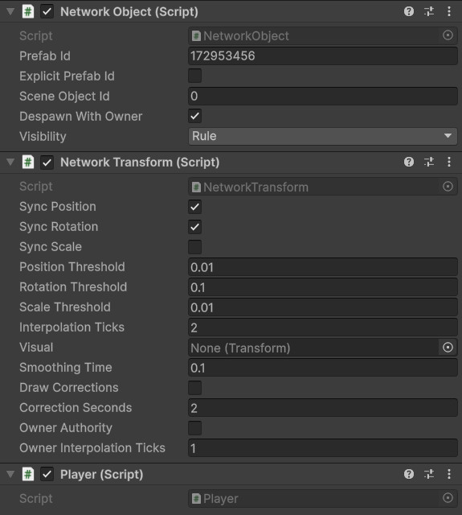

# 1. Chuẩn bị project

Trong phần này bạn chuẩn bị mọi thứ game cần trước khi chạy được: một `NetworkManager` trong scene, một script player chứa state và logic nhảy, và một player prefab. Hết trang này game vẫn chưa kết nối mạng; [phần 2](server.md) mới khởi động server.

Trước khi bắt đầu, hãy hoàn thành [cài đặt](../installation.md) với thư mục model `Assets/Network/Models` và thư mục sinh code `Assets/Network/Generated`.

## 1. Thêm NetworkManager vào scene <a href="#1-add-a-networkmanager-to-the-scene" id="1-add-a-networkmanager-to-the-scene"></a>

`NetworkManager` chạy networking cho scene. Nó cần một transport, tức component chuyên chở byte, và tutorial này dùng UDP.

1. Tạo một scene, `Assets/Scenes/Game.unity`, và mở nó.
2. Mở **File > Build Profiles** và thêm scene vào **Scene List**. Bản build player cần scene có trong danh sách này, và package cũng lấy danh sách scene của nó từ đây.
3. Tạo một GameObject trống ở gốc scene và đặt tên `Network Manager`.
4. Thêm component **Udp Network Transport** vào nó.
5. Thêm component **Network Manager** và kéo component `UdpNetworkTransport` vào field **Transport** của nó.

Để các field khác ở giá trị mặc định: **Tick Rate** 30 và **Timing Mode** Tick. [NetworkManager](../../connections/network-manager.md) mô tả từng field. Một `NetworkManager` không có transport sẽ tự thêm `UdpNetworkTransport` cho mình khi khởi động, nhưng gán transport trong scene giúp lựa chọn đó hiện rõ.

## 2. Viết script cho player <a href="#2-write-the-player-script" id="2-write-the-player-script"></a>

Tạo `Assets/Network/Player.cs`:

```csharp
using Fomoxa.Networking;
using Fomoxa.Unity;
using UnityEngine;

namespace MyGame.Network
{
    [NetworkStateModel("PlayerStats")]
    public sealed partial class Player : NetworkBehaviour
    {
        [NetworkState(OnChanged = nameof(OnJumpsChanged))]
        private uint jumps;

        public override void OnStartClient()
        {
            Debug.Log($"player {NetworkObject.ObjectId} spawned, owner {NetworkObject.OwnerId}, mine: {NetworkObject.IsOwner}, jumps: {jumps}");
        }

        private void OnGUI()
        {
            if (NetworkObject == null || !NetworkObject.IsOwner)
            {
                return;
            }

            GUILayout.BeginArea(new Rect(10, 70, 160, 30));
            if (GUILayout.Button("Jump"))
            {
                SendJumpServerRpc();
            }

            GUILayout.EndArea();
        }

        [ServerRpc]
        private void Jump()
        {
            transform.position += Vector3.up;
            jumps++;
        }

        private void OnJumpsChanged(uint previous, uint current)
        {
            Debug.Log($"player {NetworkObject.ObjectId} jumps: {previous} -> {current}");
        }
    }
}
```

`[NetworkState]` đưa `jumps` vào state của player. Server gửi nó mỗi khi nó thay đổi, và mỗi client ghi giá trị mới vào đúng field đó rồi gọi `OnJumpsChanged` với giá trị trước và giá trị hiện tại. `OnStartClient` chạy trên client khi object xuất hiện ở đó, và lúc ấy `jumps` đã giữ giá trị của server. `[NetworkStateModel("PlayerStats")]` đặt tên cho model mang state; các trang [console server](../../console-server/runtime.md) dùng tên đó.

`[ServerRpc]` đánh dấu `Jump` là method server chạy khi một client gọi nó. Mặc định chỉ owner được gọi. `Jump` chạy trên server: nó dời transform, thứ mà `NetworkTransform` gửi xuống client, và thay đổi state, thứ mà package gửi đi ở cuối tick.

`OnGUI` chỉ vẽ nút Jump trên client sở hữu player này. Bấm nút sẽ gọi `SendJumpServerRpc()`, tức là yêu cầu server chạy `Jump`. Bạn không viết `SendJumpServerRpc`: package sinh nó từ method `[ServerRpc]`.

Class phải là `partial` vì package thêm method đó cùng code đăng ký RPC và state vào class. Khi Unity biên dịch file này, package viết model của state vào `Assets/Network/Generated/StateModels/PlayerStats.cs` và model của RPC vào `Assets/Network/Generated/RpcModels/PlayerJump.cs`, sinh codec cho chúng, rồi Unity biên dịch lần thứ hai với các file mới. Nếu Console hiện một cảnh báo `[Fomoxa]` có `+ new message`, đó là điều bình thường: package báo mọi thay đổi của schema.

## 3. Tạo player prefab <a href="#3-make-the-player-prefab" id="3-make-the-player-prefab"></a>

1. Trong scene, tạo một capsule bằng **GameObject > 3D Object > Capsule** và đặt tên `Player`.
2. Thêm ba component vào nó: **Network Object**, **Network Transform** và **Player**.
3. Kéo nó vào `Assets/Prefabs` để tạo prefab, rồi xóa nó khỏi scene.
4. Chọn **Tools > Fomoxa > Assign Prefab Ids**.

<figure><figcaption><p>Prefab Player sau Assign Prefab Ids. Prefab Id của bạn sẽ là một số khác.</p></figcaption></figure>

Bước cuối gán cho prefab một prefab id, con số server và client dùng để thống nhất cần spawn gì, và viết `Assets/Network/Generated/FomoxaPrefabList.asset`. Chọn prefab và kiểm tra **Prefab Id** khác 0. Package cũng tự chạy bước này mỗi khi bạn lưu prefab trong Editor, và trước mỗi lần build player.

`NetworkObject` phải nằm ở root của prefab, và prefab không được chứa một `NetworkObject` thứ hai.

## 4. Đưa các danh sách sinh ra cho NetworkManager <a href="#4-give-the-networkmanager-the-generated-lists" id="4-give-the-networkmanager-the-generated-lists"></a>

Chọn `Network Manager` và kéo hai asset sinh ra vào nó:

- `Assets/Network/Generated/FomoxaPrefabList.asset` vào **Collected Prefabs**.
- `Assets/Network/Generated/FomoxaSceneList.asset` vào **Collected Scenes**.

`NetworkManager` đăng ký mọi prefab trong danh sách khi khởi động. Bản build player tự gán cả hai danh sách trong lúc build, nhưng trong Editor việc đó sẽ diễn ra sau khi `NetworkManager` đã khởi động, nên hãy gán chúng trong scene. Thiếu chúng, việc spawn thất bại với `prefab id 0x... of Player(Clone) is not registered`.

Lưu scene.

## Kiểm tra lại <a href="#check-your-work" id="check-your-work"></a>

- Project biên dịch không lỗi.
- `Assets/Network/Generated` có `StateModels/PlayerStats.cs`, `RpcModels/PlayerJump.cs`, `PlayerStatsNetAdapter.cs`, `PlayerJumpNetAdapter.cs`, `FomoxaPrefabList.asset` và `FomoxaPrefabs.cs`.
- `FomoxaPrefabs.cs` có các hằng số `PlayerId` và `PlayerFingerprint`.
- Vào Play Mode chưa thấy gì xảy ra, vì `NetworkManager` đứng yên cho tới khi code khởi động server hoặc client.

Tiếp tục với [phần 2: khởi động server](server.md).
