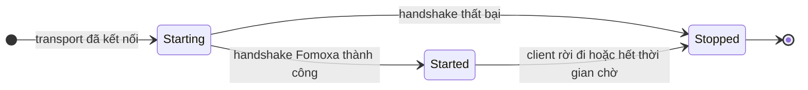
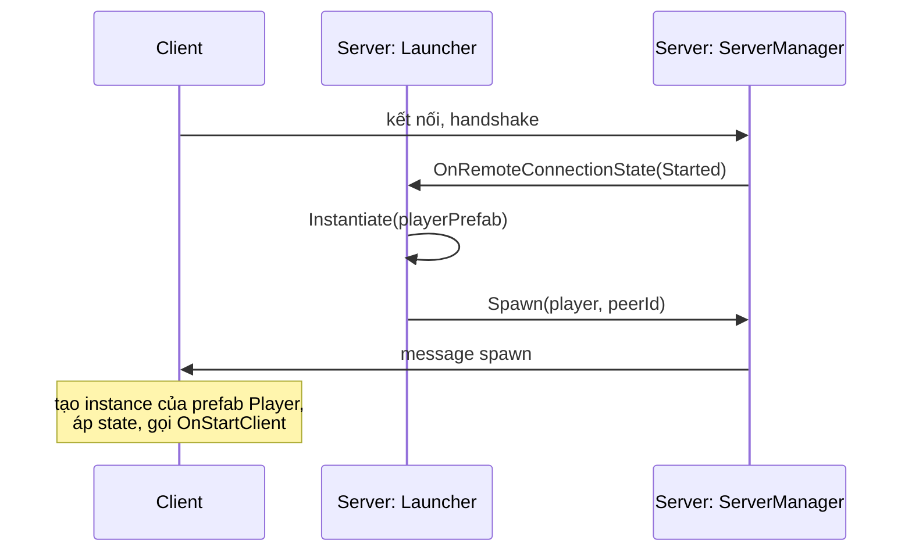
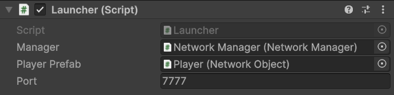

# 2. Khởi động server

Trong phần này bạn thêm một launcher vào scene của [phần 1](project-setup.md). Launcher vẽ ba nút **Server**, **Host** và **Client**, và server do nó khởi động sẽ spawn một `Player` cho mỗi client kết nối tới. Trang này chỉ thử server; [phần 3](clients.md) mới kết nối client vào.

## 1. Viết launcher <a href="#1-write-the-launcher" id="1-write-the-launcher"></a>

Tạo `Assets/Network/Launcher.cs`:

```csharp
using System;
using Fomoxa.Networking;
using Fomoxa.Networking.Sessions;
using Fomoxa.Unity;
using UnityEngine;

namespace MyGame.Network
{
    public sealed class Launcher : MonoBehaviour
    {
        [SerializeField] private NetworkManager manager;
        [SerializeField] private NetworkObject playerPrefab;
        [SerializeField] private ushort port = 7777;

        private string address = "127.0.0.1";

        private void Start()
        {
            manager.ServerManager.OnRemoteConnectionState += OnRemoteConnectionState;
            manager.ClientManager.OnClientConnectionState += OnClientConnectionState;
            if (Array.IndexOf(Environment.GetCommandLineArgs(), "-server") >= 0)
            {
                StartServer();
            }
        }

        private void OnDestroy()
        {
            if (manager != null && manager.ServerManager != null)
            {
                manager.ServerManager.OnRemoteConnectionState -= OnRemoteConnectionState;
                manager.ClientManager.OnClientConnectionState -= OnClientConnectionState;
            }
        }

        private void OnGUI()
        {
            GUILayout.BeginArea(new Rect(10, 10, 300, 120));
            DrawControls();
            GUILayout.EndArea();
        }

        private void DrawControls()
        {
            bool serverRunning = manager.ServerManager.State != ServerState.Stopped;
            bool clientRunning = manager.ClientManager.State != ConnectionState.Stopped;
            if (serverRunning || clientRunning)
            {
                GUILayout.Label($"server: {manager.ServerManager.State}, peers: {manager.ServerManager.PeerCount}, client: {manager.ClientManager.State}");
                if (GUILayout.Button("Stop"))
                {
                    manager.ClientManager.StopConnection();
                    manager.ServerManager.StopConnection();
                }

                return;
            }

            address = GUILayout.TextField(address);
            if (GUILayout.Button("Server"))
            {
                StartServer();
            }

            if (GUILayout.Button("Host"))
            {
                StartServer();
                manager.ClientManager.StartConnection(address, manager.ServerManager.Port);
            }

            if (GUILayout.Button("Client"))
            {
                manager.ClientManager.StartConnection(address, port);
            }
        }

        private void StartServer()
        {
            manager.ServerManager.StartConnection(port);
            Debug.Log($"server listening on port {manager.ServerManager.Port}");
        }

        private void OnRemoteConnectionState(ConnectionStateArgs args)
        {
            Debug.Log($"peer {args.PeerId}: {args.State} {args.Reason}");
            if (args.State != ConnectionState.Started)
            {
                return;
            }

            var position = new Vector3(args.PeerId * 2f, 0f, 0f);
            NetworkObject player = Instantiate(playerPrefab, position, Quaternion.identity);
            manager.ServerManager.Spawn(player, args.PeerId);
        }

        private void OnClientConnectionState(ConnectionStateArgs args)
        {
            Debug.Log($"client: {args.State} {args.Reason}");
        }
    }
}
```

Launcher đăng ký event kết nối trong `Start` thay vì `Awake`, vì `NetworkManager` tạo `ServerManager` và `ClientManager` trong `Awake` của chính nó, và Unity chạy mọi `Awake` trong scene trước mọi `Start`.

## 2. Phần server hoạt động thế nào <a href="#2-how-the-server-part-works" id="2-how-the-server-part-works"></a>

`ServerManager.StartConnection(port)` mở listener của transport trên port đó. Port 0 yêu cầu hệ điều hành chọn một port trống, và `ServerManager.Port` luôn cho biết port đang dùng.

Mỗi client kết nối tới được cấp một peer id, `args.PeerId`, và `ServerManager.OnRemoteConnectionState` báo mọi thay đổi trong kết nối của client đó. Một client đi qua ba trạng thái:



`Starting` bao gồm handshake của Fomoxa, trong đó client và server kiểm tra rằng cả hai được build từ cùng một bộ model. Message chỉ đi được khi client tới `Started`, nên launcher spawn player ở đúng thời điểm đó:



`ServerManager.Spawn(player, args.PeerId)` cấp cho object một object id, đặt peer làm owner và gửi object tới mọi client đang observe nó. Object truyền vào phải là một instance trong scene, không phải asset prefab, và prefab của nó phải được đăng ký với `NetworkManager`, việc mà danh sách **Collected Prefabs** đã làm ở phần 1.

Mặc định một `NetworkObject` bị despawn cùng owner của nó. Khi một client rời đi, package despawn player của client đó, và trên server việc despawn sẽ hủy instance. `ServerManager.StopConnection()` ngắt kết nối mọi client và despawn mọi object.

## 3. Thêm launcher vào scene <a href="#3-add-the-launcher-to-the-scene" id="3-add-the-launcher-to-the-scene"></a>

1. Chọn `Network Manager` và thêm component **Launcher**.
2. Kéo component `NetworkManager` vào field **Manager** của nó, và prefab `Player` vào **Player Prefab**.
3. Lưu scene.

<figure><figcaption><p>Component Launcher trên GameObject Network Manager.</p></figcaption></figure>

## 4. Thử server <a href="#4-test-the-server" id="4-test-the-server"></a>

Vào Play Mode và bấm **Server**.

- Console hiện `server listening on port 7777`.
- Dòng chữ ở góc trên bên trái là `server: Started, peers: 0, client: Stopped`.

Bấm **Stop** và thoát Play Mode.

Nếu `StartConnection` ném `SocketException`, port không mở được, ví dụ vì một tiến trình khác đang dùng UDP port 7777. Đổi field **Port** của launcher và thử lại.

## 5. Chạy dedicated server <a href="#5-run-a-dedicated-server" id="5-run-a-dedicated-server"></a>

Dedicated server là một bản build player chạy không có đồ họa. Launcher khởi động server mỗi khi dòng lệnh có `-server`.

1. Mở **File > Build Profiles**, chọn nền tảng desktop của bạn và build player, ví dụ ra `Builds/MyGame.exe` trên Windows.
2. Khởi động nó từ terminal:

```
MyGame.exe -batchmode -nographics -server -logFile server.log
```

`server.log` phải có dòng `server listening on port 7777`. Để tiến trình tiếp tục chạy cho phần sau, và dừng nó bằng công cụ quản lý tiến trình của hệ điều hành khi xong. [Dedicated server](../../deploy/dedicated-server.md) nói về frame rate, port và các chi tiết khác.

Tiếp tục với [phần 3: kết nối client](clients.md).
