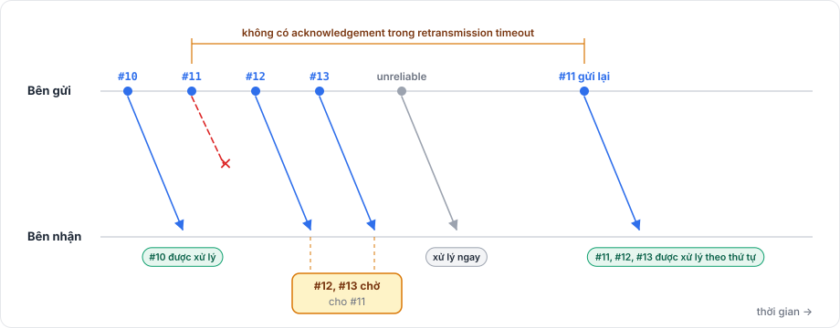

# Channel và độ tin cậy

Mỗi message id đi trên một trong hai channel:

| Channel | Giao nhận | Thứ tự | Dùng cho |
|---|---|---|---|
| `Channel.Unreliable` (mặc định) | Có thể mất | Không đảm bảo | Dữ liệu sắp được thay thế: vị trí, hiệu ứng, cập nhật thường xuyên |
| `Channel.ReliableOrdered` | Tới đúng một lần | Theo thứ tự gửi, giữa mọi message reliable của kết nối | Sự kiện không được mất: state, spawn, chat, giao dịch mua |

Package tự hiện thực độ tin cậy, trên bất kỳ transport nào. Kể cả qua TCP và WebSocket, vốn đã reliable, message reliable vẫn mang sequence number và acknowledgement của nó.

## Chọn channel <a href="#choosing-a-channel" id="choosing-a-channel"></a>

Channel thuộc về một message id, nên bạn khai báo nó trên model, mỗi codec một lần:

```csharp
[Network]
[Codec("net")]
[NetworkChannel("net", Channel.ReliableOrdered)]
public class ChatLine
{
    [Network("string")]
    [Codec("net")]
    public string Text { get; set; }
}
```

Model không có `[NetworkChannel]` là unreliable. Mỗi `[NetworkChannel]` phải chỉ tới một codec mà model khai báo, và mỗi codec có nhiều nhất một attribute như vậy.

Phần đăng ký sinh ra ghi các channel vào `FomoxaRegistry.Channels`, nên bạn không bao giờ chọn channel khi gửi. Channel được áp dụng thế nào phụ thuộc vào việc model dùng để làm gì:

| Dùng làm | Channel |
|---|---|
| State model | Phải là `ReliableOrdered`; nếu không, đăng ký sẽ ném exception |
| RPC có model | Channel của model |
| RPC không tham số | Mặc định `ReliableOrdered`, đặt bằng property `Channel` của attribute |
| Input model và reconcile model | Bị bỏ qua; package mang chúng bên trong các message unreliable của riêng nó |
| Raw message | Channel của model |

## Độ tin cậy hoạt động thế nào <a href="#how-reliability-works" id="how-reliability-works"></a>

<figure><figcaption><p>Message reliable giữ thứ tự, nên một lần mất làm chậm các message reliable phía sau, nhưng không làm chậm message unreliable.</p></figcaption></figure>

Mỗi message reliable mang một sequence number 2 byte. Bên nhận gửi acknowledgement gồm sequence number tiếp theo nó chờ và một mask 32 bit cho các message đã nhận sau số đó, và các acknowledgement này đi chung bundle với các message khác. Message tới trước một message còn thiếu sẽ chờ trong buffer cho tới khi chỗ trống được lấp, và message trùng bị bỏ.

Bên gửi gửi lại message nếu acknowledgement của nó không tới trong retransmission timeout. Timeout bắt đầu ở 200 ms rồi theo round trip đo được, nằm trong khoảng 50 ms tới 1 s. Tối đa Reliable Window message (mặc định 1024) có thể đang bay mà chưa được acknowledge, và các message reliable tiếp theo chờ trong send queue.

Vì thứ tự được giữ trên mọi message reliable của một kết nối, một message bị mất sẽ giữ các message reliable phía sau lại cho tới khi nó được gửi lại. Message unreliable không bị giữ lại.

## Kích thước message <a href="#message-size" id="message-size"></a>

Khi flush, message được đóng vào các bundle vừa với frame budget của transport, tức 1200 byte với UDP và frame Fomoxa lớn nhất với TCP và WebSocket.

Package chia message `ReliableOrdered` lớn hơn frame budget thành các mảnh, mỗi mảnh một bundle. Mỗi mảnh có sequence number riêng và được gửi lại riêng khi bị mất; bên nhận ghép các mảnh rồi giao message một lần. Message nằm ở đầu send queue cho tới khi mảnh cuối đã đi, và không message nào xếp sau nó được đi trước. Với TCP và WebSocket, frame budget là frame Fomoxa lớn nhất, và không message nào bị chia.

Message reliable cần chia dài tối đa 1 MiB (1048576 byte). Gửi message lớn hơn sẽ trả về `SendResult.TooLargeForReassembly`, và message không được đưa vào queue. Dữ liệu như vậy hãy gửi qua TCP hoặc WebSocket, hoặc tách thành nhiều message. Các object message của chính package, như spawn, luôn được xếp hàng; nếu một message như vậy quá lớn để chia, lần flush bỏ nó và phát `OnSendDropped` với `SendStatus.TooLarge`.

Message `Unreliable` lớn hơn frame budget được gửi nguyên, một mình trong bundle riêng. IP sau đó chia nhỏ datagram, và mất một mảnh IP bất kỳ là mất cả message, nên hãy gửi dữ liệu lớn qua `ReliableOrdered`.

Lệnh gửi lớn hơn Byte Capacity (mặc định 1 MiB) trả về `SendResult.TooLargeForQueue` và không được đưa vào queue. Với UDP, một bundle không bị chia phải vừa một datagram có frame tối đa 65499 byte, tính cả header của frame, còn với TCP và WebSocket giao thức cho phép message tới 16 MiB. Message mà transport hoàn toàn không gửi được sẽ bị bỏ, và package phát `OnSendDropped` với `SendStatus.TooLarge` và log `Fomoxa dropped message 0x... (N bytes) to peer <id>: TooLarge`.

Nếu phía bên kia gửi các mảnh không ghép được với nhau, kết nối dừng với `StopReason.InvalidFragment` và client không kết nối lại. Package không bao giờ gửi các mảnh như vậy, nên phía bên kia đang không theo giao thức.

Channel được khai báo trên [model](models.md). [Mô hình networking](../concepts/networking-model.md) cho thấy channel nằm ở đâu trên đường gửi, và [hiệu năng](../advanced/performance.md) nói về chi phí của message reliable.
