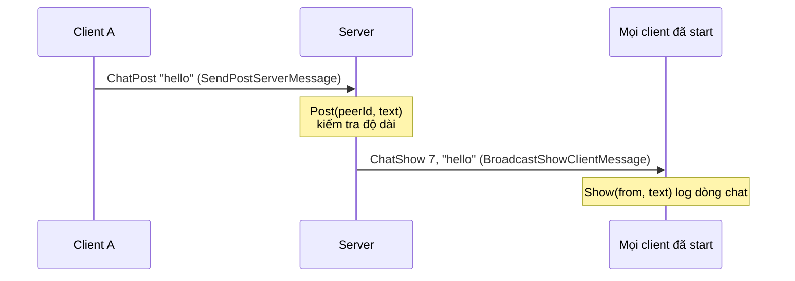

# Raw message

RPC gắn với một object đã spawn, còn raw message thì không. Một raw message đi từ client lên server hoặc từ server xuống các client của nó, và một handler đăng ký cho message id của nó xử lý nó. Chúng phù hợp với message toàn game như chat, sự kiện trận đấu hay dữ liệu lobby.

## Khi nào dùng <a href="#when-to-use-them" id="when-to-use-them"></a>

Dùng raw message khi message không gắn tự nhiên với object nào, khi nó phải hoạt động trước khi có object nào được spawn, hoặc khi bạn muốn xử lý nó một lần cho mỗi kết nối thay vì mỗi object.

Raw message bỏ qua observer và các phép kiểm tra ownership. Server gửi chúng tới bất kỳ peer nào bạn chọn, và handler nhận peer id của bên gửi, nên hãy kiểm tra mọi thứ client gửi lên.

## Cách dùng cơ bản <a href="#basic-usage" id="basic-usage"></a>

Trong Unity, raw message được khai báo bằng method của một class `partial` kế thừa `NetworkMessageBehaviour`. Component sau chuyển tiếp chat qua server:

```csharp
using Fomoxa.Networking.Sessions;
using Fomoxa.Unity;
using UnityEngine;

public sealed partial class Chat : NetworkMessageBehaviour
{
    private const int MaxLength = 200;

    public SendResult Say(string text) => SendPostServerMessage(text);

    [ServerMessage]
    private void Post(ulong peerId, string text)
    {
        if (string.IsNullOrWhiteSpace(text) || text.Length > MaxLength)
        {
            return;
        }

        BroadcastShowClientMessage(peerId, text);
    }

    [ClientMessage]
    private void Show(ulong from, string text) => Debug.Log($"{from}: {text}");
}
```

Thêm `Chat` vào một GameObject trong scene và kéo `NetworkManager` vào field **Manager** của nó. `Post` chạy trên server, `Show` chạy trên mọi client. Host chạy cả hai.

Luồng chuyển tiếp như sau:



## Khai báo message <a href="#declaring-messages" id="declaring-messages"></a>

| Attribute | Handler chạy trên | Chữ ký |
|---|---|---|
| `[ServerMessage]` | Server | `void M(ulong peerId, ...)` hoặc `void M(...)`. Tham số đầu tiên có type `ulong` nhận peer id của bên gửi và không được gửi |
| `[ClientMessage]` | Các client | `void M(...)`. Mọi tham số đều được gửi |

Cả hai attribute nằm trong namespace `Fomoxa.Unity`. Method có thể là private, nhưng không được là static hay generic, không được trả về giá trị, và không có tham số `ref`, `out`, `in` hay `params`. Tham số được gửi như tham số của [RPC](rpc.md#parameter-types), và `[NetworkType("...")]` đặt wire type cho một tham số.

Bước Editor ghi một model cho mỗi message vào thư mục con `MessageModels` của Generated Folder, trong namespace `FomoxaMessageModels`. Tên model là tên class theo sau là tên method, trong ví dụ là `ChatPost` và `ChatShow`, và model có một property cho mỗi tham số được gửi. Message đi trên `ReliableOrdered`; đặt channel khác trên attribute, ví dụ `[ClientMessage(Channel = Channel.Unreliable)]`.

Đổi tên class hoặc method sẽ đổi model và message id của nó, như với RPC, trừ khi attribute giữ nguyên tên: `[ServerMessage("ChatPost")]`. Mỗi message cần một tên model riêng, và tên đó cũng không được trùng tên model của RPC hay state; bước sinh code dừng với một lỗi nêu tên cả hai khai báo. Tham số theo [luật của RPC](rpc.md#the-generated-model) về giữ tương thích với bản build cũ, và build player thất bại chừng nào một model message còn thiếu hoặc cũ.

## Gửi <a href="#sending" id="sending"></a>

Generator viết các method gửi `protected` trên class:

| Message | Method gửi | Trả về |
|---|---|---|
| `[ServerMessage] void Post(ulong peerId, string text)` | `SendPostServerMessage(string text)` | `SendResult` |
| `[ClientMessage] void Show(ulong from, string text)` | `SendShowClientMessage(ulong peerId, ulong from, string text)` | `SendResult` |
| | `BroadcastShowClientMessage(ulong from, string text)` | Số peer ở trạng thái `Started` đã được đưa vào queue |

Client gọi các method `ServerMessage`, server gọi các method `ClientMessage`. Các method gửi có từ lần biên dịch đầu tiên, trước khi model được sinh. Gọi một method khi model của nó còn thiếu sẽ ném `InvalidOperationException`: `<Type>.<Method> has no generated message model for its parameters; run Tools > Fomoxa > Generate`. Đối số `string` hoặc model không được là `null`; method gửi ném `ArgumentNullException` kèm tên tham số.

Đối số được encode và copy vào send queue trong lúc gọi. `SendResult.NotConnected` nghĩa là kết nối hoặc peer không tồn tại. Message gửi khi kết nối đang `Starting` hoặc `Authenticating` chờ trong queue và đi khi kết nối đã khởi động.

## Bật và tắt <a href="#enabling-and-disabling" id="enabling-and-disabling"></a>

`NetworkMessageBehaviour` đăng ký handler của nó lên `ServerManager.Dispatcher` và `ClientManager.Dispatcher` của `NetworkManager` trong `OnEnable`, và gỡ chúng trong `OnDisable`. Message tới khi component đang tắt là message không có handler và bị bỏ mà không ghi log.

`OnEnable` khởi tạo `NetworkManager` trước, nên nó chạy trước hay sau `Awake` của manager cũng như nhau. Khi field **Manager** trống, `OnEnable` không đăng ký gì và ném `InvalidOperationException` với `<Class> has no NetworkManager; assign one in the Inspector or set NetworkManager`. Các method gửi ném cùng exception đó.

Mỗi message id có một handler trên mỗi dispatcher, nên chỉ một instance đang bật của một class dùng được một `NetworkManager`. Bật instance thứ hai sẽ ném `HandlerRegistrationException` và không đăng ký message nào của nó; instance đầu vẫn hoạt động.

Để tạo component từ code, thêm nó vào một GameObject đang tắt, gán manager, rồi bật GameObject:

```csharp
var chatObject = new GameObject("Chat");
chatObject.SetActive(false);
Chat chat = chatObject.AddComponent<Chat>();
chat.NetworkManager = manager;
chatObject.SetActive(true);
```

Gán `NetworkManager` cho một component đang bật sẽ gỡ handler khỏi manager cũ và đăng ký chúng lên manager mới. Với component đang tắt, phép gán chỉ đổi field.

Class con cần `OnEnable` hoặc `OnDisable` thì override chúng và gọi method của lớp gốc:

```csharp
protected override void OnEnable()
{
    base.OnEnable();
    Debug.Log("Chat is ready");
}
```

## Nhận <a href="#receiving" id="receiving"></a>

Handler nhận các giá trị bên gửi đã truyền, và handler `[ServerMessage]` còn nhận peer id của bên gửi. Trên client, message luôn tới từ server.

Handler ném exception trên server sẽ đóng kết nối của peer đó: peer dừng với `StopReason.HandlerException`, còn client dừng với `ServerClosed` và `CloseReason` là `HandlerException`. Handler ném exception trên client sẽ dừng client với `HandlerException`. Message có phần thân không decode được thì chỉ bị bỏ.

## Gửi qua các manager <a href="#sending-through-the-managers" id="sending-through-the-managers"></a>

`ClientManager` và `ServerManager` gửi raw message trực tiếp, với bất kỳ [model](models.md) nào và adapter của nó. Console server dùng các method này, và code Unity không hợp với một component cũng dùng được chúng. Bắt đầu với model:

```csharp
using Fomoxa;
using Fomoxa.Networking;

namespace MyGame.Network.Models
{
    [Network]
    [Codec("net")]
    [NetworkChannel("net", Channel.ReliableOrdered)]
    public class ChatLine
    {
        [Network("string")]
        [Codec("net")]
        public string Text { get; set; }
    }
}
```

Rồi đăng ký handler ở mỗi phía cần nhận nó, và gửi bằng adapter:

```csharp
ChatLineNetAdapter codec = ChatLineNetAdapter.Instance;
manager.ServerManager.Dispatcher.Register(codec, (ulong peerId, ChatLine line) => Debug.Log($"{peerId}: {line.Text}"));
manager.ClientManager.Send(codec, new ChatLine { Text = "hello" });
```

| Method | Gửi tới |
|---|---|
| `ClientManager.Send(codec, value)` | Server |
| `ServerManager.Send(peerId, codec, value)` | Một peer |
| `ServerManager.Broadcast(codec, value)` | Mọi peer ở trạng thái `Started`; trả về số peer đã được đưa vào queue |

`Dispatcher.Register(codec, handler)` decode mọi message vào một instance tạo lúc đăng ký, nên handler thấy cùng một object mỗi lần. Hãy copy các giá trị bạn muốn giữ. `Dispatcher.Unregister(messageId)` gỡ handler của một message id, và không làm gì khi id đó không có handler.

Message id phải có trong schema đã sinh, và mỗi id chỉ có một handler trên mỗi dispatcher. Nếu không, `Register` ném `HandlerRegistrationException` với `message id 0x... is not declared in the schema` hoặc `already has a handler`. Hãy đăng ký sau khi `NetworkManager` đã chạy `Awake`, ví dụ trong `Start`, và trước khi message tới. Trên client, `peerId` luôn là 0.

Các method này cũng nhận một message id và các byte đã encode: `ClientManager.Send(messageId, payload)`, `ServerManager.Send(peerId, messageId, payload)`, `ServerManager.Broadcast(messageId, payload)` và `Dispatcher.Register(messageId, (peerId, payload) => { })`. Payload truyền cho handler kiểu này chỉ hợp lệ trong lúc gọi, nên hãy decode hoặc copy nó trước khi return. `MessageDecodeException` từ `Decode` làm message bị bỏ.

`ClientManager.SendToObject` và `ServerManager.SendToObject` gửi một message tới một behaviour của một object, giống cách RPC làm. RPC được xây trên hai method này, và code game nên dùng RPC.

## Lỗi biên dịch <a href="#compile-errors" id="compile-errors"></a>

Source generator báo các lỗi biên dịch sau cho message:

| Id | Ý nghĩa |
|---|---|
| `FOMOXA023` | Method không nằm trong một `NetworkMessageBehaviour` |
| `FOMOXA024` | Class, hoặc một class chứa nó, không phải `partial` |
| `FOMOXA025` | Chữ ký message không được hỗ trợ |
| `FOMOXA026` | Method mang cả `[ServerMessage]` lẫn `[ClientMessage]` |
| `FOMOXA027` | Một method gửi sẽ trùng tên một member đã có |
| `FOMOXA028` | Class khai báo `OnEnable` hoặc `OnDisable` mà không có `override` |

Raw message là [model](models.md) đi trên [channel](channels.md) của nó, như [RPC](rpc.md). [Messaging API](../reference/messaging.md) liệt kê `NetworkMessageBehaviour`, các member của dispatcher và các method gửi.
