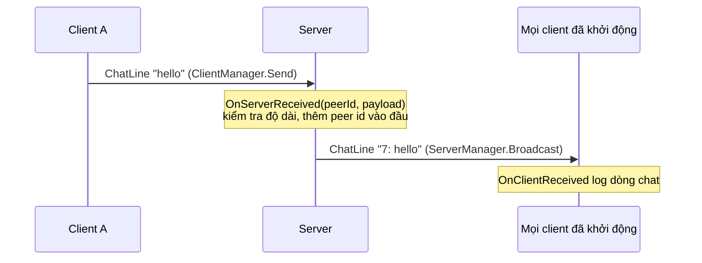

# Raw message

RPC gắn với một object đã spawn, còn raw message thì không. Với raw message, server và client gửi một model theo message id của nó, và một handler đăng ký cho id đó xử lý nó. Chúng phù hợp với message toàn game như chat, sự kiện trận đấu hay dữ liệu lobby.

## Khi nào dùng <a href="#when-to-use-them" id="when-to-use-them"></a>

Dùng raw message khi message không gắn tự nhiên với object nào, khi nó phải hoạt động trước khi có object nào được spawn, hoặc khi bạn muốn xử lý nó một lần cho mỗi kết nối thay vì mỗi object.

Raw message bỏ qua observer và các phép kiểm tra ownership. Server gửi chúng tới bất kỳ peer nào bạn chọn, và handler nhận peer id của bên gửi, nên hãy kiểm tra mọi thứ client gửi lên.

## Cách dùng cơ bản <a href="#basic-usage" id="basic-usage"></a>

Bắt đầu với model:

```csharp
using Fomoxa;
using Fomoxa.Networking;

namespace MyGame.Network.Models
{
    [Network]
    [Codec("net")]
    [NetworkChannel("net", Channel.ReliableOrdered)]
    public class ChatLine
    {
        [Network("string")]
        [Codec("net")]
        public string Text { get; set; }
    }
}
```

Component sau chuyển tiếp chat qua server:

```csharp
using System;
using Fomoxa.Networking;
using Fomoxa.Networking.Sessions;
using Fomoxa.Unity;
using Generated;
using MyGame.Network.Models;
using UnityEngine;

public sealed class Chat : MonoBehaviour
{
    private const int MaxLength = 200;

    [SerializeField] private NetworkManager manager;

    private readonly ChatLine received = new ChatLine();

    private static ChatLineNetAdapter Codec => ChatLineNetAdapter.Instance;

    private void Start()
    {
        manager.ServerManager.Dispatcher.Register(Codec.MessageId, OnServerReceived);
        manager.ClientManager.Dispatcher.Register(Codec.MessageId, OnClientReceived);
    }

    public SendResult Say(string text) =>
        manager.ClientManager.Send(Codec.MessageId, Codec.Encode(new ChatLine { Text = text }).Span);

    private void OnServerReceived(ulong peerId, ReadOnlyMemory<byte> payload)
    {
        ChatLine line = received;
        Codec.Decode(payload, ref line);
        if (string.IsNullOrWhiteSpace(line.Text) || line.Text.Length > MaxLength)
        {
            return;
        }

        line.Text = $"{peerId}: {line.Text}";
        manager.ServerManager.Broadcast(Codec.MessageId, Codec.Encode(line).Span);
    }

    private void OnClientReceived(ulong peerId, ReadOnlyMemory<byte> payload)
    {
        ChatLine line = received;
        Codec.Decode(payload, ref line);
        Debug.Log(line.Text);
    }
}
```

Luồng chuyển tiếp như sau:



## Gửi <a href="#sending" id="sending"></a>

| Method | Gửi tới |
|---|---|
| `ClientManager.Send(messageId, payload)` | Server |
| `ServerManager.Send(peerId, messageId, payload)` | Một peer |
| `ServerManager.Broadcast(messageId, payload)` | Mọi peer ở trạng thái `Started`; trả về số peer đã được đưa vào queue |

Payload được copy vào send queue trong lúc gọi, và message đi trên channel của model. `Send` trả về một `SendResult`, trong đó `NotConnected` nghĩa là kết nối hoặc peer không tồn tại.

`ClientManager.SendToObject` và `ServerManager.SendToObject` gửi một message tới một behaviour của một object, giống cách RPC làm. RPC được xây trên hai method này, và code game nên dùng RPC.

## Nhận <a href="#receiving" id="receiving"></a>

`ServerManager.Dispatcher` và `ClientManager.Dispatcher` là hai đối tượng riêng, nên hãy đăng ký handler ở mỗi phía cần nhận message:

```csharp
manager.ServerManager.Dispatcher.Register(messageId, (peerId, payload) => { });
```

Message id phải có trong schema đã sinh, và mỗi id chỉ có một handler trên mỗi dispatcher. Nếu không, `Register` ném `HandlerRegistrationException` với `message id 0x... is not declared in the schema` hoặc `already has a handler`. Hãy đăng ký sau khi `NetworkManager` đã chạy `Awake`, ví dụ trong `Start`, và trước khi message tới.

Trên client, `peerId` luôn là 0. `payload` chỉ hợp lệ trong lúc gọi, nên hãy decode hoặc copy nó trước khi return. Handler ném exception trên server sẽ đóng kết nối của peer đó: peer dừng với `StopReason.HandlerException`, còn client dừng với `ServerClosed` và `CloseReason` là `HandlerException`. Handler ném exception trên client sẽ dừng client với `HandlerException`. Ngược lại, `MessageDecodeException` từ `Decode` chỉ làm message bị bỏ.

Raw message là [model](models.md) đi trên [channel](channels.md) của nó, giống như [RPC](rpc.md). [Messaging API](../reference/messaging.md) liệt kê các member của dispatcher và các method gửi.
