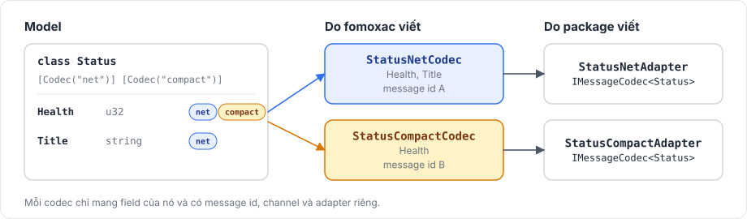

# Model và codec

Model là một class C# mô tả một message, tức các field và wire type của chúng. Trình biên dịch `fomoxac` đi kèm sinh một codec cho mỗi model, và package bọc mỗi codec trong một adapter, thứ mà phần còn lại của API làm việc cùng.

Package sinh các model mang RPC, state và input của behaviour, nên bạn không viết chúng. Bạn viết model cho dữ liệu có cấu trúc mà một tham số RPC hoặc một field state chứa, cho [raw message](messages.md), cho dữ liệu [xác thực](../connections/authentication.md) và [truyền file](../connections/transfer.md), và cho RPC và state của một [console server](../console-server/runtime.md) mà behaviour Unity không khai báo.

## Cách dùng cơ bản <a href="#basic-usage" id="basic-usage"></a>

Các class model nằm trong Models Folder đặt trong asset `FomoxaSettings`:

```csharp
using Fomoxa;

namespace MyGame.Network.Models
{
    [Network]
    [Codec("net")]
    public class Shot
    {
        [Network("u32")]
        [Codec("net")]
        public uint Weapon { get; set; }

        [Network("Vector3")]
        [Codec("net")]
        public UnityEngine.Vector3 Direction { get; set; }

        [Network("Array<u16>")]
        [Codec("net")]
        public System.Collections.Generic.List<ushort> Targets { get; set; } = new System.Collections.Generic.List<ushort>();
    }
}
```

Sau khi biên dịch, package sinh `ShotNetCodec` và `ShotNetAdapter` trong Generated Folder. Sau đó model có thể là type của một tham số RPC hoặc một field state, chúng đi bằng codec `net` của model:

```csharp
[ServerRpc]
private void Fire(Shot shot)
{
}
```

Ở chỗ API yêu cầu một `IMessageCodec<Shot>`, như với [raw message](messages.md), hãy truyền adapter `ShotNetAdapter.Instance`.

## Attribute <a href="#attributes" id="attributes"></a>

| Attribute | Đặt trên | Ý nghĩa |
|---|---|---|
| `[Network]` | Class | Class là một model |
| `[Codec("name")]` | Class | Model có một codec mang tên này. Một class có thể khai báo nhiều codec. |
| `[Network("type")]` | Property hoặc field | Member là một field với wire type này |
| `[Codec("name")]` | Property hoặc field | Member thuộc về codec này. `[Codec("net", "compact")]` khai báo nhiều codec cùng lúc. |
| `[NetworkChannel("codec", Channel.ReliableOrdered)]` | Class | Channel của một codec của model; xem [channel](channels.md) |

`[Network]` và `[Codec]` đến từ `Fomoxa.Attributes.dll`, trong namespace `Fomoxa`, còn `[NetworkChannel]` và `Channel` nằm trong namespace `Fomoxa.Networking`.

Một codec chỉ mang một property khi property đó có cả `[Network("type")]` và một `[Codec("name")]` với tên của codec. Codec bỏ qua mọi property khác, nên một model có thể giữ dữ liệu cục bộ bên cạnh các field mạng.

## Wire type <a href="#wire-types" id="wire-types"></a>

| Wire type | Type C# |
|---|---|
| `bool` | `bool` |
| `i8`, `u8` | `sbyte`, `byte` |
| `i16`, `u16` | `short`, `ushort` |
| `i32`, `u32` | `int`, `uint` |
| `i64`, `u64` | `long`, `ulong` |
| `f32`, `f64` | `float`, `double` |
| `string` | `string` |
| `bytes` | `ReadOnlyMemory<byte>` |
| `Array<T>` | `List<T>` của type C# tương ứng với phần tử |
| Tên một model khác | Class của model đó |
| `Vector2`, `Vector3`, `Vector4`, `Vector2Int`, `Vector3Int`, `Quaternion`, `Color`, `Color32`, `Rect` | Type cùng tên trong `UnityEngine` |

Package ghi codec cho các type của Unity vào thư mục con `UnityCodecs` của Generated Folder, và chỉ cho những type mà model của bạn thực sự dùng. Mảng của một type Unity, như `Array<Vector3>`, không biên dịch được và package cảnh báo về điều đó; hãy gửi các phần tử thành field riêng hoặc bọc mỗi phần tử trong một model. Để thêm type của riêng bạn, xem [codec tùy chỉnh](../advanced/custom-codecs.md).

## Tên được sinh <a href="#generated-names" id="generated-names"></a>

Với model `Shot` có codec `net`:

| Được sinh | Tên | Nội dung |
|---|---|---|
| Codec | `ShotNetCodec` | `MessageId`, `Encode` và `Decode` dạng static, do `fomoxac` viết |
| Adapter | `ShotNetAdapter` | `IMessageCodec<Shot>` với một `Instance` static |

Tên codec được chuyển sang PascalCase, nên codec tên `wide` cho ra `ShotWideAdapter` và codec tên `wide_one` cho ra `ShotWideOneAdapter`. Mọi type được sinh nằm chung một namespace, mang tên thư mục cuối của đường dẫn Generated Folder, nên `Assets/Network/Generated` cho ra `Generated`.

Các adapter hiện thực `IMessageCodec<T>`, interface có ba member:

| Member | Ý nghĩa |
|---|---|
| `MessageId` | Message id của model và codec này |
| `Encode(T value)` | Encode một giá trị. Vùng nhớ trả về được dùng lại ở lần gọi tiếp theo trên cùng adapter, nên hãy copy nếu cần giữ. |
| `Decode(ReadOnlyMemory<byte> payload, ref T value)` | Decode vào một instance có sẵn và giữ nguyên các property mà codec này không mang; ném `MessageDecodeException` với dữ liệu không hợp lệ |

## Nhiều codec cho một model <a href="#several-codecs-per-model" id="several-codecs-per-model"></a>

<figure><figcaption><p>Ví dụ Status bên dưới: một class, hai codec, hai message id.</p></figcaption></figure>

Một model có thể khai báo nhiều codec, mỗi codec chọn một tập field riêng:

```csharp
[Network]
[Codec("net")]
[Codec("compact")]
public class Status
{
    [Network("u32")]
    [Codec("net")]
    [Codec("compact")]
    public uint Health { get; set; }

    [Network("string")]
    [Codec("net")]
    public string Title { get; set; }
}
```

Mỗi codec có message id và adapter riêng, ở đây là `StatusNetAdapter` và `StatusCompactAdapter`. Tham số RPC hoặc field state có type `Status` dùng codec `net`, nên model dùng theo cách đó cần có codec này.

## Schema và tương thích <a href="#schema-and-compatibility" id="schema-and-compatibility"></a>

Mỗi lần sinh code còn ghi `NetSchema.cs`, danh sách mọi message id và layout của chúng. Trong lúc handshake, client và server so schema của nhau, từng message một. Hai phiên bản của một model làm việc được với nhau khi các field của bản này là các field đầu tiên của bản kia, nên thêm property vào cuối model, hoặc bỏ các property cuối, vẫn giữ được kết nối với bản build cũ. Chèn, đổi thứ tự, đổi type hoặc đổi tên một property làm handshake thất bại với `HandshakeFailure.SchemaConflict`, nên sau thay đổi như vậy hãy build lại cả server lẫn client. Khi package sinh code, Console in một kết luận cho mỗi model đã đổi, bắt đầu bằng `COMPATIBLE:` hoặc `BREAKING:`.

## Giới hạn <a href="#limitations" id="limitations"></a>

Ngoài các model của chính package và các model nó sinh cho RPC, state và input, chỉ những class trong Models Folder mới có codec. Binary `fomoxac` đi kèm cho Editor Windows x64, Linux x64 và macOS.

Model mang [RPC](rpc.md), [state](../synchronization/state.md), [input](../prediction/input.md) và [raw message](messages.md). [Messaging API](../reference/messaging.md) liệt kê các type codec, và [tích hợp Editor](../advanced/editor-integration.md) mô tả bước sinh code.
