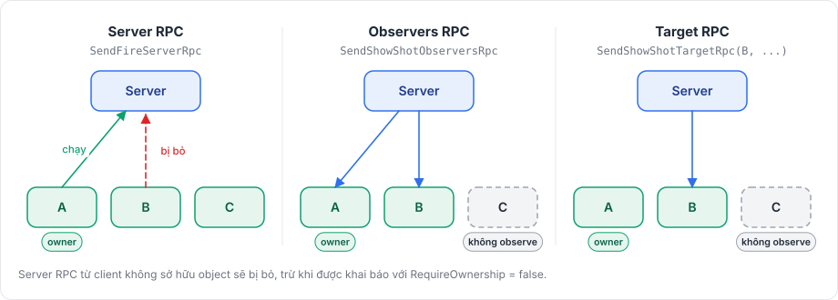

# RPC

RPC (remote procedure call) chạy một method của `NetworkBehaviour` ở phía bên kia của kết nối. RPC đi theo ba hướng:

| RPC | Từ | Tới | Gửi bằng |
|---|---|---|---|
| Server RPC | Một client | Server | `Send<Method>ServerRpc` |
| Observers RPC | Server | Mọi client observe object | `Send<Method>ObserversRpc` |
| Target RPC | Server | Một client observe object | `Send<Method>TargetRpc` |

RPC nhận số tham số bất kỳ, và package viết method gửi cho từng RPC từ chữ ký của nó.

<figure><figcaption><p>Phía nào gửi từng loại RPC, và ai nhận.</p></figcaption></figure>

## Khai báo RPC <a href="#declaring-rpcs" id="declaring-rpcs"></a>

```csharp
using Fomoxa.Networking;
using Fomoxa.Unity;
using UnityEngine;

public sealed partial class Turret : NetworkBehaviour
{
    public void RequestFire(Vector3 direction, byte weapon) => SendFireServerRpc(direction, weapon);

    public void RequestReload() => SendReloadServerRpc();

    [ServerRpc]
    private void Fire(ulong peerId, Vector3 direction, byte weapon)
    {
        Debug.Log($"peer {peerId} fires weapon {weapon}");
        SendShowShotObserversRpc(direction);
    }

    [ServerRpc]
    private void Reload()
    {
        SendPlayReloadObserversRpc();
    }

    [ClientRpc]
    private void ShowShot(Vector3 direction)
    {
        Debug.DrawRay(transform.position, direction, Color.red, 1f);
    }

    [ClientRpc]
    private void PlayReload()
    {
        GetComponent<AudioSource>().Play();
    }
}
```

Class phải là `partial`, và mọi class chứa nó cũng vậy. Một source generator trong package thêm vào class các method gửi và code đăng ký từng RPC khi object spawn.

### Chữ ký <a href="#signatures" id="signatures"></a>

| Attribute | Chữ ký |
|---|---|
| `[ServerRpc]` | `void M(...)`. Tham số đầu tiên có type `ulong` nhận peer id của bên gọi và không được gửi |
| `[ClientRpc]` | `void M(...)`. Mọi tham số đều được gửi |

Method có thể là private, nhưng không được là static hay generic, không được trả về giá trị, và không có tham số `ref`, `out`, `in` hay `params`.

### Type của tham số <a href="#parameter-types" id="parameter-types"></a>

Package tự xác định cách mỗi tham số được gửi:

| Type C# | Gửi dưới dạng |
|---|---|
| `bool`, `sbyte`, `byte`, `short`, `ushort`, `int`, `uint`, `long`, `ulong`, `float`, `double`, `string` | Type nguyên thuỷ tương ứng |
| `Vector2`, `Vector3`, `Vector4`, `Vector2Int`, `Vector3Int`, `Quaternion`, `Color`, `Color32`, `Rect`, và các type đăng ký bằng `FomoxaUnityTypes.Register` | Các [type Unity](../advanced/custom-codecs.md#unity-types) của package |
| Class đánh dấu `[Network]` có codec `net` | [Model](models.md) đó |

Với type khác, hoặc để gửi một giá trị ở dạng khác, hãy đặt `[NetworkType("...")]` kèm wire type lên tham số, ví dụ `[NetworkType("f16")] float yaw` hoặc `[NetworkType("Array<u32>")] List<uint> targets`. Tham số có type mà package không xác định được sẽ dừng bước sinh code với `[ServerRpc] <Type>.<Method>: the parameter <name> has the type <type>, whose wire type com.fomoxa.networking cannot infer; give the parameter [NetworkType("...")]`.

Đối số `string` hoặc model không được là `null`; method gửi ném `ArgumentNullException` kèm tên tham số.

### Model sinh ra <a href="#the-generated-model" id="the-generated-model"></a>

Tham số của một RPC đi trong một model mà package sinh ra ở thư mục con `RpcModels` của Generated Folder. Tên model là tên class theo sau là tên method, trong ví dụ là `TurretFire`, và model có một field cho mỗi tham số được gửi, đặt theo tên tham số với chữ cái đầu viết hoa. RPC không tham số có một model rỗng.

Khi bạn thêm một RPC hoặc đổi tham số của nó, package sinh model sau lần biên dịch kế tiếp và Unity biên dịch lại. Build player thất bại chừng nào một model sinh ra còn thiếu hoặc cũ.

Tham số theo cùng luật với [field state](../synchronization/state.md#changing-the-fields). Thêm một tham số vào cuối, hoặc bỏ tham số cuối, vẫn giữ được kết nối với bản build cũ; tham số mà bản build cũ không gửi sẽ tới dưới dạng 0, `false` hoặc giá trị rỗng. Chèn, đổi thứ tự, đổi type hoặc đổi tên một tham số, trừ đổi chữ hoa chữ thường hay dấu gạch dưới, thì không, và đổi tên class hoặc method cũng vậy, trừ khi attribute giữ nguyên tên model. Console hiện kết luận khi model được sinh. Luật này không áp cho một RPC mà bản build cũ hoàn toàn không có: khi thêm RPC mới, hãy phát hành server và client cùng lúc.

Khi hai RPC cho ra cùng một tên model, hãy đặt tên khác cho một trong hai bằng đối số của attribute, như `[ServerRpc("TurretReloadRequest")]`.

### Channel <a href="#channels" id="channels"></a>

RPC đi trên `ReliableOrdered` theo mặc định. Đặt channel khác trên attribute, ví dụ `[ClientRpc(Channel = Channel.Unreliable)]` cho một hiệu ứng được phép mất.

### Ownership <a href="#ownership" id="ownership"></a>

Server RPC chỉ chạy khi bên gọi sở hữu object. Server bỏ các lời gọi khác và phát `ServerManager.OnServerRpcRejected` kèm peer, object, behaviour và message id của RPC. Khi không có gì subscribe, server log `Fomoxa dropped server RPC 0x... to object <id> from peer <id>, which does not own the object` thay vào đó. Để client nào cũng gọi được, ví dụ trên một cánh cửa ai cũng mở được, hãy khai báo nó bằng `[ServerRpc(RequireOwnership = false)]`.

## Gửi <a href="#sending" id="sending"></a>

Với mỗi RPC, generator viết các method gửi `protected` trên class:

| RPC | Method gửi | Trả về |
|---|---|---|
| `[ServerRpc] void Fire(ulong peerId, Vector3 direction, byte weapon)` | `SendFireServerRpc(Vector3 direction, byte weapon)` | `SendResult` của queue |
| `[ClientRpc] void ShowShot(Vector3 direction)` | `SendShowShotObserversRpc(Vector3 direction)` | Số observer mà RPC đã được đưa vào queue |
| | `SendShowShotTargetRpc(ulong peerId, Vector3 direction)` | `SendResult`; `NotObserver` khi peer không observe object |

Tham số peer id của server RPC do server điền, nên nó không nằm trong method gửi. Các method gửi có từ lần biên dịch đầu tiên, trước khi model được sinh. Method gửi mà tên đã bị một member khác của class dùng thì không được sinh, và generator báo `FOMOXA011`.

Các đối số được encode ngay trong lời gọi, nên sau đó bạn được sửa hoặc dùng lại chúng, và RPC đi cùng lần flush tiếp theo ở cuối tick.

Server RPC chỉ gửi được ở nơi object đã spawn trên client, còn observers RPC hoặc target RPC chỉ ở nơi object đã spawn trên server. Ngược lại, lời gọi ném `<name> is not spawned on the client` hoặc `on the server`. Trên host, observers RPC cũng tới client của host nếu client đó observe object, và client RPC khi đó chạy trên instance dùng chung.

### Gửi theo tên <a href="#sending-by-name" id="sending-by-name"></a>

Các method sinh ra gọi những method `protected` của `NetworkBehaviour` nhận tên RPC, và bạn cũng có thể tự gọi chúng:

| Method | Đối số |
|---|---|
| `SendServerRpc(string rpc)`, `SendObserversRpc(string rpc)`, `SendTargetRpc(ulong peerId, string rpc)` | Không có |
| `SendServerRpc<TValues>(string rpc, TValues values)`, `SendObserversRpc<TValues>(...)`, `SendTargetRpc<TValues>(ulong peerId, ...)` | Một giá trị, hoặc một tuple khi có nhiều giá trị |

```csharp
SendServerRpc(nameof(Reload));
SendServerRpc(nameof(Fire), (direction, weapon));
SendTargetRpc(peerId, nameof(ShowShot), direction);
```

Các giá trị phải có type của các tham số được gửi của RPC, theo đúng thứ tự. Nếu không, lời gọi ném `ArgumentException`; với method sinh ra, trình biên dịch bắt được lỗi này. Method khai báo ở class cha có thể được gửi theo tên từ class con.

## Nhận <a href="#receiving" id="receiving"></a>

Method RPC chạy ở phía nhận với các giá trị đã gửi. Tham số đầu tiên `ulong` của server RPC chứa id của peer đã gọi nó. Mỗi lời gọi nhận instance mới của các đối số là model, nên method được phép giữ chúng lại.

## Lỗi trong handler <a href="#errors-in-handlers" id="errors-in-handlers"></a>

Server RPC ném exception sẽ đóng kết nối của client gọi nó: peer dừng với `StopReason.HandlerException`, còn client dừng với `ServerClosed` và `CloseReason` là `HandlerException`. Client RPC ném exception sẽ dừng client đó với `HandlerException`. Trong cả hai trường hợp client không kết nối lại. Trên server, subscriber của `OnHandlerException` có thể đặt `Disconnect` thành `false` để giữ kết nối với client. Message không decode được thì được xử lý khác: nó bị bỏ và phát `OnReceiveDropped`. Hãy kiểm tra tham số của server RPC, và viết chúng sao cho input xấu không làm nó ném exception; [lỗi](../concepts/error-handling.md#validate-client-data-in-server-handlers) chỉ cách làm.

## Lỗi biên dịch <a href="#compile-errors" id="compile-errors"></a>

Source generator báo các lỗi biên dịch sau cho RPC trên một `NetworkBehaviour`:

| Id | Ý nghĩa |
|---|---|
| `FOMOXA001` | Method không nằm trong một `NetworkBehaviour` |
| `FOMOXA002` | Class, hoặc một class chứa nó, không phải `partial` |
| `FOMOXA003` | Chữ ký `[ServerRpc]` không được hỗ trợ |
| `FOMOXA004` | Chữ ký `[ClientRpc]` không được hỗ trợ |
| `FOMOXA005` | Method mang nhiều hơn một trong `[NetworkRpc]`, `[ServerRpc]`, `[ClientRpc]` |
| `FOMOXA009` | `Codec` được đặt trên attribute; nó không áp dụng trên `NetworkBehaviour` |
| `FOMOXA011` | Một method gửi sẽ trùng tên với một member đã có |
| `FOMOXA022` | Method mang `[NetworkRpc]`; hãy khai báo nó bằng `[ServerRpc]` hoặc `[ClientRpc]` |

## Giới hạn <a href="#limitations" id="limitations"></a>

RPC luôn gửi tới một behaviour của một object đã spawn. Để gửi message không gắn với object, dùng [raw message](messages.md).

Các model sinh ra đi trên [channel](channels.md) của RPC. [Tham chiếu attribute](../reference/attributes.md) liệt kê mọi attribute và property của RPC, và [NetworkBehaviour](../objects/network-behaviour.md) tóm tắt các method gửi. [Console server](../console-server/runtime.md) khai báo và đăng ký RPC trên `EntityBehaviour`, với model viết tay.
