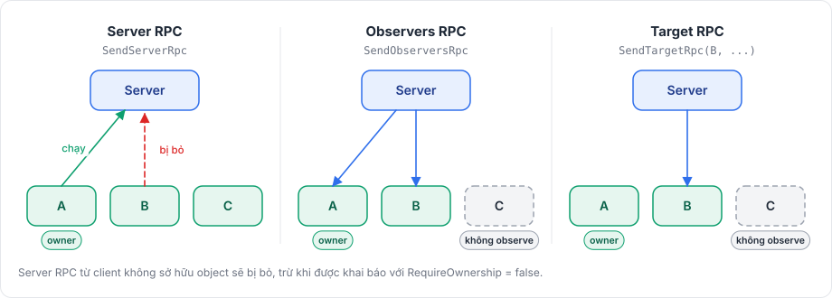

# RPC

RPC (remote procedure call) chạy một method của `NetworkBehaviour` ở phía bên kia của kết nối. RPC đi theo ba hướng:

| RPC | Từ | Tới | Gửi bằng |
|---|---|---|---|
| Server RPC | Một client | Server | `SendServerRpc` |
| Observers RPC | Server | Mọi client đang observe object | `SendObserversRpc` |
| Target RPC | Server | Một client đang observe object | `SendTargetRpc` |

Mỗi RPC nhận không tham số nào hoặc đúng một [model](models.md).

<figure><figcaption><p>Phía nào gửi từng loại RPC, và ai nhận.</p></figcaption></figure>

## Khai báo RPC bằng attribute <a href="#declaring-rpcs-with-attributes" id="declaring-rpcs-with-attributes"></a>

```csharp
using Fomoxa.Networking;
using Fomoxa.Unity;
using Generated;
using MyGame.Network.Models;
using UnityEngine;

public sealed partial class Turret : NetworkBehaviour
{
    public void RequestFire(Shot shot) => SendServerRpc(ShotNetAdapter.Instance, shot);

    public void RequestReload() => SendServerRpc(nameof(Reload));

    [ServerRpc]
    private void Fire(ulong peerId, Shot shot)
    {
        Debug.Log($"peer {peerId} fires weapon {shot.Weapon}");
        SendObserversRpc(ShotNetAdapter.Instance, shot);
    }

    [ServerRpc]
    private void Reload()
    {
        SendObserversRpc(nameof(PlayReload));
    }

    [ClientRpc]
    private void ShowShot(Shot shot)
    {
        Debug.DrawRay(transform.position, shot.Direction, Color.red, 1f);
    }

    [ClientRpc]
    private void PlayReload()
    {
        GetComponent<AudioSource>().Play();
    }
}
```

Class phải là `partial`, và mọi class chứa nó cũng vậy, vì một source generator trong package viết code đăng ký từng method có attribute khi object spawn.

### Chữ ký được phép <a href="#allowed-signatures" id="allowed-signatures"></a>

| Attribute | Chữ ký |
|---|---|
| `[ServerRpc]` | `void M()`, `void M(ulong peerId)`, `void M(TModel value)`, `void M(ulong peerId, TModel value)` |
| `[ClientRpc]` | `void M()`, `void M(TModel value)` |

`TModel` là một model có adapter đã sinh, và `peerId` nhận peer id của bên gọi. Method có thể là private, nhưng không được là static hay generic.

### RPC có model <a href="#rpcs-with-a-model" id="rpcs-with-a-model"></a>

Server và client tra RPC theo message id của model, nên chính model quyết định method nào chạy. Trong ví dụ, `SendObserversRpc(ShotNetAdapter.Instance, shot)` chạy `ShowShot` trên các client.

Khi model có một codec, generator dùng adapter của codec đó. Khi có nhiều codec, hãy chỉ ra codec cần dùng, như `[ServerRpc(Codec = "compact")]`. RPC đi trên channel của model, khai báo bằng `[NetworkChannel]` trên model, và là unreliable nếu model không khai báo channel nào.

### RPC không có model <a href="#rpcs-without-a-model" id="rpcs-without-a-model"></a>

Với mỗi RPC không tham số, package sinh một model rỗng trong thư mục con `RpcModels` của Generated Folder, và bạn gọi các RPC này theo tên method:

```csharp
SendServerRpc(nameof(Reload));
SendObserversRpc(nameof(PlayReload));
SendTargetRpc(peerId, nameof(PlayReload));
```

Model được sinh mang tên class nối với tên method, `TurretReload` trong ví dụ. Khi hai method cho ra cùng một tên, hãy đặt tên khác cho một method qua tham số của attribute, như `[ServerRpc("TurretReloadRequest")]`. Channel được đặt trên attribute và mặc định là `ReliableOrdered`, nên RPC unreliable được khai báo là `[ClientRpc(Channel = Channel.Unreliable)]`.

Khi bạn thêm hoặc đổi tên một method như vậy, package sinh model của nó sau lần biên dịch tiếp theo và Unity biên dịch lại lần nữa. Build player sẽ thất bại chừng nào còn một model được sinh bị thiếu hoặc lỗi thời. Method khai báo trong base class có thể được gọi theo tên từ class con.

### Ownership <a href="#ownership" id="ownership"></a>

Server RPC chỉ chạy khi bên gọi sở hữu object. Server bỏ các lời gọi khác và log `Fomoxa dropped server RPC 0x... to object <id> from peer <id>, which does not own the object`. Để mọi client đều gọi được, ví dụ với cánh cửa ai cũng mở được, hãy khai báo `[ServerRpc(RequireOwnership = false)]`.

## Gửi <a href="#sending" id="sending"></a>

Các method gửi là member `protected` của `NetworkBehaviour`:

| Method | Trả về |
|---|---|
| `SendServerRpc<T>(IMessageCodec<T> codec, T value)`, `SendServerRpc(string rpc)` | `SendResult` của queue |
| `SendObserversRpc<T>(IMessageCodec<T> codec, T value)`, `SendObserversRpc(string rpc)` | Số observer mà RPC đã được đưa vào queue |
| `SendTargetRpc<T>(ulong peerId, IMessageCodec<T> codec, T value)`, `SendTargetRpc(ulong peerId, string rpc)` | `SendResult`; `NotObserver` khi peer không observe object |

Giá trị được encode ngay trong lúc gọi, nên bạn có thể thay đổi hoặc dùng lại nó sau đó, và RPC đi cùng lần flush tiếp theo ở cuối tick.

Server RPC chỉ gửi được ở nơi object đã spawn trên client, còn observers RPC và target RPC chỉ ở nơi object đã spawn trên server. Nếu không, lời gọi ném `<name> is not spawned on the client` hoặc `on the server`. Trên host, observers RPC cũng tới client của host nếu client đó observe object, và client RPC khi đó chạy trên instance dùng chung.

## Đăng ký thủ công <a href="#registering-by-hand" id="registering-by-hand"></a>

Thay vì dùng attribute, bạn có thể đăng ký handler bằng code trong `OnRegisterRpcs`, hook chạy một lần cho mỗi instance trước `OnStartServer` hoặc `OnStartClient`:

```csharp
using Fomoxa.Networking;
using Fomoxa.Unity;
using Generated;
using UnityEngine;

public sealed class Lever : NetworkBehaviour
{
    public void RequestPull() => SendServerRpc(nameof(Pull));

    protected override void OnRegisterRpcs(NetworkRpcs rpc)
    {
        rpc.OnServer(nameof(Pull), peerId => Pull(), requireOwnership: false);
        rpc.OnClient(nameof(PlayClick), PlayClick);
        rpc.OnClient(ShotNetAdapter.Instance, shot => Debug.Log($"weapon {shot.Weapon}"));
    }

    [NetworkRpc]
    private void Pull()
    {
        SendObserversRpc(nameof(PlayClick));
    }

    [NetworkRpc]
    private void PlayClick()
    {
        GetComponent<AudioSource>().Play();
    }
}
```

| Method | Đăng ký |
|---|---|
| `OnServer<T>(IMessageCodec<T> codec, Action<ulong, T> handler, bool requireOwnership = true)` | Server RPC có model |
| `OnClient<T>(IMessageCodec<T> codec, Action<T> handler)` | Client RPC có model |
| `OnServer(string rpc, Action<ulong> handler, bool requireOwnership = true)` | Server RPC không tham số |
| `OnClient(string rpc, Action handler)` | Client RPC không tham số |

RPC không tham số đăng ký thủ công vẫn cần model được sinh của nó. `[NetworkRpc]` sinh model đó mà không sinh phần đăng ký, nên class chỉ dùng `[NetworkRpc]` không cần là `partial`. Nó nhận cùng tham số tên model và property `Channel` như `[ServerRpc]`. Nếu thiếu model, việc đăng ký ném `<Type>.<Method> has no generated parameterless RPC model; mark the method with [NetworkRpc] and run Tools > Fomoxa > Generate`.

Đừng đăng ký thủ công một method đã mang `[ServerRpc]` hoặc `[ClientRpc]`, vì behaviour đăng ký cùng một message id hai lần ở một phía sẽ ném `HandlerRegistrationException`.

Mỗi lần gọi handler nhận một instance model mới, nên handler có thể giữ lại instance đó.

## Lỗi trong handler <a href="#errors-in-handlers" id="errors-in-handlers"></a>

Server RPC handler ném exception sẽ đóng kết nối của client gọi nó: peer dừng với `StopReason.HandlerException`, còn client dừng với `ServerClosed` và `CloseReason` là `HandlerException`. Client RPC handler ném exception sẽ dừng client đó với `HandlerException`. Trong cả hai trường hợp client không kết nối lại. Model không decode được thì được xử lý khác: nó bị bỏ và phát `OnReceiveDropped`. Hãy kiểm tra tham số của server RPC, và viết handler sao cho input xấu không làm nó ném exception.

## Lỗi biên dịch <a href="#compile-errors" id="compile-errors"></a>

Source generator báo các lỗi biên dịch sau:

| Id | Ý nghĩa |
|---|---|
| `FOMOXA001` | Method không nằm trong một `NetworkBehaviour` |
| `FOMOXA002` | Class, hoặc một class chứa nó, không phải `partial` |
| `FOMOXA003` | Chữ ký `[ServerRpc]` không được hỗ trợ |
| `FOMOXA004` | Chữ ký `[ClientRpc]` không được hỗ trợ |
| `FOMOXA005` | Method mang nhiều hơn một trong `[NetworkRpc]`, `[ServerRpc]`, `[ClientRpc]` |
| `FOMOXA006` | Model không có adapter đã sinh; chạy Tools > Fomoxa > Generate |
| `FOMOXA007` | Model có nhiều codec và attribute không chỉ ra codec nào |
| `FOMOXA008` | Codec được chỉ ra không tồn tại cho model |
| `FOMOXA009` | `Codec` được đặt trên RPC không có model |
| `FOMOXA010` | Tên model hoặc `Channel` được đặt trên RPC có model; hãy khai báo channel trên model |

## Giới hạn <a href="#limitations" id="limitations"></a>

RPC nhận nhiều nhất một tham số, nên nhiều giá trị phải gom vào một model. Ở mỗi phía, một message id thuộc về một type behaviour: model dùng làm server RPC cho một type không thể làm server RPC cho type khác, và model dùng làm RPC không thể đồng thời làm state model. Cùng một model vẫn có thể vừa là server RPC vừa là client RPC, như `Shot` trong ví dụ trên.

RPC luôn gửi tới một behaviour của một object đã spawn. Để gửi message không gắn với object, dùng [raw message](messages.md).

Tham số là các [model](models.md) đi trên [channel](channels.md) của chúng. [Tham chiếu attribute](../reference/attributes.md) liệt kê mọi attribute và property của RPC, và [NetworkBehaviour](../objects/network-behaviour.md) tóm tắt các method gửi.
