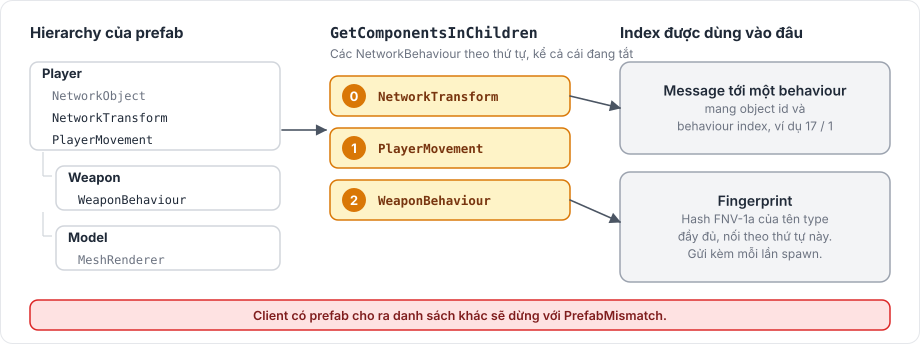

# NetworkObject

`NetworkObject` đánh dấu một GameObject là object tồn tại trên mạng. Server gán cho nó một object id khi nó spawn, và mỗi client observe nó sẽ tạo hoặc kích hoạt một instance tương ứng. Mọi `NetworkBehaviour` trên GameObject và trên các object con đều thuộc về nó.

## Khi nào dùng 

Đặt `NetworkObject` ở gốc của mọi prefab mà server spawn, như người chơi, đạn hay vật phẩm, và trên các object đặt sẵn trong scene mà server cần điều khiển, như cửa hay bệ di chuyển. Object không bao giờ thay đổi, hoặc mọi client có thể tự tính ra, thì không cần.

## Cách dùng cơ bản 

1. Thêm `NetworkObject` vào gốc của một prefab.
2. Thêm các component `NetworkBehaviour` vào prefab, ở gốc hoặc ở object con.
3. Lưu prefab. Package gán một prefab id.
4. Đảm bảo prefab được đăng ký với `NetworkManager`, qua Collected Prefabs hoặc danh sách Prefabs.
5. Trên server, instantiate prefab và gọi `ServerManager.Spawn`.

[Spawn](spawning.md) nói chi tiết về hai bước cuối.

## Field 

<figure><figcaption>
NetworkObject trên prefab Player của tutorial.
</figcaption></figure>

| Field | Mặc định | Ý nghĩa |
|---|---|---|
| Prefab Id | được gán | Id mà server và client dùng cho prefab này. Editor điền nó từ asset GUID của prefab. |
| Explicit Prefab Id | tắt | Giữ Prefab Id viết tay thay vì id suy ra từ GUID |
| Scene Object Id | được gán | Id của object đặt trong scene. Editor điền nó khi scene được lưu. Asset prefab có giá trị 0. |
| Despawn With Owner | bật | Server despawn object khi owner ngắt kết nối. Khi tắt, object được giữ lại và chuyển sang do server sở hữu. |
| Visibility | Rule | `Rule`: Observer Rule của `NetworkManager` quyết định. `Everyone`: mọi client observe nó. `OwnerOnly`: chỉ owner observe. Xem [observer](observers.md). |

`DespawnWithOwner` và `Visibility` cũng có thể đặt từ code, và server đọc giá trị hiện tại của chúng vào lúc cần.

## Property 

| Property | Ý nghĩa |
|---|---|
| `ObjectId` | Id server đã gán; 0 khi chưa spawn |
| `PrefabId` | Prefab id |
| `SceneObjectId` | Scene object id; 0 với instance prefab |
| `OwnerId` | Peer id của owner; 0 khi server sở hữu hoặc khi chưa spawn |
| `IsOwner` | True trên client sở hữu object, kể cả client của host |
| `IsSpawned` | True khi đang spawn trên server hoặc trên một client của tiến trình này |
| `Behaviours` | Các component `NetworkBehaviour` của object, theo thứ tự behaviour index |
| `Body`, `Body2D` | Physics body của object, xem [PhysicsBody](../physics/physics-body.md) |

`IsOwner` chỉ có thể true trên client. Trên dedicated server nó luôn false, kể cả với object do server sở hữu.

## Cách hoạt động 

<figure><figcaption>
Behaviour index đi theo hierarchy, và fingerprint kiểm tra hai phía có cùng index hay không.
</figcaption></figure>

Khi object spawn, package thu thập mọi `NetworkBehaviour` bên dưới GameObject, kể cả những cái đang tắt, bằng `GetComponentsInChildren`, và vị trí của một behaviour trong danh sách đó trở thành behaviour index của nó. Message tới object mang object id và behaviour index, nên danh sách phải giống hệt nhau trên server và client.

Package kiểm tra điều này bằng một fingerprint, là hash của tên type đầy đủ của các behaviour theo thứ tự. Server gửi fingerprint kèm mỗi lần spawn, và client có prefab với danh sách khác sẽ dừng với `PrefabMismatch`.

## Giới hạn 

Với prefab, `NetworkObject` phải nằm ở gốc. Scene object có thể nằm ở bất kỳ đâu trong hierarchy, nhưng không được nằm dưới một `NetworkObject` khác, vì `NetworkObject` lồng nhau không được hỗ trợ. Một object có tối đa 256 component `NetworkBehaviour`.

Hủy `GameObject` trên server sẽ despawn object. Hủy nó trên client mà không có lệnh despawn từ server thì chỉ gỡ nó khỏi danh sách object của client, kèm một cảnh báo.

Các script thuộc object được mô tả trong [NetworkBehaviour](network-behaviour.md). [Spawn](spawning.md), [ownership](ownership.md) và [observer](observers.md) nói về những gì server làm với object, và [tham chiếu NetworkObject](../reference/network-object.md) liệt kê mọi member.
