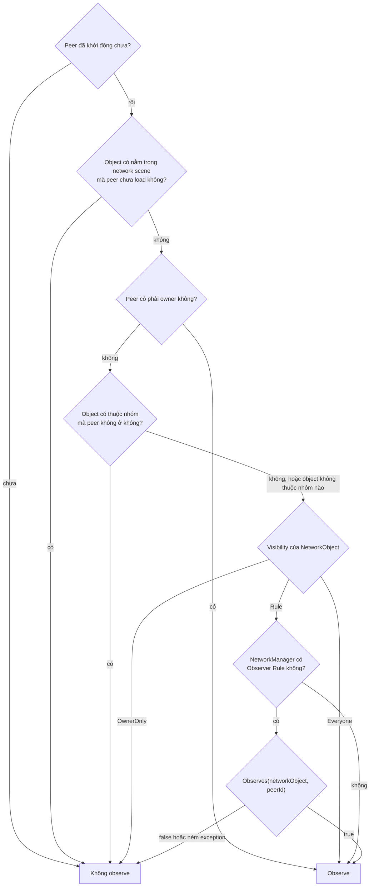
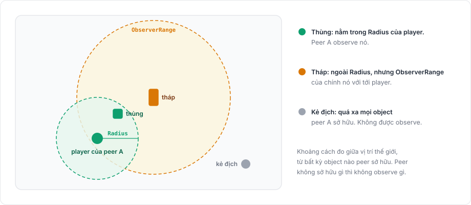

# Observer

Observer của một object là client nhận object đó. Với mỗi object đã spawn, server giữ tập các peer observe nó. Peer vào tập sẽ nhận message spawn của object, peer rời tập sẽ nhận despawn, còn state, cập nhật transform và RPC tới observer chỉ đi tới các peer trong tập.

Giới hạn observer giúp tiết kiệm băng thông và giữ thông tin khỏi những client không nên có nó, như kẻ địch sau bức tường hay quân của đội khác.

## Ai observe một object <a href="#who-observes-an-object" id="who-observes-an-object"></a>

Với mỗi peer và mỗi object, server xét lần lượt các điều kiện dưới đây và dừng ở điều kiện đầu tiên cho ra kết quả.



1. Peer chưa khởi động thì không observe gì.
2. Object trong một network scene chỉ được observe bởi các peer đã load scene đó. Điều này áp dụng cả cho owner.
3. Owner observe các object của chính nó, kể cả khi owner không ở nhóm nào của object.
4. Object thuộc ít nhất một [nhóm](#groups) thì không được observe bởi peer không ở nhóm nào trong số đó.
5. Tiếp theo là field Visibility của object. Với `Everyone`, peer observe object, còn với `OwnerOnly` thì không.
6. Với `Rule`, giá trị mặc định, `ObserverRule` của `NetworkManager` quyết định, và nếu không có rule thì peer observe object. Nếu rule ném exception, exception được ghi log và peer không observe object.

Điều kiện nhóm đứng trước Visibility, nên một object `Everyone` thuộc một nhóm được mọi peer của nhóm đó observe và không ai khác.

## ObserverRule <a href="#observerrule" id="observerrule"></a>

Observer rule là một `ScriptableObject` trả lời câu hỏi một peer cụ thể có observe một object cụ thể hay không:

```csharp
using Fomoxa.Unity;
using UnityEngine;

[CreateAssetMenu(menuName = "Game/Team Rule")]
public sealed class TeamRule : ObserverRule
{
    public override bool Observes(NetworkObject networkObject, ulong peerId)
    {
        Team team = networkObject.GetComponent<Team>();
        return team == null || team.IsVisibleTo(peerId);
    }
}
```

`Team` ở đây là một component của riêng bạn. Tạo một asset của rule và gán nó vào field Observer Rule của `NetworkManager`.

`Observes` chỉ chạy trên server. Nó không được spawn, despawn, đổi owner hay dựng lại observer, và các lời gọi đó sẽ ném exception khi server đang quyết định. Nếu `Observes` ném exception, exception được log và câu trả lời được tính là "không observe".

## DistanceRule <a href="#distancerule" id="distancerule"></a>

<figure><figcaption><p>DistanceRule đo từ mọi object mà peer sở hữu. ObserverRange cho một object bán kính riêng.</p></figcaption></figure>

`DistanceRule` là rule có sẵn trong package, tạo bằng Assets > Create > Fomoxa > Distance Rule. Một peer observe một object khi object nằm trong Radius (mặc định 50 đơn vị) tính từ bất kỳ object nào peer đó sở hữu, đo giữa vị trí world của các transform. Component `ObserverRange` trên một object thay Radius cho riêng object đó, ví dụ để một tòa nhà cao có bán kính lớn hơn.

Peer không sở hữu object nào sẽ không observe gì qua rule này, nên hãy spawn player của peer trước khi muốn nó thấy thế giới. Ngay khi một peer có object sở hữu đầu tiên, server dựng lại observer cho peer đó.

## Nhóm <a href="#groups" id="groups"></a>

Một nhóm gom các peer và object đi cùng nhau, như người chơi và object của một trận. Nhóm nằm trên server trong `ServerManager.Groups`, và mỗi nhóm có một id kiểu `uint` do bạn chọn. Một peer hay một object có thể ở nhiều nhóm.

```csharp
using Fomoxa.Unity;
using UnityEngine;

public sealed class MatchRooms : MonoBehaviour
{
    [SerializeField] private NetworkManager manager;
    [SerializeField] private NetworkObject cratePrefab;

    public void Join(uint matchId, ulong peerId)
    {
        manager.ServerManager.Groups.Add(matchId, peerId);
    }

    public void Leave(uint matchId, ulong peerId)
    {
        manager.ServerManager.Groups.Remove(matchId, peerId);
    }

    public void SpawnCrate(uint matchId, Vector3 position)
    {
        NetworkObject crate = Instantiate(cratePrefab, position, Quaternion.identity);
        manager.ServerManager.Groups.Add(matchId, crate);
        manager.ServerManager.Spawn(crate);
    }
}
```

Object không thuộc nhóm nào được quyết định như khi chưa có nhóm. Khi object thuộc một nhóm, chỉ peer của các nhóm đó và owner có thể observe nó, rồi Visibility và observer rule chọn trong số đó (bước 4 tới 6 ở trên). Nhóm dùng được khi có hoặc không có observer rule, nên một server chạy nhiều phòng có thể chỉ dùng nhóm và để trống field Observer Rule.

Thêm hay bớt một peer hoặc một object sẽ tính lại ngay các cặp bị ảnh hưởng và xếp hàng spawn, despawn của chúng trước khi method trả về, như `RebuildObservers`. Hãy thêm object vào nhóm trước khi spawn, khi đó message spawn không bao giờ tới peer ngoài nhóm. Peer ngắt kết nối sẽ rời mọi nhóm của nó, object bị despawn cũng vậy, nên hãy thêm object vào nhóm lại nếu bạn spawn nó lần nữa. Dừng server sẽ xoá mọi nhóm. Gọi một method của nhóm từ bên trong `ObserverRule.Observes` sẽ ném exception.

Việc tính lại theo chu kỳ chỉ xét các peer cùng nhóm với object, và observer rule không bao giờ được hỏi về một cặp ngoài nhóm. Khi có nhóm, chi phí của cả hai tăng theo kích thước nhóm. Khi không có nhóm, chi phí tăng theo số object nhân số peer của server.

## Khi nào observer được tính lại <a href="#when-observers-are-recalculated" id="when-observers-are-recalculated"></a>

Server tính lại phần bị ảnh hưởng ngay khi một sự kiện xảy ra: spawn, một peer khởi động, đổi owner, một peer load hoặc unload network scene, và thay đổi nhóm.

Vì vị trí liên tục thay đổi, server cũng tính lại observer theo chu kỳ. Mỗi tick nó xử lý một phần các object, sao cho mỗi object được tính lại một lần sau mỗi Observer Interval tick (mặc định 15), tức hai lần mỗi giây ở 30 tick mỗi giây.

Việc tính lại theo chu kỳ chỉ chạy khi `NetworkManager` có observer rule với `RebuildsPeriodically` là true, giá trị mặc định. Một rule mà kết quả chỉ đổi khi game đổi điều gì đó, như rule theo đội, có thể tắt nó:

```csharp
using Fomoxa.Unity;
using UnityEngine;

[CreateAssetMenu(menuName = "Game/Team Rule")]
public sealed class TeamRule : ObserverRule
{
    public override bool RebuildsPeriodically => false;

    public override bool Observes(NetworkObject networkObject, ulong peerId)
    {
        Team team = networkObject.GetComponent<Team>();
        return team == null || team.IsVisibleTo(peerId);
    }
}
```

Khi đó server chỉ hỏi rule này ở các sự kiện trên và khi bạn gọi một method bên dưới, ví dụ `RebuildObservers(networkObject)` sau khi người chơi đổi đội. Không có observer rule thì không có việc tính lại theo chu kỳ.

Khi một điều kiện mà rule dựa vào thay đổi, bạn có thể tính lại ngay thay vì chờ:

| Method | Tính lại |
|---|---|
| `ServerManager.RebuildObservers(networkObject)` | Một object cho mọi peer. Trả về false khi server này không spawn object đó. |
| `ServerManager.RebuildObserversOfPeer(peerId)` | Mọi object cho một peer |
| `ServerManager.RebuildObservers()` | Mọi object cho mọi peer |

`ServerManager.IsObserver(networkObject, peerId)` cho biết một peer hiện có observe một object hay không.

## Host mode <a href="#host-mode" id="host-mode"></a>

Client của host là một peer như mọi peer khác và chỉ observe những gì rule cho phép. Object mà nó không observe vẫn tồn tại trong tiến trình của host vì server cần chúng, nhưng package ẩn renderer của chúng, như mô tả trong [host mode](../connections/host-mode.md).

Field Visibility được đặt trên [NetworkObject](network-object.md), [network scene](scenes.md) giải thích bước scene trong việc quyết định, và [tham chiếu ServerManager](../reference/server-manager.md) liệt kê các member về observer.
