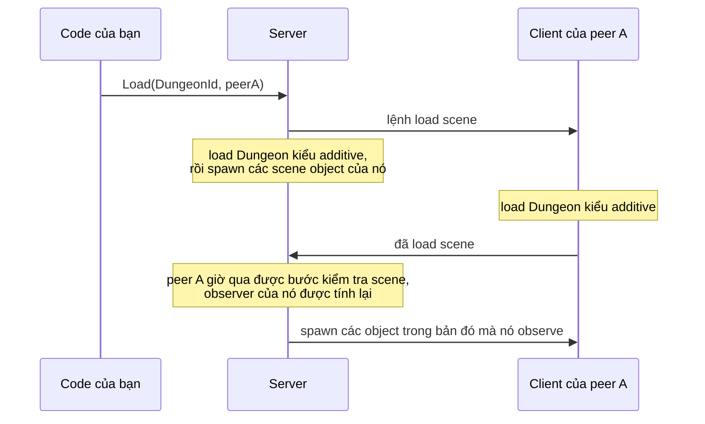

# Network scene

Network scene là scene mà server load theo kiểu additive, cả trên chính nó lẫn trên các client được chọn. Mỗi lần load tạo một bản (instance) của scene asset, và server có thể giữ nhiều bản của cùng một asset cùng lúc, như mỗi nhóm người chơi một bản dungeon. Một bản hoặc là global, tức mọi client đều load nó, hoặc chỉ được load cho một số peer. Object trong một bản, kể cả object được spawn vào đó, chỉ tới các peer đã load bản đó.

Scene mà game khởi động cùng không phải network scene. Hai bên mở nó theo cách thông thường, và các scene object của nó hiển thị với mọi peer thỏa observer rule.

## Scene id <a href="#scene-ids" id="scene-ids"></a>

Scene id chỉ một scene asset: đó là hash 32 bit của asset GUID. Editor ghi các id vào hai file. `FomoxaSceneList.asset` chứa id và đường dẫn của mọi scene trong Scene List của Build Profiles và được làm mới mỗi khi danh sách đó hoặc một scene asset thay đổi. `FomoxaScenes.cs` chứa một hằng số `<SceneName>Id` cho mọi scene asset dưới `Assets`, kể cả scene nằm ngoài danh sách build.

Gán `FomoxaSceneList.asset` vào Collected Scenes trên `NetworkManager`. Manager sau đó đăng ký mỗi scene trong danh sách với một loader gọi `SceneManager.LoadSceneAsync(path, LoadSceneMode.Additive)` và `UnloadSceneAsync`, và `NetworkManager.Scenes.IdOf("Assets/Scenes/Arena.unity")` trả về id của một scene trong danh sách, hoặc 0 nếu scene không có trong đó.

## Bản <a href="#instances" id="instances"></a>

Một `NetworkScene` chỉ một bản đã load. Server cấp id bản tăng dần từ 1 và không dùng lại id nào khi còn chạy, nên một bản đã unload không bị nhầm với một bản sau đó của cùng asset. `default(NetworkScene)` nghĩa là không có network scene. Các lời gọi load nhận scene id và trả về `NetworkScene`, mọi lời gọi khác về scene nhận `NetworkScene`.

## Load scene cho mọi người <a href="#load-a-scene-for-everyone" id="load-a-scene-for-everyone"></a>

```csharp
NetworkScene arena = manager.ServerManager.Scenes.LoadGlobal(new[] { FomoxaScenes.ArenaId })[0];
```

Server bắt đầu load scene và, trong cùng lời gọi đó, báo mọi peer đã khởi động load nó, nên server và client load song song. Peer kết nối sau sẽ load mọi bản global khi khởi động. Mỗi scene asset có nhiều nhất một bản global: gọi `LoadGlobal` với asset đã có bản global thì nhận lại bản đó và không gửi gì. `LoadGlobal(sceneIds, replace: true)` unload các bản global hiện tại trước khi load bản mới.

`UnloadGlobal(scenes)` unload các bản global và ném exception với bản không phải global.

## Load scene cho một số peer <a href="#load-a-scene-for-some-peers" id="load-a-scene-for-some-peers"></a>

```csharp
NetworkScene dungeon = manager.ServerManager.Scenes.Load(FomoxaScenes.DungeonId, new[] { peerA, peerB });
```

`Load` luôn tạo bản mới, kể cả khi asset đã có bản, nên hai nhóm cùng gọi nó sẽ có hai dungeon riêng. Danh sách peer có thể rỗng. Peer chưa khởi động bị bỏ qua. Hãy giữ `NetworkScene` trả về cùng phòng hoặc trận của bạn, vì các lời gọi sau cần nó.

`AddPeers(dungeon, peerIds)` và `RemovePeers(dungeon, peerIds)` đổi tập peer có bản đó và trả về số peer đã thêm hoặc đã gỡ. Peer bị gỡ nhận despawn của các object trong bản, rồi lệnh unload. Bản vẫn được load trên server khi không còn peer nào có nó, kể cả khi peer cuối cùng ngắt kết nối. `Unload(dungeon)` despawn các object của bản, unload nó trên các peer của nó rồi unload trên server.

Một bản global và một bản theo peer luôn là hai bản khác nhau. `AddPeers`, `RemovePeers` và `Unload` ném exception với bản global, còn `UnloadGlobal` ném exception với bản theo peer.

Mọi lời gọi load nhận thêm một `ScenePhysics` tùy chọn. Với giá trị mặc định `Shared`, bản dùng physics world mặc định, nên một scene asset chỉ có một bản `Shared` tại một thời điểm, và bản thứ hai cần `ScenePhysics.Own`. Load một bản `Shared` của asset có bản trước đó vẫn đang unload sẽ chờ tới khi unload xong.

## Object trong network scene <a href="#objects-in-network-scenes" id="objects-in-network-scenes"></a>



Khi server load xong một bản, nó spawn các scene object trong đó, và khi unload bản, nó despawn mọi object trong bản. Mỗi bản có bản copy riêng của các scene object, nên cùng một scene object id có thể được spawn một lần trong mỗi bản.

Object mà server spawn vào một bản, bằng cách chuyển nó vào `Scene` của bản đó trước khi gọi `Spawn`, chỉ tới các peer đã load bản đó, như trong [spawn](spawning.md#spawning-into-a-network-scene). Một peer chỉ bắt đầu observe object như vậy sau khi client của nó báo đã load xong bản.

## Event và truy vấn trên server <a href="#server-events-and-queries" id="server-events-and-queries"></a>

| Member | Ý nghĩa |
|---|---|
| `OnLoaded(NetworkScene scene)` | Server đã load xong một bản |
| `OnLoadFailed(NetworkScene scene, Exception exception)` | Server không load được bản; exception cũng được log |
| `OnUnloaded(NetworkScene scene)` | Server đã unload xong một bản |
| `OnPeerLoaded(ulong peerId, NetworkScene scene)` | Client của một peer đã báo load xong một bản |
| `Global` | Các bản global |
| `Contains(scene)` | Bản đang tồn tại |
| `IsGlobal(scene)` | Bản là global |
| `HasLoaded(peerId, scene)` | Client của peer đã báo load xong bản |
| `PeersOf(scene)` | Các peer có bản |
| `ScenesOf(peerId)` | Các bản mà peer có |
| `InstancesOf(sceneId)` | Các bản của một scene asset |
| `SceneIdOf(scene)` | Scene id của một bản, hoặc 0 |
| `TryGetScene(scene, out Scene unityScene)` | `Scene` của Unity mà server đã load cho bản |

Mọi member này nằm trên `ServerManager.Scenes`.

## Trên client <a href="#on-the-client" id="on-the-client"></a>

Client load và unload từng bản một, theo thứ tự server yêu cầu, và báo cho server mỗi lần load xong. Nếu một lần load thất bại, client log exception và dừng với `PrefabMismatch`, phát `OnObjectMismatch` với loại `UnknownScene`. Khi kết nối dừng, client giữ lại các bản đã load. Sau khi kết nối lại, client chỉ giữ một bản khi server liệt kê lại nó với cùng id bản, scene id và chế độ physics, và thay bản đó trong trường hợp còn lại.

`ClientManager.Scenes` có phần truy vấn và event phía client:

| Member | Ý nghĩa |
|---|---|
| `OnLoadStarted(NetworkScene scene, uint sceneId)` | Client bắt đầu load một bản |
| `OnLoaded(NetworkScene scene)` | Client đã load xong một bản |
| `OnUnloaded(NetworkScene scene)` | Client đã unload xong một bản |
| `SceneIdOf(scene)` | Scene id của một bản client đã load hoặc đang load, hoặc 0 |
| `TryGetScene(scene, out Scene unityScene)` | `Scene` của Unity mà client đã load cho bản |

Client của host dùng các bản server đã load thay vì load lại, và `TryGetScene` của nó trả về `Scene` của server.

## Loader tùy chỉnh <a href="#custom-loaders" id="custom-loaders"></a>

Scene không có trong danh sách build, như một scene Addressables, cần loader riêng, đăng ký trên server và trên mọi client:

```csharp
using System;
using Fomoxa.Unity;
using Generated;
using UnityEngine.SceneManagement;

public sealed class ArenaLoader : ISceneLoader
{
    public void Load(Action<Scene> loaded, Action<Exception> failed)
    {
        var operation = SceneManager.LoadSceneAsync("Arena", LoadSceneMode.Additive);
        operation.completed += _ => loaded(SceneManager.GetSceneByName("Arena"));
    }

    public void Unload(Scene scene, Action unloaded)
    {
        SceneManager.UnloadSceneAsync(scene).completed += _ => unloaded();
    }
}
```

```csharp
manager.Scenes.Register(FomoxaScenes.ArenaId, new ArenaLoader());
```

Loader gọi `loaded` với scene đã load hoặc `failed` với một exception, và gọi `unloaded` khi unload xong. Hãy đăng ký nó trước khi server hoặc client cần scene, vì `LoadGlobal` và `Load` ném `scene 0x... is not in the scene registry` với id chưa đăng ký. Scene id 0 không đăng ký được.

## Giới hạn <a href="#limitations" id="limitations"></a>

Mọi lần load scene đều là additive, và package không đổi active scene cũng không unload scene khởi động. Một peer có thể có nhiều bản, kể cả hai bản của cùng một asset.

Network scene tham gia vào việc quyết định [observer](observers.md) và vào việc [spawn](spawning.md), còn [tham chiếu ServerManager](../reference/server-manager.md) liệt kê các member về scene.
