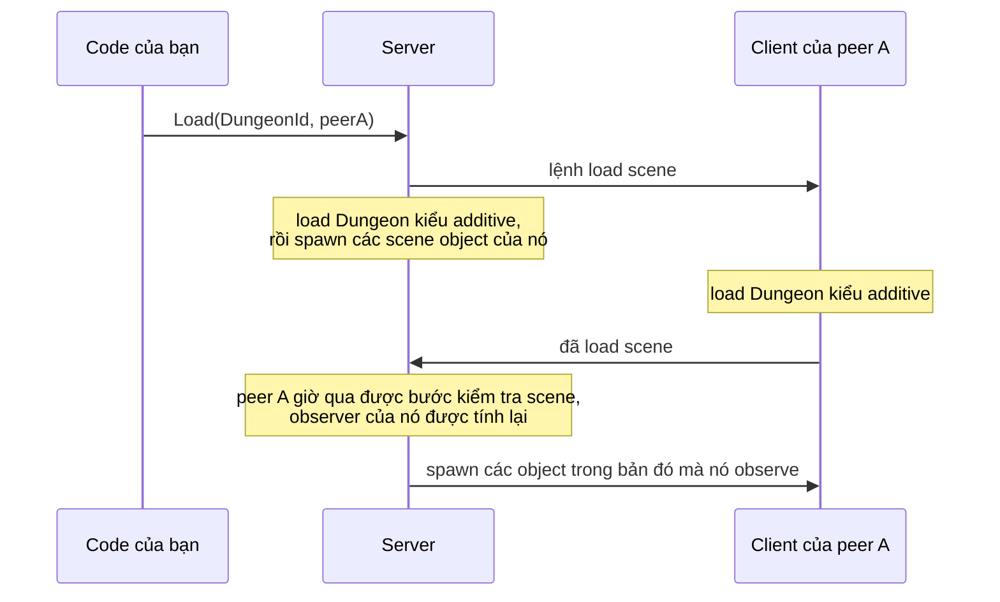

# Network scene

Network scene là scene mà server load theo kiểu additive, cả trên chính nó lẫn trên các client được chọn. Mỗi lần load tạo một bản (instance) của scene asset, và server có thể giữ nhiều bản của cùng một asset cùng lúc, như mỗi nhóm người chơi một bản dungeon. Một bản hoặc là global, tức mọi client đều load nó, hoặc chỉ được load cho một số peer. Object trong một bản, kể cả object được spawn vào đó, chỉ tới các peer đã load bản đó.

Scene mà game khởi động cùng không phải network scene. Hai bên mở nó theo cách thông thường, và các scene object của nó hiển thị với mọi peer thỏa observer rule.

## Scene id <a href="#scene-ids" id="scene-ids"></a>

Scene id chỉ một scene asset: đó là hash 32 bit của asset GUID. Editor ghi các id vào hai file. `FomoxaSceneList.asset` chứa id và đường dẫn của mọi scene trong Scene List của Build Profiles và được làm mới mỗi khi danh sách đó hoặc một scene asset thay đổi. `FomoxaScenes.cs` chứa một hằng số `<SceneName>Id` cho mọi scene asset dưới `Assets`, kể cả scene nằm ngoài danh sách build.

Gán `FomoxaSceneList.asset` vào Collected Scenes trên `NetworkManager`. Manager sau đó đăng ký mỗi scene trong danh sách với một loader load nó theo kiểu additive bằng `SceneManager.LoadSceneAsync` và unload bằng `UnloadSceneAsync`, và `NetworkManager.Scenes.IdOf("Assets/Scenes/Arena.unity")` trả về id của một scene trong danh sách, hoặc 0 nếu scene không có trong đó.

## Bản <a href="#instances" id="instances"></a>

Một `NetworkScene` chỉ một bản đã load. Server cấp id bản tăng dần từ 1 và không dùng lại id nào khi còn chạy, nên một bản đã unload không bị nhầm với một bản sau đó của cùng asset. `default(NetworkScene)` nghĩa là không có network scene. Các lời gọi load nhận scene id và trả về `NetworkScene`, mọi lời gọi khác về scene nhận `NetworkScene`.

## Load scene cho mọi người <a href="#load-a-scene-for-everyone" id="load-a-scene-for-everyone"></a>

```csharp
NetworkScene arena = manager.ServerManager.Scenes.LoadGlobal(new[] { FomoxaScenes.ArenaId })[0];
```

Server bắt đầu load scene và, trong cùng lời gọi đó, báo mọi peer đã khởi động load nó, nên server và client load song song. Peer kết nối sau sẽ load mọi bản global khi khởi động. Mỗi scene asset có nhiều nhất một bản global: gọi `LoadGlobal` với asset đã có bản global thì nhận lại bản đó và không gửi gì. `LoadGlobal(sceneIds, replace: true)` unload các bản global hiện tại trước khi load bản mới.

`UnloadGlobal(scenes)` unload các bản global và ném exception với bản không phải global.

## Load scene cho một số peer <a href="#load-a-scene-for-some-peers" id="load-a-scene-for-some-peers"></a>

```csharp
NetworkScene dungeon = manager.ServerManager.Scenes.Load(FomoxaScenes.DungeonId, new[] { peerA, peerB });
```

`Load` luôn tạo bản mới, kể cả khi asset đã có bản, nên hai nhóm cùng gọi nó sẽ có hai dungeon riêng. Danh sách peer có thể rỗng. Peer chưa khởi động bị bỏ qua. Hãy giữ `NetworkScene` trả về cùng phòng hoặc trận của bạn, vì các lời gọi sau cần nó.

`AddPeers(dungeon, peerIds)` và `RemovePeers(dungeon, peerIds)` đổi tập peer có bản đó và trả về số peer đã thêm hoặc đã gỡ. Peer bị gỡ nhận despawn của các object trong bản, rồi lệnh unload. Bản vẫn được load trên server khi không còn peer nào có nó, kể cả khi peer cuối cùng ngắt kết nối. `Unload(dungeon)` despawn các object của bản, unload nó trên các peer của nó rồi unload trên server.

Một bản global và một bản theo peer luôn là hai bản khác nhau. `AddPeers`, `RemovePeers` và `Unload` ném exception với bản global, còn `UnloadGlobal` ném exception với bản theo peer.

## Physics của một bản <a href="#physics-of-an-instance" id="physics-of-an-instance"></a>

Mọi lời gọi load nhận thêm một `ScenePhysics` tùy chọn. Với giá trị mặc định `Shared`, collider và rigidbody của bản vào physics world mặc định. Khi đó hai bản `Shared` của một map sẽ chồng lên nhau và va chạm với nhau, nên một scene asset chỉ có một bản `Shared` tại một thời điểm, và load bản thứ hai ném `ArgumentException`. Load một bản `Shared` của asset có bản trước đó vẫn đang unload sẽ chờ tới khi unload xong.

`ScenePhysics.Own` load bản với `LocalPhysicsMode.Physics3D | LocalPhysicsMode.Physics2D`, nên bản có physics world 3D và 2D riêng. Dùng nó cho mọi phòng khi một process server chạy nhiều phòng của cùng một map:

```csharp
NetworkScene red = manager.ServerManager.Scenes.Load(FomoxaScenes.ArenaId, redPeers, ScenePhysics.Own);
NetworkScene blue = manager.ServerManager.Scenes.Load(FomoxaScenes.ArenaId, bluePeers, ScenePhysics.Own);
```

Client load mỗi bản với chế độ server đã chọn. Raycast hay truy vấn overlap chỉ thấy collider của một world, nên hãy truy vấn qua world của bản, ví dụ `unityScene.GetPhysicsScene().Raycast(...)`, chứ không qua `Physics.Raycast` tĩnh, vốn chỉ thấy world mặc định.

Unity không bao giờ tự step world của scene load với `LocalPhysicsMode`. Mỗi `NetworkManager` step các world Unity của các bản `Own` nó đã load, trừ khi backend là `RigidbodyPhysics` đang bật Simulate Physics. Với `RapierPhysics` manager cũng step chúng, vì các world đó vẫn giữ physics Unity nằm ngoài network object. Các bước theo chế độ mô phỏng của Unity: sau bước của chính Unity ở mỗi fixed update với `Time.fixedDeltaTime` khi `Physics.simulationMode` (hoặc `Physics2D.simulationMode`) là `FixedUpdate`, mỗi frame một lần với `Time.deltaTime` khi là `Update`, và không step khi là `Script`, vì game ở chế độ đó tự step physics. Khi bật Simulate Physics, package step mọi world mỗi tick một lần, kể cả bản `Own`.

Với [backend Rapier](../rapier/setup.md#export-the-scene-files), network object được mô phỏng trong world Rapier, và mỗi bản có world riêng, dù load với chế độ nào. Khi đó chế độ chỉ quyết định world Unity nào nhận physics Unity của bản.

Observer rule và [nhóm](observers.md#groups) quyết định peer nào thấy một object. Chúng không tách physics: object của hai phòng chung một world vẫn va chạm với nhau.

## Object trong network scene <a href="#objects-in-network-scenes" id="objects-in-network-scenes"></a>



Khi server load xong một bản, nó spawn các scene object trong đó, và khi unload bản, nó despawn mọi object trong bản. Mỗi bản có bản copy riêng của các scene object, nên cùng một scene object id có thể được spawn một lần trong mỗi bản.

Object mà server spawn vào một bản, bằng cách chuyển nó vào `Scene` của bản đó trước khi gọi `Spawn`, chỉ tới các peer đã load bản đó, như trong [spawn](spawning.md#spawning-into-a-network-scene). Một peer chỉ bắt đầu observe object như vậy sau khi client của nó báo đã load xong bản.

## Chuyển object sang bản khác <a href="#move-an-object-to-another-instance" id="move-an-object-to-another-instance"></a>

`ServerManager.MoveToScene(networkObject, scene)` chuyển một object đã spawn sang bản khác, hoặc ra khỏi network scene khi `scene` là `default`. Ví dụ một lobby đưa người chơi vào phòng đấu khi phòng đã load xong trên server:

```csharp
using System;
using System.Collections.Generic;
using Fomoxa.Networking;
using Fomoxa.Unity;

public sealed class MatchStart
{
    private readonly NetworkManager manager;

    public MatchStart(NetworkManager manager)
    {
        this.manager = manager;
    }

    public NetworkScene Begin(uint arenaId, IReadOnlyList<ulong> peers, IReadOnlyList<NetworkObject> players)
    {
        NetworkScene match = manager.ServerManager.Scenes.Load(arenaId, peers, ScenePhysics.Own);
        Action<NetworkScene> moveIn = null;
        moveIn = loaded =>
        {
            if (loaded != match)
            {
                return;
            }

            manager.ServerManager.Scenes.OnLoaded -= moveIn;
            foreach (NetworkObject player in players)
            {
                manager.ServerManager.MoveToScene(player, match);
            }
        };
        manager.ServerManager.Scenes.OnLoaded += moveIn;
        return match;
    }
}
```

Đừng tự chuyển object đã spawn bằng `SceneManager.MoveGameObjectToScene`. Server sẽ không ghi nhận thay đổi, và client vẫn giữ bản copy của chúng trong bản cũ.

Trên server, `MoveToScene` chuyển GameObject vào Unity scene của bản, hoặc vào active scene khi là `default`, rồi chuyển các body của nó vào physics world của bản đó. Body giữ nguyên vị trí, góc xoay, vận tốc, vận tốc góc và việc nó có kinematic hay không. Sau đó server quyết định lại peer nào observe object, giống như khi spawn vào bản đó:

- Peer đã observe object và vẫn observe nó ở bản mới nhận một message chuyển scene và chuyển bản copy của nó.
- Peer đã observe object nhưng không observe nó ở bản mới nhận một despawn.
- Peer chỉ observe object ở bản mới nhận một spawn. Peer có client còn đang load bản sẽ nhận spawn khi lần load đó được báo xong.

Sau khi chuyển, server gọi `OnSceneChangedServer(previous, current)` trên các behaviour của object. Client đã chuyển bản copy gọi `OnSceneChangedClient(previous, current)`; client nhận despawn hoặc spawn thì gọi callback stop hoặc start. Trên host, callback của server chạy trước, callback của client chạy khi message chuyển scene tới.

Owner đang [dự đoán](../prediction/overview.md) object sẽ ngừng dự đoán khi lệnh chuyển tới, như khi mất quyền owner, và bỏ qua các reconcile state server gửi trước lần chuyển. Nó dự đoán lại từ state đầu tiên server gửi sau lần chuyển.

`MoveToScene` trả `false` khi server này không spawn object đó, và trả `true` mà không gửi gì khi object đã ở bản đó. Nó ném `ArgumentException` cho scene object, vốn ở yên trong bản của nó, và cho bản không tồn tại. Nó ném `InvalidOperationException` khi server còn đang load bản, và khi chuyển về `default` lúc active scene chính là một bản network scene.

Lần chuyển dựng lại các body, cùng joint và effector đến từ component, trong world mới. Joint và effector tạo từ code, ví dụ bằng `RapierScenes.CreateJoint`, bị gỡ cùng body cũ, nên hãy tạo lại chúng trong `OnSceneChangedServer`. Một `NetworkBody` đọc trước lần chuyển trỏ tới body đã bị gỡ; hãy đọc lại `networkObject.Body`.

Client nhận một lệnh chuyển mà nó không áp dụng được, cho object nó không có, cho scene object hoặc vào bản nó chưa load, sẽ dừng với `ObjectMismatch` và raise `OnObjectMismatch` với kind `UnknownObject` hoặc `InvalidSpawn`.

## Event và truy vấn trên server <a href="#server-events-and-queries" id="server-events-and-queries"></a>

| Member | Ý nghĩa |
|---|---|
| `OnLoaded(NetworkScene scene)` | Server đã load xong một bản |
| `OnLoadFailed(NetworkScene scene, Exception exception)` | Server không load được bản; exception cũng được log |
| `OnUnloaded(NetworkScene scene)` | Server đã unload xong một bản |
| `OnPeerLoaded(ulong peerId, NetworkScene scene)` | Client của một peer đã báo load xong một bản |
| `Global` | Các bản global |
| `Contains(scene)` | Bản đang tồn tại |
| `IsGlobal(scene)` | Bản là global |
| `HasLoaded(peerId, scene)` | Client của peer đã báo load xong bản |
| `PeersOf(scene)` | Các peer có bản |
| `ScenesOf(peerId)` | Các bản mà peer có |
| `InstancesOf(sceneId)` | Các bản của một scene asset |
| `SceneIdOf(scene)` | Scene id của một bản, hoặc 0 |
| `TryGetScene(scene, out Scene unityScene)` | `Scene` của Unity mà server đã load cho bản |
| `TryGetNetworkScene(unityScene, out NetworkScene scene)` | Bản mà một `Scene` của Unity ở server thuộc về |

Mọi member này nằm trên `ServerManager.Scenes`.

## Trên client <a href="#on-the-client" id="on-the-client"></a>

Client load và unload từng bản một, theo thứ tự server yêu cầu, và báo cho server mỗi lần load xong. Nếu một lần load thất bại, client log exception và dừng với `PrefabMismatch`, phát `OnObjectMismatch` với loại `UnknownScene`. Khi kết nối dừng, client giữ lại các bản đã load. Sau khi kết nối lại, client chỉ giữ một bản khi server liệt kê lại nó với cùng id bản, scene id và chế độ physics, và thay bản đó trong trường hợp còn lại.

`ClientManager.Scenes` có phần truy vấn và event phía client:

| Member | Ý nghĩa |
|---|---|
| `OnLoadStarted(NetworkScene scene, uint sceneId)` | Client bắt đầu load một bản |
| `OnLoadProgress(NetworkScene scene, float progress)` | Loader báo tiến độ, từ 0 tới 1, của bản đang load |
| `OnLoaded(NetworkScene scene)` | Client đã load xong một bản |
| `OnUnloaded(NetworkScene scene)` | Client đã unload xong một bản |
| `SceneIdOf(scene)` | Scene id của một bản client đã load hoặc đang load, hoặc 0 |
| `TryGetScene(scene, out Scene unityScene)` | `Scene` của Unity mà client đã load cho bản |
| `TryGetNetworkScene(unityScene, out NetworkScene scene)` | Bản mà một `Scene` của Unity ở client thuộc về |

Client của host dùng các bản server đã load thay vì load lại, nên không phát tiến độ, và `TryGetScene`, `TryGetNetworkScene` của nó trả lời bằng scene của server.

## Loader tùy chỉnh <a href="#custom-loaders" id="custom-loaders"></a>

Scene không có trong danh sách build, như một scene Addressables, cần loader riêng, đăng ký trên server và trên mọi client:

```csharp
using System;
using System.Collections.Generic;
using Fomoxa.Unity;
using UnityEngine.AddressableAssets;
using UnityEngine.ResourceManagement.AsyncOperations;
using UnityEngine.ResourceManagement.ResourceProviders;
using UnityEngine.SceneManagement;

public sealed class AddressableSceneLoader : ISceneLoader
{
    private readonly string address;
    private readonly Dictionary<Scene, AsyncOperationHandle<SceneInstance>> handles = new Dictionary<Scene, AsyncOperationHandle<SceneInstance>>();

    public AddressableSceneLoader(string address)
    {
        this.address = address;
    }

    public void Load(SceneLoadRequest request, Action<float> progress, Action<Scene> loaded, Action<Exception> failed)
    {
        var parameters = new LoadSceneParameters(LoadSceneMode.Additive, request.Physics);
        Addressables.LoadSceneAsync(address, parameters).Completed += handle =>
        {
            if (handle.Status != AsyncOperationStatus.Succeeded)
            {
                failed(handle.OperationException ?? new InvalidOperationException($"{address} did not load"));
                return;
            }

            Scene scene = handle.Result.Scene;
            handles[scene] = handle;
            loaded(scene);
        };
    }

    public void Unload(Scene scene, Action unloaded)
    {
        if (!handles.Remove(scene, out AsyncOperationHandle<SceneInstance> handle))
        {
            unloaded();
            return;
        }

        Addressables.UnloadSceneAsync(handle).Completed += _ => unloaded();
    }
}
```

```csharp
manager.Scenes.Register(FomoxaScenes.ArenaId, new AddressableSceneLoader("Arena"));
```

`SceneLoadRequest` mang bản (`Scene`), scene id (`SceneId`) và `LocalPhysicsMode` cần dùng khi load (`Physics`). Loader phải load với `request.Physics` và gọi `loaded` với đúng `Scene` mà lần load này tạo ra, ở đây là `SceneInstance.Scene`. Đừng tìm scene bằng `SceneManager.GetSceneByName` hay `GetSceneByPath`: khi đã load hai bản của một asset, cả hai hàm đều trả về bản đầu. Loader gọi `failed` với một exception khi load thất bại, có thể gọi `progress` với giá trị từ 0 tới 1 trong lúc load, và gọi `unloaded` khi unload xong. Ví dụ trên không báo tiến độ; loader cần thanh tiến độ thì đọc `handle.PercentComplete` mỗi frame rồi chuyển tiếp.

Hãy đăng ký loader trước khi server hoặc client cần scene, vì `LoadGlobal` và `Load` ném `scene 0x... is not in the scene registry` với id chưa đăng ký. Scene id 0 không đăng ký được. Loader dựng sẵn cho danh sách build load với `request.Physics` và lấy scene từ `SceneManager.sceneLoaded` của chính lần load đó; một scene cùng đường dẫn mà code khác load đúng lúc đó có thể bị nhận nhầm.

## Giới hạn <a href="#limitations" id="limitations"></a>

Mọi lần load scene đều là additive, và package không đổi active scene cũng không unload scene khởi động. Một peer có thể có nhiều bản, kể cả hai bản của cùng một asset.

Network scene tham gia vào việc quyết định [observer](observers.md) và vào việc [spawn](spawning.md), còn [tham chiếu ServerManager](../reference/server-manager.md) liệt kê các member về scene.
