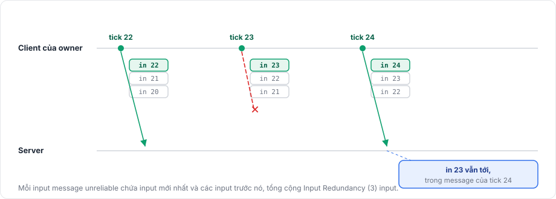

# Input

Input model mang những gì người chơi của owner đã làm trong một tick. Package thu thập nó trên client của owner mỗi tick và gửi tới server kèm số tick. Callback `apply` của bạn chạy với input đó trên server khi tick ấy tới, và chạy ngay trên client của owner nếu client đang dự đoán.

## Đăng ký <a href="#registering" id="registering"></a>

```csharp
protected override void OnRegisterInput(NetworkInput input)
{
    input.Use(MoveInputNetAdapter.Instance, Gather, Apply);
    input.Reconcile(MoveStateNetAdapter.Instance, Capture, Restore, Matches);
}
```

`NetworkInput.Use<T>(codec, gather, apply)` nhận hai callback. `gather(T input)` điền input của tick hiện tại, còn `apply(T input, InputContext context)` chạy tick với input đó.

Một behaviour có nhiều nhất một input model. `Use` ném `HandlerRegistrationException` khi bị gọi hai lần, hoặc khi `NetworkManager` dùng timing mode Variable.

Không có reconcile model, owner chỉ gửi input mà không dự đoán, nên object di chuyển khi kết quả của server tới, như mọi object khác. [Reconciliation](reconciliation.md) mô tả reconcile model.

## Gather <a href="#gather" id="gather"></a>

`gather` chạy mỗi tick một lần trên client của owner, cho `TimeManager.PredictionTick`, khi client đang kết nối tới server ở xa và đồng hồ đã đồng bộ. Trên host nó chạy trên server, cho các object mà client của host sở hữu. Package truyền cùng một instance mỗi tick, nên hãy đặt mọi field mỗi lần.

Input xảy ra giữa các tick, như một nút được bấm trong một frame, được bắt trong `Update` và chuyển sang trong `gather`. Ví dụ sau thêm một field `bool` tên `Jump` (wire type `bool`) vào model `MoveInput` từ trang [tổng quan](overview.md):

```csharp
private bool jumpPressed;

private void Update()
{
    if (NetworkObject != null && NetworkObject.IsOwner && Input.GetButtonDown("Jump"))
    {
        jumpPressed = true;
    }
}

private void Gather(MoveInput input)
{
    input.X = Input.GetAxisRaw("Horizontal");
    input.Z = Input.GetAxisRaw("Vertical");
    input.Jump = jumpPressed;
    jumpPressed = false;
}
```

## Apply <a href="#apply" id="apply"></a>

`apply` chạy trong bốn tình huống:

| Ở đâu | Khi nào | `context.Replaying` |
|---|---|---|
| Server | Mỗi tick, với object có owner, bằng input của tick đó | false |
| Client của owner, khi đang dự đoán | Ngay sau `gather` | false |
| Client của owner, trong lúc reconciliation | Lại một lần cho mỗi tick sau tick được sửa | true |
| Host | Mỗi tick, với input vừa thu thập của host | false |

Server không gọi `apply` cho object do chính nó sở hữu, cũng không gọi trước khi input đầu tiên từ owner tới.

`InputContext` cho `apply` biết thêm về input nó nhận:

| Property | Ý nghĩa |
|---|---|
| `Tick` | Tick mà input này dành cho |
| `Repeated` | Server hoặc lần replay không có input cho tick này và dùng lại input cuối |
| `RepeatedTicks` | Khi `Repeated`, số tick đã qua kể từ tick của input đang được dùng lại |
| `Replaying` | Lời gọi là một phần của lần replay trên client của owner |

`Replaying` cho phép bỏ qua các hiệu ứng đã hiển thị, như âm thanh và particle, còn `Repeated` cho phép tránh lặp lại các hành động một lần:

```csharp
private void Apply(MoveInput input, InputContext context)
{
    Move(input.X, input.Z, (float)manager.TimeManager.TickDelta);
    if (input.Jump && !context.Repeated)
    {
        Jump(playEffects: !context.Replaying);
    }
}
```

Exception ném ra trong `apply` hoặc `gather` được log và không ngắt kết nối ai.

## Gửi <a href="#sending" id="sending"></a>

Mỗi tick, client của owner gửi một input message unreliable cho mỗi behaviour. Message chứa input mới nhất cùng các input trước đó, tổng cộng Input Redundancy input (mặc định 3), nên một gói bị mất không làm mất input.

<figure><figcaption><p>Với Input Redundancy mặc định là 3, mất một message không làm mất input nào.</p></figcaption></figure>

## Trên server <a href="#on-the-server" id="on-the-server"></a>

Server giữ các input nhận được theo object và behaviour, sắp theo tick. Nó chấp nhận input cho các tick từ tick hiện tại của nó tới tối đa Max Input Lead tick phía trước (mặc định 30). Message có input mới nhất dành cho một tick đã qua, hoặc xa hơn giới hạn đó, sẽ bị bỏ và được đếm trong `ServerManager.DroppedInputsOf(peerId)`.

Ở mỗi tick, server áp dụng input của tick đó, và nếu không có input nào tới kịp, nó áp dụng lại input cuối với `Repeated` được đặt. Input từ peer không sở hữu object bị bỏ, và server log `Fomoxa dropped input to object <id> from peer <id>, which does not own the object`. Khi owner thay đổi hoặc object bị despawn, input đã đệm bị xóa.

Client cố gắng để mỗi input tới sớm Input Buffer tick (mặc định 2) trước khi server cần nó, như mô tả ở mục [đồng bộ đồng hồ](../concepts/tick.md#clock-synchronization).

## Kiểm tra input <a href="#validating-input" id="validating-input"></a>

Server áp dụng bất cứ gì owner gửi lên, nên hãy kẹp hoặc từ chối giá trị trong `apply`, ví dụ bằng `Vector3.ClampMagnitude` trên một hướng, để một client bị sửa đổi không thể di chuyển nhanh hơn mức cho phép. Vì cùng `apply` chạy trên client của owner, một client trung thực sẽ dự đoán ra đúng kết quả đã kẹp.

Input làm việc cùng [reconciliation](reconciliation.md) và đồng hồ tick mô tả trong [tick và thời gian](../concepts/tick.md). [NetworkBehaviour](../objects/network-behaviour.md) liệt kê các hook đăng ký.
