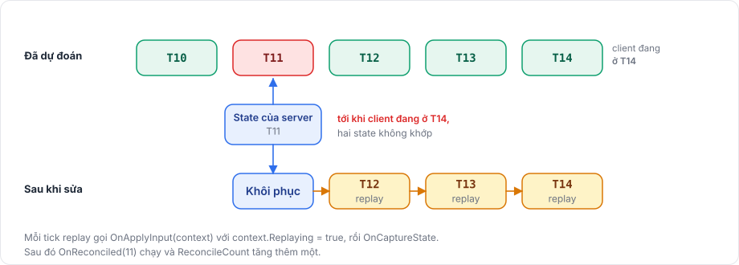

# Reconciliation

Reconciliation là cách client của owner sửa lại dự đoán của mình. Sau khi áp dụng một input, server chụp state của object và gửi nó tới owner kèm số tick. Client so sánh nó với state đã dự đoán cho cùng tick, và nếu hai bên khác nhau, nó khôi phục state của server rồi replay input cho mọi tick sau đó.

## Khai báo <a href="#declaring" id="declaring"></a>

State cần so sánh nằm trong các field `[NetworkReconcile]`, cạnh các [field input](input.md):

```csharp
using Fomoxa.Networking;
using Fomoxa.Unity;
using UnityEngine;

public sealed partial class Glider : NetworkBehaviour
{
    [NetworkInput]
    private float thrust;

    [NetworkReconcile(Tolerance = 0.01f)]
    private Vector3 position;

    [NetworkReconcile(Tolerance = 0.01f)]
    private float speed;

    protected override void OnGatherInput()
    {
        thrust = Input.GetAxisRaw("Vertical");
    }

    protected override void OnApplyInput(InputContext context)
    {
        speed = Mathf.Max(0f, speed + thrust * 0.1f);
        transform.position += transform.forward * speed * 0.02f;
    }

    protected override void OnCaptureState()
    {
        position = transform.position;
    }

    protected override void OnRestoreState()
    {
        transform.position = position;
    }
}
```

Package gom các field reconcile vào một model mang tên class theo sau là `Reconcile`, ở đây là `GliderReconcile`, cạnh input model. Đặt tên khác cho model bằng `[NetworkReconcileModel("...")]` trên class. Thay đổi field của nó theo luật của [state](../synchronization/state.md#changing-the-fields). Class có field `[NetworkReconcile]` cần ít nhất một field `[NetworkInput]`, và một field mang một trong hai attribute, không mang cả hai.

| Method | Chạy khi | Làm gì |
|---|---|---|
| `OnCaptureState()` | Sau mỗi input được áp dụng trên server; sau mỗi tick được dự đoán hoặc replay trên client. Package chép các field sau khi nó trả về | Chép state nằm ngoài các field, như transform hay physics body, vào chúng |
| `OnRestoreState()` | Trên client, khi bắt đầu một lần sửa, sau khi package đã ghi state của server vào các field | Chép các field ngược về transform hoặc body |

Cả hai đều không bắt buộc. Field mà `OnApplyInput` thay đổi trực tiếp, như `speed` ở trên, không cần method nào.

## Field reconcile chứa gì <a href="#what-goes-in-the-reconcile-fields" id="what-goes-in-the-reconcile-fields"></a>

Các field reconcile phải giữ mọi thứ mà `OnApplyInput` đọc, thay đổi và mang từ tick này sang tick sau, như vị trí, vận tốc, bộ đếm cooldown hay vận tốc damping. Nếu thiếu thứ gì, lần replay bắt đầu từ một giá trị khác với server, và lần so sánh tiếp theo lại thất bại.

## So sánh <a href="#comparing" id="comparing"></a>

Khi không có `Tolerance` nào, package so sánh các byte đã encode của hai state, nên mọi khác biệt đều tính là mismatch, kể cả nhiễu số thực ở bit cuối. Khi một field có `Tolerance`, package so sánh từng field, và dự đoán khớp khi mọi field đều khớp:

| Field | Khớp khi |
|---|---|
| `float`, `double` với `Tolerance = t` | Hai giá trị lệch nhau tối đa `t` |
| `Vector2`, `Vector3`, `Vector4` với `Tolerance = t` | Mỗi thành phần lệch nhau tối đa `t` |
| `Quaternion` với `Tolerance = t` | Góc giữa hai giá trị tối đa `t` độ |
| Model, không có `Tolerance` | Bản encode giống nhau |
| Field khác không có `Tolerance` | Hai giá trị bằng nhau |

`Tolerance` trên type khác là lỗi biên dịch `FOMOXA020`.

## Sửa và replay <a href="#correction-and-replay" id="correction-and-replay"></a>

<figure><figcaption><p>Một lần sửa ở tick 11 khi client đã ở tick 14.</p></figcaption></figure>

Client giữ input và state của Prediction History tick gần nhất (mặc định 64). Một lần replay bao các tick từ tick được sửa tới tick dự đoán mới nhất, dùng các input client đã ghi lại, và sau lần sửa package gọi `OnReconciled(tick)` trên behaviour và tăng `ReconcileCount` của nó.

Khi nhiều state tới giữa hai tick, client chỉ xử lý state mới nhất. State cho một tick mà client không có dự đoán được tính là mismatch.

Trong lúc replay, `NetworkBehaviour.IsReplaying` và `ClientManager.IsReplaying` là true, và `InputContext.Replaying` trong `OnApplyInput` cũng vậy.

## Bắt đầu và dừng dự đoán <a href="#starting-and-stopping-prediction" id="starting-and-stopping-prediction"></a>

Client của owner bắt đầu dự đoán khi reconcile state đầu tiên từ server tới, và trước đó nó chỉ gửi input.

Khi object mất owner hoặc đổi owner, owner cũ thôi dự đoán nó, xóa lịch sử và quay về đi theo `NetworkTransform`. Owner mới bắt đầu dự đoán khi server đã gửi cho nó một state.

## Server gửi thường xuyên tới mức nào <a href="#how-often-the-server-sends" id="how-often-the-server-sends"></a>

Server gửi state sau mỗi Reconcile Interval tick (mặc định 1), cho các tick mà nó đã áp dụng input. Khoảng lớn hơn tiết kiệm băng thông, và các lần sửa trở nên thưa hơn nhưng lớn hơn.

## Hiển thị lần sửa mượt mà <a href="#showing-corrections-smoothly" id="showing-corrections-smoothly"></a>

Một lần sửa di chuyển object ngay lập tức. Để che điều đó, hãy gán một object con chứa các phần hiển thị vào field Visual của `NetworkTransform` trên object. Package khi đó giữ object con ở chỗ nó đang hiện trên màn hình rồi đưa nó về dần trong Smoothing Time, như mô tả trong [NetworkTransform](../synchronization/transform.md#prediction).

## Chẩn đoán việc sửa thường xuyên <a href="#diagnosing-frequent-corrections" id="diagnosing-frequent-corrections"></a>

`ReconcileCount` nên giữ ở mức thấp chừng nào không có gì bất thường xảy ra. Khi nó cứ tăng, nguyên nhân thường gặp là:

- `OnApplyInput` dùng `Time.deltaTime` thay vì `TimeManager.TickDelta`.
- `OnApplyInput` đọc dữ liệu khác nhau giữa server và client, như object khác hoặc số ngẫu nhiên không có seed.
- Các field reconcile thiếu state được mang qua các tick.
- `Tolerance` bị thiếu hoặc quá nhỏ.
- Input tới server muộn và bị lặp lại, điều mà `ServerManager.DroppedInputsOf` cho thấy.

[Mô phỏng tất định](../concepts/deterministic-simulation.md) giải thích vì sao mỗi nguyên nhân trên làm hai bên khác nhau.

Để thấy mỗi lần sửa dời object bao xa, hãy subscribe `NetworkTransform.OnCorrected` hoặc bật Draw Corrections, như mô tả trong [debug](../advanced/debugging.md#prediction-corrections). [Giả lập mạng](../connections/transports/simulated.md) thêm độ trễ và mất gói ngay trong Editor, nên các lần sửa lộ ra trước khi bạn thử trên mạng thật.

## Với physics <a href="#with-physics" id="with-physics"></a>

Khi object di chuyển bằng `Rigidbody` hoặc `Rigidbody2D` và mô phỏng physics đang bật, một lần sửa còn rollback cả các physics world, như mô tả trong [rollback với physics](rollback.md).

Reconciliation xây trên [input](input.md), và [tổng quan prediction](overview.md) cho thấy cả hai trong một nhân vật hoàn chỉnh. [NetworkBehaviour](../objects/network-behaviour.md) liệt kê `OnReconciled` và các callback khác.
