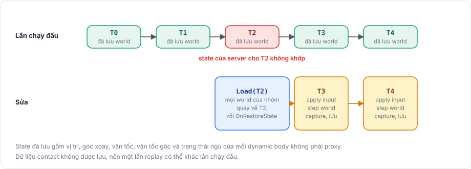
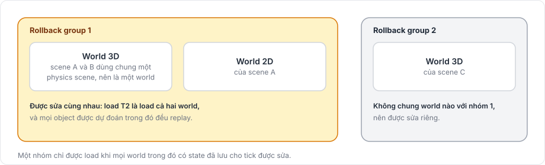

# Rollback với physics

Khi một object được dự đoán di chuyển bằng `Rigidbody` hoặc `Rigidbody2D`, kết quả của nó phụ thuộc vào cả physics world, gồm các body khác, contact và trọng lực. Vì vậy sửa nó nghĩa là rollback physics world về tick được sửa rồi step tiếp từ đó, việc package làm khi mô phỏng physics đang bật.

## Yêu cầu <a href="#requirements" id="requirements"></a>

Component `RigidbodyPhysics` của `NetworkManager` phải bật Simulate Physics, cả trên server lẫn client, để manager step physics mỗi tick một lần (xem [physics](../physics/overview.md#turning-it-on)). Object được dự đoán phải có `Rigidbody` hoặc `Rigidbody2D` trên cùng GameObject với `NetworkObject` của nó. `OnApplyInput` di chuyển body bằng lực, xung lực hoặc vận tốc, còn `OnCaptureState` và `OnRestoreState` chép body sang các field reconcile và ngược lại qua `NetworkObject.Body` hoặc `Body2D`:

```csharp
[NetworkReconcile(Tolerance = 0.01f)]
private float positionX;

[NetworkReconcile(Tolerance = 0.01f)]
private float positionZ;

[NetworkReconcile(Tolerance = 0.05f)]
private float velocityX;

[NetworkReconcile(Tolerance = 0.05f)]
private float velocityZ;

protected override void OnApplyInput(InputContext context)
{
    Vector3 push = new Vector3(x, 0f, z) * pushStrength;
    NetworkObject.Body.AddImpulse(push);
}

protected override void OnCaptureState()
{
    NetworkBodyState body = NetworkObject.Body.State;
    positionX = body.Position.x;
    positionZ = body.Position.z;
    velocityX = body.Velocity.x;
    velocityZ = body.Velocity.z;
}

protected override void OnRestoreState()
{
    NetworkBody body = NetworkObject.Body;
    NetworkBodyState current = body.State;
    current.Position = new Vector3(positionX, current.Position.y, positionZ);
    current.Velocity = new Vector3(velocityX, current.Velocity.y, velocityZ);
    body.State = current;
}
```

`x` và `z` là các field input của trang [tổng quan](overview.md), và `OnGatherInput` điền chúng như ở đó. `NetworkBody` và `NetworkBodyState` nằm trong `Fomoxa.Unity` và dùng `Vector3` của Unity. Ví dụ di chuyển trên mặt phẳng nền và để trục dọc cho trọng lực.

## Dòng thời gian <a href="#timeline" id="timeline"></a>

Mỗi tick, sau khi step physics, client của owner lưu state của mỗi physics world chứa một object nó dự đoán và ghi lại state của mỗi behaviour được dự đoán. Lịch sử giữ Prediction History tick (mặc định 64).

<figure><figcaption><p>Một lần sửa ở T2 khi client đã dự đoán tới T4.</p></figcaption></figure>

Với mỗi tick của lần replay, từ T3 tới T4, `OnApplyInput` chạy cho mọi object được dự đoán của nhóm rồi mỗi world step một lần.

## Rollback group <a href="#rollback-groups" id="rollback-groups"></a>

Một lần replay bao một rollback group, tức tập các physics world mà các object client dự đoán nằm trong đó.

<figure><figcaption><p>Các world có chung object được dự đoán sẽ rollback cùng nhau.</p></figcaption></figure>

Mỗi scene có object được dự đoán đưa 3D world và 2D world của nó vào một nhóm. Hai scene dùng chung một physics scene của Unity cũng dùng chung một world, và các nhóm của chúng gộp lại, còn các nhóm không chung world nào được sửa độc lập với nhau.

Tick của một lần sửa là tick mới nhất có state của server trong số các behaviour của nhóm. Mọi object được dự đoán của nhóm đều replay, kể cả những object có state riêng đã khớp, vì chúng nằm trong các world bị đưa lùi lại.

## Không load một phần <a href="#no-partial-loads" id="no-partial-loads"></a>

Một nhóm chỉ được load khi mọi world trong đó có state đã lưu cho tick được sửa, vì load một số world mà không load các world khác sẽ đặt các object của cùng một mô phỏng ở những tick khác nhau. Nếu một world thiếu tick đó, ví dụ vì scene của nó được load sau, sẽ không world nào của nhóm được load. Client vẫn khôi phục state của server và replay input, bắt đầu từ state hiện tại của các world, nhưng không lưu các tick được replay.

## State đã lưu chứa gì <a href="#what-a-saved-state-contains" id="what-a-saved-state-contains"></a>

Với mỗi world, state đã lưu giữ vị trí, góc xoay, vận tốc, vận tốc góc và trạng thái ngủ của mọi body dynamic không phải proxy. Body kinematic không được lưu. Body của các object mà client không dự đoán là proxy: client biến chúng thành kinematic và đặt chúng vào vị trí `NetworkTransform` mỗi tick, nên chúng không bị rollback và giữ nguyên chỗ client đang hiển thị.

Spawn và despawn cũng không được replay. Body tạo sau một tick đã lưu giữ state hiện tại khi tick đó được load, và body bị hủy sau tick đó không được tạo lại.

Dữ liệu contact của physics engine không được lưu, nên một lần replay có thể khác lần chạy đầu dù input giống hệt. Hãy chấp nhận thỉnh thoảng có lần sửa, và đặt `Tolerance` cho các field reconcile.

## Contact event trong lúc replay <a href="#contact-events-during-a-replay" id="contact-events-during-a-replay"></a>

[Các component contact](../physics/contacts.md) ghi lại contact của mỗi tick. Một lần replay khôi phục contact của tick được sửa và cập nhật chúng khi các world step. Chỉ sau khi replay xong nó mới phát event enter và exit, một lần, cho phần khác biệt so với những gì đã hiển thị, nên cùng một event không bao giờ được phát hai lần.

## Server và host <a href="#server-and-host" id="server-and-host"></a>

Server không lưu hay load physics mà chỉ step mỗi world một lần mỗi tick. Host không dự đoán object của chính nó nên không bao giờ rollback.

Rollback mở rộng [reconciliation](reconciliation.md) sang physics. [Tổng quan physics](../physics/overview.md) và [NetworkBody](../physics/physics-body.md) mô tả các body liên quan, và [mô phỏng tất định](../concepts/deterministic-simulation.md) giải thích vì sao rollback physics của Unity chỉ gần đúng.
