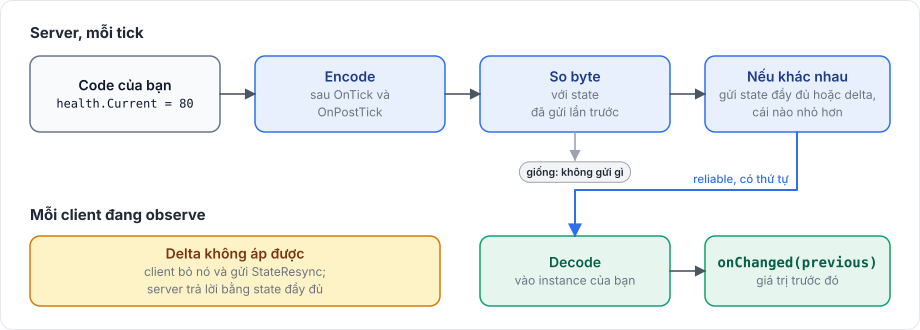

# State

State model giữ dữ liệu của một `NetworkBehaviour` mà server giữ đồng bộ trên mọi observer, như máu, điểm số hay một cánh cửa đang mở hay đóng. Server thay đổi instance của model, và cuối mỗi tick package gửi phần đã thay đổi. Client nhận giá trị mới vào instance của riêng nó và nhận một callback kèm giá trị trước đó.

## Khi nào dùng <a href="#when-to-use-it" id="when-to-use-it"></a>

State phù hợp với giá trị mà client phải luôn biết, kể cả client vào muộn. Sự kiện một lần nên gửi bằng [RPC](../messaging/rpc.md), còn chuyển động do [`NetworkTransform`](transform.md) lo. Dữ liệu lớn lên và nhỏ đi, như túi đồ, hợp với [collection](collections.md) hơn: state có field `Array` được gửi nguyên vẹn mỗi khi mảng đổi độ dài.

## Cách dùng cơ bản <a href="#basic-usage" id="basic-usage"></a>

State model phải nằm trên channel reliable-ordered:

```csharp
using Fomoxa;
using Fomoxa.Networking;

namespace MyGame.Network.Models
{
    [Network]
    [Codec("net")]
    [NetworkChannel("net", Channel.ReliableOrdered)]
    public class Health
    {
        [Network("u16")]
        [Codec("net")]
        public ushort Current { get; set; }

        [Network("u16")]
        [Codec("net")]
        public ushort Max { get; set; }
    }
}
```

Sau đó behaviour đăng ký một instance của nó:

```csharp
using Fomoxa.Networking;
using Fomoxa.Unity;
using Generated;
using MyGame.Network.Models;
using UnityEngine;

public sealed class Damageable : NetworkBehaviour
{
    [SerializeField] private ushort maxHealth = 100;

    private readonly Health health = new Health();

    public ushort Current => health.Current;

    private void Awake()
    {
        health.Max = maxHealth;
        health.Current = maxHealth;
    }

    protected override void OnRegisterState(NetworkState state)
    {
        state.Use(HealthNetAdapter.Instance, health, OnHealthChanged);
    }

    public void TakeDamage(ushort amount)
    {
        health.Current = (ushort)Mathf.Max(0, health.Current - amount);
    }

    private void OnHealthChanged(Health previous)
    {
        Debug.Log($"{name}: {previous.Current} -> {health.Current}");
    }
}
```

Gọi `TakeDamage` trên server, và `health` của các client thay đổi vào cuối tick đó, sau độ trễ mạng.

## Cách hoạt động <a href="#how-it-works" id="how-it-works"></a>

<figure><figcaption><p>Server chỉ gửi state khi các byte đã encode thay đổi.</p></figcaption></figure>

`NetworkState.Use(codec, instance, onChanged)` đăng ký instance. Sau các event `OnTick` và `OnPostTick` của tick, server encode mọi instance state, so sánh các byte với lần gửi trước, và gửi state tới mọi observer nếu chúng khác nhau.

Vì phép so sánh làm trên các byte đã encode, mọi thay đổi của một property được codec mang đều được phát hiện mà bạn không cần đánh dấu dirty. Property mà codec không mang thì không được so sánh cũng không được gửi. Một behaviour cũng có thể chọn [tự đánh dấu thay đổi](#marking-changes).

## Đánh dấu thay đổi <a href="#marking-changes" id="marking-changes"></a>

Encode mọi state ở mỗi tick tốn thời gian của server, kể cả với behaviour mà state hiếm khi đổi. Một behaviour có state lớn và phần lớn thời gian đứng yên có thể truyền `onlyWhenDirty: true` cho `Use`:

```csharp
state.Use(HealthNetAdapter.Instance, health, OnHealthChanged, onlyWhenDirty: true);
```

Khi đó server chỉ encode và so sánh state đó ở tick sau lần behaviour gọi `SetStateDirty()`, nên hãy gọi nó trên server sau mỗi lần thay đổi:

```csharp
public void TakeDamage(ushort amount)
{
    health.Current = (ushort)Mathf.Max(0, health.Current - amount);
    SetStateDirty();
}
```

Thay đổi không kèm `SetStateDirty()` sẽ không được gửi, và không có gì báo việc thiếu này. Client giữ state gửi lần cuối, và client bắt đầu observe sau đó cũng nhận đúng state ấy trong message spawn. State bắt lúc `Spawn` không cần gọi. Không có `onlyWhenDirty`, giá trị mặc định, thì `SetStateDirty()` không làm gì và server so sánh state ở mỗi tick.

## Hành vi trên server <a href="#server-behavior" id="server-behavior"></a>

Chỉ thay đổi instance trên server. Server không nhận callback cho thay đổi của chính nó; `onChanged` chạy trên client.

Message spawn chứa state được chụp lúc `Spawn`, nên hãy đặt giá trị ban đầu trước khi gọi `Spawn`, ví dụ trong `Awake`. Client vào muộn nhận state như ở tick gần nhất.

## Hành vi trên client <a href="#client-behavior" id="client-behavior"></a>

State ban đầu đã nằm trong instance trước khi `OnStartClient` chạy, và `onChanged` không chạy cho nó. Với mỗi thay đổi sau đó, package decode giá trị mới vào instance và gọi `onChanged` với một object riêng chứa giá trị trước đó, nên hãy đọc giá trị mới từ instance của bạn.

Thay đổi instance trên client sẽ không được gửi đi, và lần cập nhật tiếp theo sẽ ghi đè nó. Trên host, instance dùng chung với server và không được decode lại, nhưng `onChanged` vẫn chạy trên client của host.

## Delta encoding <a href="#delta-encoding" id="delta-encoding"></a>

Khi state đã encode có cùng độ dài với lần gửi trước, server tính một delta, là XOR của hai bản encode với các đoạn byte không đổi được nén lại. Nếu delta nhỏ hơn state đầy đủ, server gửi delta thay thế, và client áp nó lên state cuối cùng đã nhận.

Client không áp được delta, ví dụ vì bị lệch nhịp, sẽ bỏ delta đó, yêu cầu server gửi state đầy đủ và bỏ qua các delta tiếp theo cho tới khi state đầy đủ tới. Việc khôi phục này diễn ra tự động.

Field có kích thước cố định giữ độ dài bản encode ổn định, giúp delta áp dụng được. Thay đổi độ dài, như một string hoặc một mảng dài hơn, khiến server gửi state đầy đủ.

## Cấu hình <a href="#configuration" id="configuration"></a>

| Quy tắc | Khi vi phạm |
|---|---|
| Model nằm trên channel reliable-ordered | `HandlerRegistrationException`: `... is not on the reliable-ordered channel; declare the model's codec with [NetworkChannel(..., Channel.ReliableOrdered)]` |
| Model encode ra ít nhất một byte | `HandlerRegistrationException`: `... whose model encodes to no bytes; a state model needs at least one field` |
| Mỗi behaviour một state model | `HandlerRegistrationException`: `... uses more than one state model` |
| Model không đồng thời là RPC | `HandlerRegistrationException` khi object spawn |

## Giới hạn <a href="#limitations" id="limitations"></a>

Mỗi `NetworkBehaviour` có nhiều nhất một state model, nên dữ liệu cần nhiều hơn phải chia ra nhiều behaviour hoặc giữ trong [collection](collections.md) bên cạnh state model. State được gửi nhiều nhất một lần mỗi tick, nên mọi thay đổi trong cùng một tick được gộp lại. Mọi observer nhận cùng một state, nên dữ liệu dành cho một client duy nhất phải gửi bằng target RPC.

State được đăng ký trong một [NetworkBehaviour](../objects/network-behaviour.md) và khai báo như mọi [model](../messaging/models.md) khác. [NetworkAnimator](animator.md) được xây trên cùng cơ chế này.
