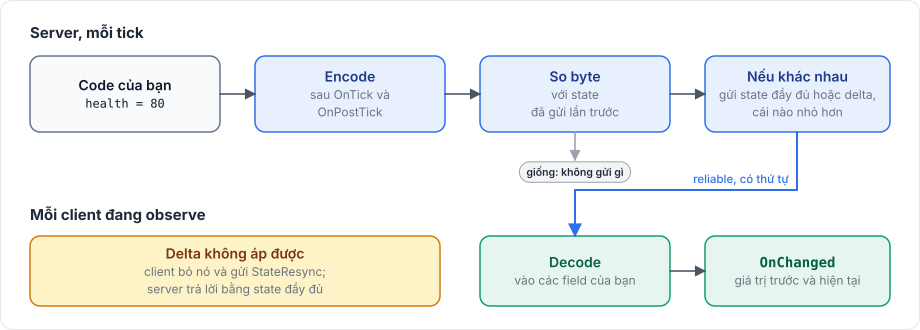

# State

State là dữ liệu của một `NetworkBehaviour` mà server giữ đồng bộ trên mọi observer, như máu, điểm số hay một cánh cửa đang mở hay đóng. Bạn đánh dấu field bằng `[NetworkState]`, server thay đổi chúng, và cuối mỗi tick package gửi phần đã thay đổi. Client nhận giá trị mới vào chính các field đó và có thể nhận một callback kèm giá trị trước đó.

## Khi nào dùng <a href="#when-to-use-it" id="when-to-use-it"></a>

State phù hợp với giá trị mà client phải luôn biết, kể cả client vào muộn. Sự kiện một lần nên gửi bằng [RPC](../messaging/rpc.md), còn chuyển động do [`NetworkTransform`](transform.md) lo. Dữ liệu lớn lên và nhỏ đi, như túi đồ, hợp với [collection](collections.md) hơn: một mảng trong field state được gửi nguyên vẹn mỗi khi nó đổi độ dài.

## Cách dùng cơ bản <a href="#basic-usage" id="basic-usage"></a>

```csharp
using Fomoxa.Networking;
using Fomoxa.Unity;
using UnityEngine;

public sealed partial class Damageable : NetworkBehaviour
{
    [SerializeField] private ushort maxHealth = 100;

    [NetworkState(OnChanged = nameof(OnHealthChanged))]
    private ushort health;

    [NetworkState]
    private ushort max;

    public ushort Current => health;

    private void Awake()
    {
        max = maxHealth;
        health = maxHealth;
    }

    public void TakeDamage(ushort amount)
    {
        health = (ushort)Mathf.Max(0, health - amount);
    }

    private void OnHealthChanged(ushort previous, ushort current)
    {
        Debug.Log($"{name}: {previous} -> {current} of {max}");
    }
}
```

Gọi `TakeDamage` trên server, và `health` của các client thay đổi vào cuối tick đó, sau độ trễ mạng.

Class phải là `partial`, và mọi class chứa nó cũng vậy, vì một source generator trong package viết code chép các field.

## Field state <a href="#state-fields" id="state-fields"></a>

Field state là một field instance không phải `readonly`, và có thể là private. Type của field quyết định cách nó được gửi, như với [tham số RPC](../messaging/rpc.md#parameter-types): package nhận ra các type nguyên thuỷ, các type Unity của package và model `[Network]`, còn `[NetworkState("...")]` cho bất kỳ field nào một wire type, như `[NetworkState("f16")] private float speed;`.

`OnChanged` chỉ tới một method của cùng class với chữ ký `void M(T previous, T current)`, trong đó `T` là type của field. Khi một bản cập nhật tới, package ghi mọi field trước, rồi mới gọi callback của các field có giá trị đổi, nên một callback đọc được giá trị mới của các field khác. Type nguyên thuỷ, type Unity hoặc `string` được coi là đổi khi khác giá trị trước, còn model khi bản encode của nó khác. Khi field chứa một model, `previous` chỉ dùng được trong lúc callback chạy, vì bản cập nhật sau được decode vào cùng instance đó.

## Model sinh ra <a href="#the-generated-model" id="the-generated-model"></a>

Package gom các field state của một class vào một model, sinh ra trong thư mục con `StateModels` của Generated Folder. Model mang tên class theo sau là `State`, trong ví dụ là `DamageableState`, và có một field cho mỗi field state, đặt theo tên field với chữ cái đầu viết hoa. Đặt tên khác cho model bằng `[NetworkStateModel("...")]` trên class.

Khi bạn thêm, bỏ hoặc sửa một field state, package sinh model sau lần biên dịch kế tiếp và Unity biên dịch lại. Vào Play mode và build player bị chặn chừng nào model sinh ra còn thiếu hoặc cũ, với thông báo kết thúc bằng `run Tools > Fomoxa > Generate and commit the generated files`.

### Thay đổi field <a href="#changing-the-fields" id="changing-the-fields"></a>

Model mang các field theo vị trí, từ class cha xuống, theo thứ tự khai báo. Fomoxa cho hai bản build làm việc với nhau khi danh sách field của chúng chỉ khác nhau ở cuối, nên chỗ bạn thay đổi quyết định bản build cũ của game còn kết nối được hay không:

| Thay đổi | Bản build cũ |
|---|---|
| Thêm một field sau field state cuối cùng của class | Vẫn kết nối được. Nó bỏ qua field mới, còn client mới nối tới server cũ đọc được 0, `false` hoặc giá trị rỗng ở field đó |
| Bỏ field state cuối cùng | Vẫn kết nối được |
| Chèn một field trước field khác, đổi thứ tự field, đổi type hoặc đổi tên một field | Không kết nối được |
| Thêm một field vào class cha | Không kết nối được, vì field của class cha đứng trước |
| Đổi tên class | Không làm việc được với bản build mới, trừ khi `[NetworkStateModel("...")]` giữ nguyên tên model |

Khi package sinh một model đã đổi, Console hiện một cảnh báo `[Fomoxa]` ghi tên model, các field đã đổi và một kết luận. `COMPATIBLE: append-only field (1 appended at the end)` nghĩa là bản build cũ vẫn kết nối được. Kết luận bắt đầu bằng `BREAKING:`, như `BREAKING: field inserted; every field after it moved`, nghĩa là bạn phải phát hành server mới và client mới cùng lúc.

Class kế thừa từ một behaviour có field state có model riêng, chứa field của cả chuỗi từ class cha xuống, theo thứ tự khai báo. Class cha biên dịch trong assembly khác cũng phải được biên dịch với generator của package.

## Cách hoạt động <a href="#how-it-works" id="how-it-works"></a>

<figure><figcaption><p>Server chỉ gửi state khi các byte đã encode thay đổi.</p></figcaption></figure>

Sau các event `OnTick` và `OnPostTick` của tick, server chép các field state của mọi behaviour vào model của nó, encode, so sánh các byte với lần gửi trước, và gửi state tới mọi observer nếu chúng khác nhau.

Vì phép so sánh làm trên các byte đã encode, mọi thay đổi của một field state đều được phát hiện mà bạn không cần đánh dấu dirty. Field không có `[NetworkState]` thì không được so sánh cũng không được gửi. Một behaviour cũng có thể chọn [tự đánh dấu thay đổi](#marking-changes).

## Đánh dấu thay đổi <a href="#marking-changes" id="marking-changes"></a>

Encode mọi state ở mỗi tick tốn thời gian của server, kể cả với behaviour mà state hiếm khi đổi. Một behaviour có state lớn và phần lớn thời gian đứng yên có thể đặt `OnlyWhenDirty` trên class:

```csharp
using Fomoxa.Networking;
using Fomoxa.Unity;

[NetworkStateModel(OnlyWhenDirty = true)]
public sealed partial class Scoreboard : NetworkBehaviour
{
    [NetworkState]
    private uint red;

    [NetworkState]
    private uint blue;

    public void Score(uint redPoints, uint bluePoints)
    {
        red += redPoints;
        blue += bluePoints;
        SetStateDirty();
    }
}
```

Khi đó server chỉ encode và so sánh state đó ở tick sau lần behaviour gọi `SetStateDirty()`, nên hãy gọi nó trên server sau mỗi lần thay đổi. Thay đổi không kèm `SetStateDirty()` sẽ không được gửi. Trong Editor và trong bản build Development, server log một cảnh báo khi một thay đổi như vậy chưa được gửi sau State Mark Warning Seconds trên `NetworkManager`, mặc định 2; [debug](../advanced/debugging.md#forgotten-state-marks) mô tả phép kiểm này. Client giữ state gửi lần cuối, và client bắt đầu observe sau đó cũng nhận đúng state ấy trong message spawn. State chụp lúc `Spawn` không cần gọi. Không có `OnlyWhenDirty`, giá trị mặc định, thì `SetStateDirty()` không làm gì và server so sánh state ở mỗi tick.

## Hành vi trên server <a href="#server-behavior" id="server-behavior"></a>

Chỉ thay đổi các field trên server. Server không nhận callback cho thay đổi của chính nó; `OnChanged` chạy trên client.

Message spawn chứa state được chụp lúc `Spawn`, nên hãy đặt giá trị ban đầu trước khi gọi `Spawn`, ví dụ trong `Awake`. Client vào muộn nhận state như ở tick gần nhất.

## Hành vi trên client <a href="#client-behavior" id="client-behavior"></a>

State ban đầu đã nằm trong các field trước khi `OnStartClient` chạy, và `OnChanged` không chạy cho nó. Với mỗi thay đổi sau đó, package ghi giá trị mới vào các field và gọi `OnChanged` cho những field đã đổi.

Thay đổi field state trên client sẽ không được gửi đi, và lần cập nhật tiếp theo sẽ ghi đè nó. Trên host, các field dùng chung với server và không được ghi lại, nhưng `OnChanged` vẫn chạy trên client của host, với `current` là giá trị của field.

## Delta encoding <a href="#delta-encoding" id="delta-encoding"></a>

Khi state đã encode có cùng độ dài với lần gửi trước, server tính một delta, là XOR của hai bản encode với các đoạn byte không đổi được nén lại. Nếu delta nhỏ hơn state đầy đủ, server gửi delta thay thế, và client áp nó lên state cuối cùng đã nhận.

Client không áp được delta, ví dụ vì bị lệch nhịp, sẽ bỏ delta đó, yêu cầu server gửi state đầy đủ và bỏ qua các delta tiếp theo cho tới khi state đầy đủ tới. Việc khôi phục này diễn ra tự động.

Field có kích thước cố định giữ độ dài bản encode ổn định, giúp delta áp dụng được. Thay đổi độ dài, như một string hoặc một mảng dài hơn, khiến server gửi state đầy đủ.

## Lỗi <a href="#errors" id="errors"></a>

Source generator báo các lỗi biên dịch sau:

| Id | Ý nghĩa |
|---|---|
| `FOMOXA012` | Một field state là `static`, `const` hoặc `readonly` |
| `FOMOXA013` | `OnChanged` không chỉ tới một method `void M(T previous, T current)` của class |
| `FOMOXA014` | Class, hoặc một class chứa nó, không phải `partial` |
| `FOMOXA018` | Một field mang nhiều hơn một trong `[NetworkState]`, `[NetworkInput]`, `[NetworkReconcile]` |

Bước sinh model báo trong Console: field có type không có wire type, field nằm ngoài một `NetworkBehaviour`, hai field cho ra cùng một field model, và hai class cho ra cùng một tên model.

## Giới hạn <a href="#limitations" id="limitations"></a>

Mọi field state của một behaviour tạo thành một model, nên dữ liệu cần nhiều hơn một model phải chia ra nhiều behaviour hoặc giữ trong [collection](collections.md) bên cạnh các field state. State được gửi nhiều nhất một lần mỗi tick, nên mọi thay đổi trong cùng một tick được gộp lại. Mọi observer nhận cùng một state, nên dữ liệu dành cho một client duy nhất phải gửi bằng target RPC.

State được khai báo trong một [NetworkBehaviour](../objects/network-behaviour.md), và một field có thể chứa một [model](../messaging/models.md). [Console server](../console-server/runtime.md) dùng model sinh ra để gửi cùng state đó; hãy đặt tên model bằng `[NetworkStateModel("...")]` khi behaviour dùng chung với một console server. [NetworkAnimator](animator.md) được xây trên cùng cơ chế này.
