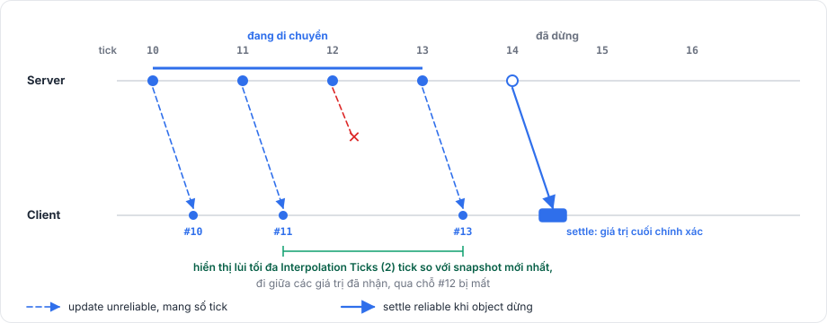
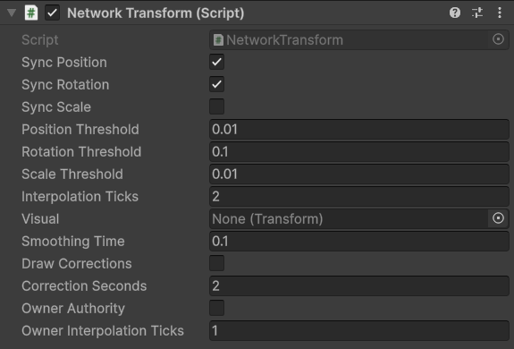

# NetworkTransform

`NetworkTransform` gửi transform phía server của một GameObject tới mọi observer và di chuyển bản copy trên client một cách mượt mà giữa các giá trị nhận được. Nó là một `NetworkBehaviour`, nên nằm trên một `NetworkObject` hoặc trên một object con của nó.

## Khi nào dùng <a href="#when-to-use-it" id="when-to-use-it"></a>

Thêm nó vào các object do server di chuyển, như nhân vật của người chơi khác, đạn và bệ di chuyển. Object được owner dự đoán cũng cần nó để các client khác thấy object di chuyển, dù bản thân owner bỏ qua nó trong lúc dự đoán.

## Cách dùng cơ bản <a href="#basic-usage" id="basic-usage"></a>

1. Thêm `NetworkTransform` vào prefab, trên GameObject có transform cần replicate.
2. Chọn những phần cần đồng bộ. Vị trí và góc xoay bật mặc định, tỉ lệ thì tắt.
3. Di chuyển object trên server.

Ngoài việc di chuyển object, không cần code gì thêm.

## Cách hoạt động <a href="#how-it-works" id="how-it-works"></a>

Server lấy mẫu vị trí, góc xoay và tỉ lệ local sau mỗi tick.

<figure><figcaption><p>Các bản cập nhật trong lúc object di chuyển, một settle khi nó dừng, và client đi theo chậm hơn một chút.</p></figcaption></figure>

Khi object di chuyển, server gửi một bản cập nhật cho mỗi tick mà một phần được đồng bộ đã rời giá trị gửi lần trước quá ngưỡng của nó. Các bản cập nhật này là unreliable và mang tick. Khi object dừng, server gửi một message settle trên channel reliable với giá trị cuối cùng chính xác, nên một bản cập nhật bị mất không bao giờ khiến object dừng sai chỗ. Client cũng nhận một settle với giá trị hiện tại khi object spawn và mỗi khi nó bắt đầu observe object.

Bản cập nhật chỉ chứa những phần đã thay đổi, và client không bao giờ áp dụng một phần nó chưa nhận được.

Server gom các bản cập nhật của một tick cho một client vào một message unreliable và chỉ chia ra khi nó không vừa một gói. Bản cập nhật được làm tròn: vị trí và tỉ lệ tới 0,01 đơn vị, góc xoay trong khoảng 0,2 độ. Trục nào của vị trí hoặc tỉ lệ có giá trị local vượt ±327,67 thì được gửi nguyên dạng `float`. Settle vẫn mang giá trị chính xác, nên việc làm tròn không làm đổi chỗ object dừng lại.

## Hành vi trên server <a href="#server-behavior" id="server-behavior"></a>

Server chỉ đọc transform, nên bạn có thể di chuyển nó bằng bất cứ cách nào, từ code, từ physics hay từ animation.

Server đọc thường xuyên tới đâu là tuỳ physics backend. Với [Rapier](../rapier/overview.md), `NetworkTransform` trên GameObject của `NetworkObject` chỉ được đọc khi có gì đó làm nó đổi: Rapier báo body của object đang di chuyển, parent của nó di chuyển hoặc đổi sang parent khác, z của object 2D đổi, hoặc `Teleport()` được gọi. Khi không còn gì đổi, server đọc tiếp sau mỗi tick tới khi đã gửi bản settle, rồi thôi đọc. Mọi `NetworkTransform` khác được đọc sau mỗi tick: với `RigidbodyPhysics`, trên GameObject con, trên object không có body, và trên mọi object bật Sync Scale, vì body không quyết định scale.

Khi Rapier mô phỏng một object, hãy di chuyển nó qua [NetworkBody](../physics/physics-body.md) của nó. Rapier ghi pose của body vào `Transform` sau mỗi bước, nên vị trí chỉ đặt trên `Transform` sẽ bị ghi đè.

## Hành vi trên client <a href="#client-behavior" id="client-behavior"></a>

Client giữ một danh sách ngắn các snapshot đã nhận và hiển thị object chậm tối đa Interpolation Ticks (mặc định 2) so với snapshot mới nhất, nội suy tuyến tính vị trí và tỉ lệ và nội suy cầu góc xoay. Một settle thay thế danh sách và đặt object vào giá trị của nó ngay lập tức.

Client áp giá trị vào vị trí, góc xoay và tỉ lệ local, nên object phải có cùng parent trên server và client để các giá trị mang cùng ý nghĩa.

## Interpolation <a href="#interpolation" id="interpolation"></a>

Interpolation hiển thị object ở xa hơi chậm về quá khứ, để luôn có một snapshot kế tiếp để di chuyển tới. Interpolation Ticks lớn hơn cho chuyển động mượt hơn trên mạng hay mất gói nhưng trễ hơn, còn giá trị nhỏ hơn bớt trễ nhưng giật rõ hơn khi mất cập nhật.

Khác với [prediction](../concepts/prediction.md), interpolation không dùng input và không đoán object sẽ ở đâu.

## Prediction <a href="#prediction" id="prediction"></a>

Khi client của owner đang dự đoán một object, nó bỏ qua các bản cập nhật transform của object đó và để mô phỏng của chính nó di chuyển object. Các client khác vẫn interpolate object như thường.

Một lần sửa có thể khiến object được dự đoán bị giật. Để che chỗ giật đó, hãy đặt các phần hiển thị của object lên một GameObject con và gán object con đó vào field Visual. Sau mỗi lần sửa, package giữ object con ở chỗ nó đang hiện trên màn hình rồi đưa nó về vị trí nghỉ trong Smoothing Time giây (mặc định 0.1), hoặc đặt ngay về đó nếu Smoothing Time bằng 0.

## Teleport <a href="#teleporting" id="teleporting"></a>

Gọi `Teleport()` trên server sau khi đã đưa object tới chỗ mới:

```csharp
transform.position = respawnPoint;
GetComponent<NetworkTransform>().Teleport();
```

Client khi đó nhảy thẳng tới giá trị mới thay vì nội suy qua quãng đường, và bỏ qua các bản cập nhật có từ trước teleport mà tới muộn. `Teleport()` không làm gì trên client hoặc trước khi object được spawn.

Với object có physics body, hãy đặt cả vị trí của body, như mô tả trong [NetworkBody](../physics/physics-body.md#teleporting).

## Cho owner quyết định <a href="#letting-the-owner-decide" id="letting-the-owner-decide"></a>

Có những object cần di chuyển trên màn hình của owner ngay khi người chơi bấm phím, mà không cần input và replay của [prediction](../concepts/prediction.md). Hãy bật Owner Authority trên `NetworkTransform` của chúng. Client của owner khi đó đọc transform của chính nó sau mỗi tick và gửi lên server, với cùng ngưỡng, bản cập nhật và bản chốt mà server dùng. Server hiển thị chuyển động của owner chậm tối đa Owner Interpolation Ticks (mặc định 1) so với mẫu mới nhất của owner, ghi nó vào object và chuyển tiếp cho mọi observer khác. Với 0, server áp mỗi mẫu ngay ở tick nó tới: không thêm độ trễ, nhưng độ giật của owner truyền nguyên sang mọi người khác.

Owner Authority chỉ là giá trị ban đầu. Server đọc nó khi object spawn, và sau đó chỉ server đổi được `OwnerAuthority`, chẳng hạn để lấy lại một nhân vật trong lúc chạy cutscene. Đặt nó trên client sau khi spawn sẽ ném `InvalidOperationException`, và cờ trong build của client không có tác dụng. Object không có owner thì vẫn do server quyết.

Client của owner biết mình được di chuyển object khi `IsOwnerSending` là `true`. Chỉ di chuyển transform lúc đó, vì mọi giá trị đặt trong lúc server quyết đều bị ghi đè:

```csharp
using Fomoxa.Unity;
using UnityEngine;

public sealed class OwnerWalker : NetworkBehaviour
{
    [SerializeField] private float speed = 4f;

    private void Update()
    {
        if (!GetComponent<NetworkTransform>().IsOwnerSending)
        {
            return;
        }

        var direction = new Vector3(Input.GetAxisRaw("Horizontal"), 0f, Input.GetAxisRaw("Vertical"));
        transform.position += direction * (speed * Time.deltaTime);
    }
}
```

Trên server, `Rigidbody`, `Rigidbody2D` hay body Rapier trên cùng GameObject thành kinematic trong lúc owner quyết, và server dời nó tới từng pose mà server áp. Body lấy lại loại cũ khi owner thôi quyết hoặc object bị despawn. Client của owner giữ body như bạn đã cấu hình. Nếu client đó cũng dự đoán physics, object vẫn là một proxy kinematic ở đó như mọi object khác mà client không dự đoán, nên hãy di chuyển nó qua transform.

### Kiểm tra mẫu của owner <a href="#checking-the-owners-samples" id="checking-the-owners-samples"></a>

Server vẫn có thể từ chối một mẫu. Hãy đặt `OwnerSampleFilter` trên server để xem từng mẫu trước khi nó được áp. Bộ lọc nhận mẫu cuối mà server đã nhận, mẫu đang tới với mọi phần được sync đã điền đủ, và số tick của owner giữa hai mẫu. Trả `false` để bỏ mẫu đang tới:

```csharp
using Fomoxa.Unity;
using UnityEngine;

public sealed class SpeedLimit : NetworkBehaviour
{
    [SerializeField] private float maxSpeed = 6f;

    public override void OnStartServer()
    {
        float tickSeconds = (float)NetworkManager.TimeManager.TickDelta;
        GetComponent<NetworkTransform>().OwnerSampleFilter = (in NetworkTransformSample accepted, in NetworkTransformSample incoming, uint ticks) =>
            ticks == 0 || Vector3.Distance(accepted.LocalPosition, incoming.LocalPosition) <= maxSpeed * ticks * tickSeconds;
    }
}
```

`ticks` bằng 0 ở mẫu đầu tiên sau khi owner bắt đầu quyết và ở lần owner teleport. Trong cả hai trường hợp, `accepted` là pose mà server đang có lúc đó. Mẫu bị bỏ không được áp và không được chuyển tiếp, và owner không được báo. Để đưa owner về chỗ server muốn, hãy đặt transform trên server rồi gọi `Teleport()`. Owner nhảy tới đó và gửi tiếp từ chỗ mới, còn server bỏ qua mọi thứ owner đã gửi trước khi nhận bản sửa. Bộ lọc chạy trong lúc server giao message của owner, nên exception mà nó ném là một [exception trong handler](../concepts/error-handling.md#exceptions-in-server-handlers): server phát `OnHandlerException` và đóng kết nối của owner, trừ khi một subscriber xoá `Disconnect`.

Owner cũng gọi được `Teleport()`, sau khi tự đưa object của mình tới chỗ mới. Khi đó server áp mẫu đó ngay thay vì nội suy tới nó, và cho các client khác nhảy theo.

### Không dùng cùng prediction <a href="#not-with-prediction" id="not-with-prediction"></a>

Một object không thể vừa được dự đoán vừa do owner quyết, vì cả hai cùng ghi pose của owner. Build player sẽ thất bại khi một prefab hay scene object có `NetworkTransform` bật Owner Authority mà một behaviour bất kỳ của nó khai báo field `[NetworkInput]` hoặc `[NetworkReconcile]`. Lúc chạy, spawn một object như vậy với Owner Authority bật, hoặc bật nó sau đó, sẽ ném `InvalidOperationException` trên server.

## Cấu hình <a href="#configuration" id="configuration"></a>

<figure><figcaption><p>Một NetworkTransform với giá trị mặc định.</p></figcaption></figure>

| Field | Mặc định | Ý nghĩa |
|---|---|---|
| Sync Position | bật | Replicate vị trí local |
| Sync Rotation | bật | Replicate góc xoay local |
| Sync Scale | tắt | Replicate tỉ lệ local |
| Position Threshold | 0.01 | Quãng đường vị trí phải di chuyển trước khi được đưa vào bản cập nhật |
| Rotation Threshold | 0.1 | Góc, tính bằng độ, mà góc xoay phải quay trước khi được đưa vào bản cập nhật |
| Scale Threshold | 0.01 | Mức thay đổi tỉ lệ phải đạt trước khi được đưa vào bản cập nhật |
| Interpolation Ticks | 2 | Số tick tối đa client hiển thị object chậm so với snapshot mới nhất |
| Visual | không có | Transform con được làm mượt sau các lần sửa prediction |
| Smoothing Time | 0.1 | Số giây để Visual quay về vị trí nghỉ |
| Owner Authority | tắt | Cho client của owner quyết định transform, bắt đầu từ lúc spawn |
| Owner Interpolation Ticks | 1 | Số tick của owner mà server áp chuyển động của owner chậm so với mẫu mới nhất của nó |

`Visual` và `SmoothingTime` cũng có thể đặt từ code, `OwnerAuthority` đặt được trên server, còn các cờ sync, `InterpolationTicks` và `OwnerInterpolationTicks` chỉ đọc được từ code.

## Giới hạn <a href="#limitations" id="limitations"></a>

Trừ khi bật Owner Authority, transform chỉ đi từ server tới client, và client chỉ có thể di chuyển một networked object cho người khác thấy thông qua RPC hoặc input. Giá trị được replicate trong không gian local, và việc đổi parent của object được replicate lúc chạy không được replicate. Chuyển động chưa rời giá trị gửi lần trước quá ngưỡng chỉ được gửi khi object dừng lại. Trên host, transform của server được hiển thị nguyên trạng, không có interpolation cho góc nhìn của host.

[Replication](../concepts/replication.md) giải thích message transform nằm ở đâu so với các message khác, [tổng quan prediction](../prediction/overview.md) cho thấy `NetworkTransform` trên một nhân vật được dự đoán, và [tham chiếu component](../reference/components.md#networktransform) liệt kê các member của nó.
