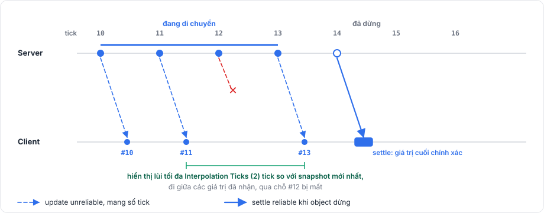
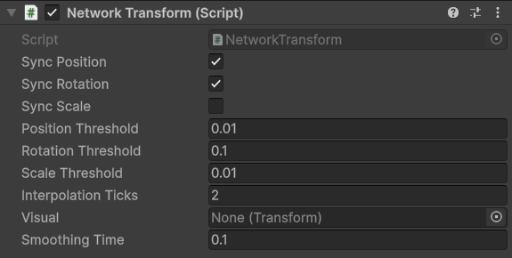

# NetworkTransform

`NetworkTransform` gửi transform phía server của một GameObject tới mọi observer và di chuyển bản copy trên client một cách mượt mà giữa các giá trị nhận được. Nó là một `NetworkBehaviour`, nên nằm trên một `NetworkObject` hoặc trên một object con của nó.

## Khi nào dùng <a href="#when-to-use-it" id="when-to-use-it"></a>

Thêm nó vào các object do server di chuyển, như nhân vật của người chơi khác, đạn và bệ di chuyển. Object được owner dự đoán cũng cần nó để các client khác thấy object di chuyển, dù bản thân owner bỏ qua nó trong lúc dự đoán.

## Cách dùng cơ bản <a href="#basic-usage" id="basic-usage"></a>

1. Thêm `NetworkTransform` vào prefab, trên GameObject có transform cần replicate.
2. Chọn những phần cần đồng bộ. Vị trí và góc xoay bật mặc định, tỉ lệ thì tắt.
3. Di chuyển object trên server.

Ngoài việc di chuyển object, không cần code gì thêm.

## Cách hoạt động <a href="#how-it-works" id="how-it-works"></a>

Server lấy mẫu vị trí, góc xoay và tỉ lệ local sau mỗi tick.

<figure><figcaption><p>Các bản cập nhật trong lúc object di chuyển, một settle khi nó dừng, và client đi theo chậm hơn một chút.</p></figcaption></figure>

Khi object di chuyển, server gửi một bản cập nhật cho mỗi tick mà một phần được đồng bộ đã rời giá trị gửi lần trước quá ngưỡng của nó. Các bản cập nhật này là unreliable và mang tick. Khi object dừng, server gửi một message settle trên channel reliable với giá trị cuối cùng chính xác, nên một bản cập nhật bị mất không bao giờ khiến object dừng sai chỗ. Client cũng nhận một settle với giá trị hiện tại khi object spawn và mỗi khi nó bắt đầu observe object.

Bản cập nhật chỉ chứa những phần đã thay đổi, và client không bao giờ áp dụng một phần nó chưa nhận được.

## Hành vi trên server <a href="#server-behavior" id="server-behavior"></a>

Server chỉ đọc transform, nên bạn có thể di chuyển nó bằng bất cứ cách nào, từ code, từ physics hay từ animation.

## Hành vi trên client <a href="#client-behavior" id="client-behavior"></a>

Client giữ một danh sách ngắn các snapshot đã nhận và hiển thị object chậm tối đa Interpolation Ticks (mặc định 2) so với snapshot mới nhất, nội suy tuyến tính vị trí và tỉ lệ và nội suy cầu góc xoay. Một settle thay thế danh sách và đặt object vào giá trị của nó ngay lập tức.

Client áp giá trị vào vị trí, góc xoay và tỉ lệ local, nên object phải có cùng parent trên server và client để các giá trị mang cùng ý nghĩa.

## Interpolation <a href="#interpolation" id="interpolation"></a>

Interpolation hiển thị object ở xa hơi chậm về quá khứ, để luôn có một snapshot kế tiếp để di chuyển tới. Interpolation Ticks lớn hơn cho chuyển động mượt hơn trên mạng hay mất gói nhưng trễ hơn, còn giá trị nhỏ hơn bớt trễ nhưng giật rõ hơn khi mất cập nhật.

Khác với [prediction](../concepts/prediction.md), interpolation không dùng input và không đoán object sẽ ở đâu.

## Prediction <a href="#prediction" id="prediction"></a>

Khi client của owner đang dự đoán một object, nó bỏ qua các bản cập nhật transform của object đó và để mô phỏng của chính nó di chuyển object. Các client khác vẫn interpolate object như thường.

Một lần sửa có thể khiến object được dự đoán bị giật. Để che chỗ giật đó, hãy đặt các phần hiển thị của object lên một GameObject con và gán object con đó vào field Visual. Sau mỗi lần sửa, package giữ object con ở chỗ nó đang hiện trên màn hình rồi đưa nó về vị trí nghỉ trong Smoothing Time giây (mặc định 0.1), hoặc đặt ngay về đó nếu Smoothing Time bằng 0.

## Teleport <a href="#teleporting" id="teleporting"></a>

Gọi `Teleport()` trên server sau khi đã đưa object tới chỗ mới:

```csharp
transform.position = respawnPoint;
GetComponent<NetworkTransform>().Teleport();
```

Client khi đó nhảy thẳng tới giá trị mới thay vì nội suy qua quãng đường, và bỏ qua các bản cập nhật có từ trước teleport mà tới muộn. `Teleport()` không làm gì trên client hoặc trước khi object được spawn.

Với object có physics body, hãy đặt cả vị trí của body, như mô tả trong [PhysicsBody](../physics/physics-body.md#teleporting).

## Cấu hình <a href="#configuration" id="configuration"></a>

<figure><figcaption><p>Một NetworkTransform với giá trị mặc định.</p></figcaption></figure>

| Field | Mặc định | Ý nghĩa |
|---|---|---|
| Sync Position | bật | Replicate vị trí local |
| Sync Rotation | bật | Replicate góc xoay local |
| Sync Scale | tắt | Replicate tỉ lệ local |
| Position Threshold | 0.01 | Quãng đường vị trí phải di chuyển trước khi được đưa vào bản cập nhật |
| Rotation Threshold | 0.1 | Góc, tính bằng độ, mà góc xoay phải quay trước khi được đưa vào bản cập nhật |
| Scale Threshold | 0.01 | Mức thay đổi tỉ lệ phải đạt trước khi được đưa vào bản cập nhật |
| Interpolation Ticks | 2 | Số tick tối đa client hiển thị object chậm so với snapshot mới nhất |
| Visual | không có | Transform con được làm mượt sau các lần sửa prediction |
| Smoothing Time | 0.1 | Số giây để Visual quay về vị trí nghỉ |

`Visual` và `SmoothingTime` cũng có thể đặt từ code, còn các cờ sync và `InterpolationTicks` chỉ đọc được từ code.

## Giới hạn <a href="#limitations" id="limitations"></a>

Transform chỉ đi từ server tới client, và client chỉ có thể di chuyển một networked object cho người khác thấy thông qua RPC hoặc input. Giá trị được replicate trong không gian local, và việc đổi parent của object được replicate lúc chạy không được replicate. Chuyển động chưa rời giá trị gửi lần trước quá ngưỡng chỉ được gửi khi object dừng lại. Trên host, transform của server được hiển thị nguyên trạng, không có interpolation cho góc nhìn của host.

[Replication](../concepts/replication.md) giải thích message transform nằm ở đâu so với các message khác, [tổng quan prediction](../prediction/overview.md) cho thấy `NetworkTransform` trên một nhân vật được dự đoán, và [tham chiếu component](../reference/components.md#networktransform) liệt kê các member của nó.
